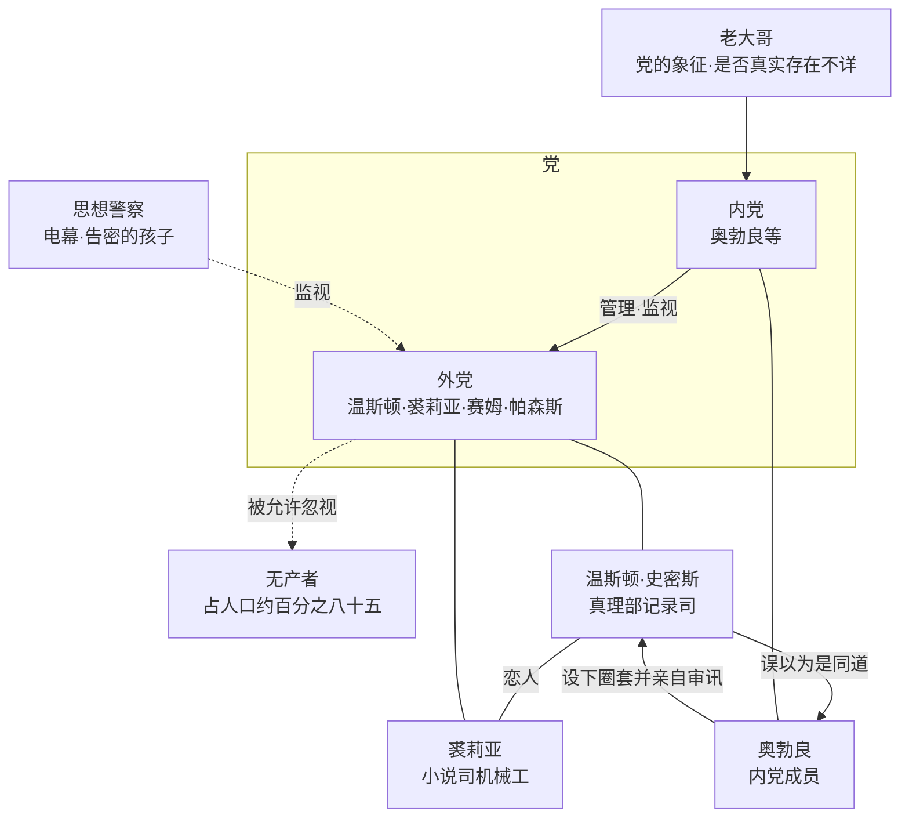

# 00｜系列导读与目录

> 《一九八四》深度解读系列：先带你认识这本书，再带你一层层走进去。

## 系列简介

《一九八四》是乔治·奥威尔在一九四九年出版的长篇小说。故事发生在一个叫「大洋国」的世界里：伦敦成了一座破败的城市，墙上到处是「老大哥在看着你」的海报，每个房间里都有一块不能关掉的电幕。主人公温斯顿·史密斯是真理部的一名小职员，他的工作是把过去的报纸改成党需要的样子。有一天，他买了一本日记，写下了第一行字。这本书最值得读的地方，不是它「预言」了什么，而是它问了几个到今天仍然尖锐的问题：当权力可以决定什么是真的，一个人还能靠什么确认自己没有疯？语言被拿走之后，思想还剩下什么？隐私被取消之后，自由还能存在吗？本系列不按原书三部的顺序走，而是按「故事 → 人物 → 权力机器 → 主题 → 作者与写法 → 今天」的递进逻辑，把这本书拆成十八篇文章加一篇总结，每一篇只回答一个问题。

## 作品定位

| 项目 | 内容 |
|---|---|
| 作者 | 乔治·奥威尔（George Orwell，本名埃里克·布莱尔 Eric Arthur Blair，1903—1950），英国作家、记者、随笔作家 |
| 首版时间 | 一九四九年六月，英国 Secker & Warburg 出版社首版；奥威尔在一九五零年一月去世，距出版不到八个月 |
| 创作过程 | 主要写于一九四七至一九四八年，奥威尔当时住在苏格兰西部的朱拉岛，肺结核病情反复，书稿是在病中赶完的 |
| 文学类型 | 反乌托邦小说、政治小说；常与扎米亚京《我们》、赫胥黎《美丽新世界》并称「三大反乌托邦」 |
| 历史背景 | 二战刚结束、冷战开始的年代；纳粹和斯大林体制的经验，加上奥威尔本人在西班牙内战与英国广播公司工作的经历 |
| 书名由来 | 常见说法是把写作年份「一九四八」的后两位调换而成；这一说法流传很广，但没有奥威尔本人的明确证实 |
| 核心思想 | 权力对真相、记忆、语言和内心的控制；监视如何取消私人空间；极权如何让人自己交出判断力 |

## 全书核心问题

| 层次 | 核心问题 |
|---|---|
| 故事层 | 温斯顿为什么偏偏在这一天写下日记？大洋国到底是一个怎样运转的世界？ |
| 人物层 | 温斯顿为什么会走上反抗这条路？裘莉亚的反抗为什么和他不一样？他为什么愿意相信奥勃良？ |
| 权力层 | 谎言是如何被「例行公事」地生产出来的？为什么控制了过去就能控制未来？新话、双重思想、仇恨仪式分别在做什么？ |
| 主题层 | 那本能解释一切的书为什么也是陷阱？是什么让一个人在 101 号房间里放弃了最后的底线？「我爱老大哥」为什么比死亡更可怕？权力能不能重新定义现实？ |
| 作者与现实层 | 奥威尔为什么要写这样一本书？它是预言还是警告？今天的我们该从中读出什么？ |

## 故事与人物地图

主要人物与权力关系：

## 剧透策略声明

本系列默认读者是**已经读完小说**的人，各篇正文会自由动用结局。每篇开头都标有「剧透提示」，说明本篇会用到的情节范围；还没读完的读者，建议先读完 00 导读和第一部分（01—03），那几篇只涉及小说的开头部分。00 本身不点破结局的具体走向。

## 全系列目录

### 第一部分：进入大洋国

#### 01｜温斯顿为什么要写下那第一行日记？
核心问题：一个没有任何计划的小职员，为什么会在这个下午做出一件会让他被处死的事？
核心观点：日记不是反抗的工具，而是一个人想确认「我还存在」的本能；这个本能本身，就是这个世界最怕的东西。
理解难度：★★☆☆☆
关键词：日记、思想罪、私人记忆、胜利大厦
剧透范围：第一部第一至三章
---

#### 02｜大洋国到底是一个什么样的世界？
核心问题：这个世界是怎么分层、怎么运转的？四个部的名字为什么都和它们做的事相反？
核心观点：看清党、外党和无产者的结构，才能看懂后面所有人物为什么会这样活。
理解难度：★★★☆☆
关键词：内党、外党、无产者、四部、永恒战争
剧透范围：第一部第四至八章
---

#### 03｜电幕之下，监视为什么比暴力更有效？
核心问题：大洋国几乎不需要军队镇压，为什么没人敢反抗？
核心观点：监视的力量不在于真的看见，而在于让每个人永远不确定自己有没有被看见。
理解难度：★★★☆☆
关键词：电幕、思想警察、告密、自我审查
剧透范围：第一部全部，另涉及第三部开头帕森斯被捕
---

### 第二部分：认识三个人

#### 04｜温斯顿为什么会走上反抗这条路？
核心问题：一个胆小、体弱、并不英勇的人，为什么会一步一步靠近危险？
核心观点：温斯顿的反抗从来不是出于信仰，而是出于对「真实」的一点执念——这也是他的力量，和他的弱点。
理解难度：★★★☆☆
关键词：记忆、凯瑟琳、玻璃镇纸、执念
剧透范围：全书，含结局
---

#### 05｜裘莉亚的反抗为什么和温斯顿不一样？
核心问题：同样是违反规矩，两个人的反抗究竟差在哪里？
核心观点：裘莉亚反抗的是「生活被管得太多」，温斯顿反抗的是「真相被改得太多」，所以她更像一个幸存者，而他更像一个见证者。
理解难度：★★★☆☆
关键词：裘莉亚、务实、身体、纸条
剧透范围：全书，含结局
---

#### 06｜温斯顿为什么愿意相信奥勃良？
核心问题：所有迹象都是危险的，他为什么还是把命交给了一个只看过几眼的人？
核心观点：人在极度孤独里，会把一个眼神读成一整个同盟——这不是愚蠢，而是需要。
理解难度：★★★☆☆
关键词：奥勃良、兄弟会、圈套、孤独
剧透范围：全书，含结局
---

### 第三部分：权力的机器

#### 07｜谎言为什么可以被例行公事地生产？
核心问题：真理部每天改写报纸，改的人自己难道不知道在撒谎吗？
核心观点：谎言要变成行政流程，才真正可怕；它不需要人相信，只需要人照章办事。
理解难度：★★★☆☆
关键词：真理部、记忆洞、奥吉尔维、官僚化
剧透范围：第一部第四章，另涉及后文对改史的回顾
---

#### 08｜为什么控制了过去，就能控制未来？
核心问题：党的第二句口号为什么说：谁控制过去，谁就控制未来？
核心观点：一个人对「我们从哪里来」的记忆一旦失效，他就失去了衡量现在的尺子。
理解难度：★★★☆☆
关键词：历史、照片、记忆、证据
剧透范围：第一部第七至八章，第二部相关片段
---

#### 09｜为什么要发明一种让人无法造反的语言？
核心问题：新话是一门什么样的语言？它真的能让人想不出反抗吗？
核心观点：新话的目标不是增加新词，而是消灭旧词；同时，我们也要清醒地知道这套设想在多大程度上成立。
理解难度：★★★★☆
关键词：新话、词典、思想罪、语言与思想
剧透范围：第一部第五章，附录《新话的原则》
---

#### 10｜一个人怎么能同时相信两个相反的事实？
核心问题：双重思想是怎么回事？它是自我欺骗，还是一种能力？
核心观点：双重思想不是糊涂，而是一种需要刻意练习、并且要求把练习本身也忘掉的精神技术。
理解难度：★★★★☆
关键词：双重思想、黑白、自我欺骗、认知失调
剧透范围：全书
---

#### 11｜为什么情绪也要被定期定量供应？
核心问题：两分钟仇恨、仇恨周、胜利杜松子酒……情绪为什么也要配给？
核心观点：党要管的不只是你的行为，还有你的情绪出口；让仇恨有一个规定的方向，比禁止仇恨更有效。
理解难度：★★☆☆☆
关键词：两分钟仇恨、仇恨周、敌人、情绪管理
剧透范围：第一部第一章，第二部仇恨周片段
---

### 第四部分：反抗如何落幕

#### 12｜那本能解释一切的书，为什么也是陷阱？
核心问题：温斯顿读到的《寡头集体主义的理论与实践》到底说了什么？它为什么还是陷阱？
核心观点：一本讲透了「怎么做」却从不回答「为什么」的书，恰好最适合用来诱捕一个想要答案的人。
理解难度：★★★★☆
关键词：戈德斯坦、永恒战争、权力、书中书
剧透范围：第二部第九至十章，第三部相关片段
---

#### 13｜101 号房间为什么能摧毁一切抵抗？
核心问题：一个人为什么会在最后关头选择背叛自己最爱的人？
核心观点：101 号房间不是在测试勇气，而是在证明：每个人都有一个无法承受的恐惧，而权力的本事就是找到它。
理解难度：★★★★☆
关键词：101 号房间、老鼠、背叛、恐惧
剧透范围：第三部，含关键情节
---

#### 14｜「我爱老大哥」为什么是全书最恐怖的一句话？
核心问题：结局为什么比死亡还让人不安？
核心观点：党要的不是你屈服，而是你真心爱它；让一个人心甘情愿，比杀死他更彻底。
理解难度：★★★☆☆
关键词：结局、栗树咖啡馆、转化、爱
剧透范围：第三部第六章，含结局
---

#### 15｜「2+2=5」：权力能否重新定义现实？
核心问题：奥勃良的审讯想证明什么？现实究竟在不在一个人的头脑之外？
核心观点：党想证明的不是它能让你说错话，而是它能让「对」和「错」都服从它的命令。
理解难度：★★★★☆
关键词：现实、2+2=5、权力、唯我论
剧透范围：第三部第二至三章
---

### 第五部分：作者、写法与今天

#### 16｜奥威尔为什么要写这样一本书？
核心问题：一个自称民主社会主义者的人，为什么写出了这样一部黑暗的小说？
核心观点：这本书是对极权的警告，不是对社会主义的攻击；奥威尔本人晚年专门澄清过这一点。
理解难度：★★★☆☆
关键词：奥威尔、西班牙内战、极权主义、民主社会主义
剧透范围：不涉及具体情节
---

#### 17｜这本书是怎么写成的？
核心问题：视角、书中书和附录，这些结构选择各自在做什么？
核心观点：奥威尔用最平实的语言，搭了一个让读者无处可逃的结构；附录那一段，是全书最安静也最有争议的一笔。
理解难度：★★★★☆
关键词：叙事视角、书中书、象征、附录
剧透范围：全书，含结局与附录
---

#### 18｜《一九八四》是预言还是警告？
核心问题：今天的监视、数据和假消息，和书里的世界到底有多像？
核心观点：它不是一本预言书，而是一面镜子；把它当预言，容易失望，把它当警告，才读得出分量。
理解难度：★★★☆☆
关键词：监视、后真相、赫胥黎、今日现实
剧透范围：不涉及具体情节
---

#### 99｜系列总结：《一九八四》
核心问题：回头看，这本书究竟在讨论什么？
核心观点：全系列收束：一个人怎样一点点被拿走了世界，又怎样被换成了另一个。
理解难度：★★★☆☆
关键词：总结、主题、闭环
剧透范围：全书，含结局
---

## 推荐阅读顺序

主线：`01 → 18 → 99`，按认知难度分三段：

- **进入故事**（01—03）：难度最低，剧透最少，读完就能进入这个世界。
- **理解人物与机器**（04—11）：弄懂三个人物，再弄懂权力是怎么运转的。
- **理解结局与作者**（12—18）：从那本书、101 号房间走到作者本人与我们今天的世界。

不同读者的入口：

- **只想抓骨架**：01 → 02 → 03 → 13 → 14 → 18 → 99。
- **对权力与真相感兴趣**：07 → 08 → 10 → 15。
- **对语言与思想的关系感兴趣**：09 → 10。
- **想练习批判性阅读**：09、10、12、16、18 这几篇都明确区分了「文本事实」和「后人的解释」。

## 全系列状态

本系列共 18 篇正文 + 1 篇系列总结（99）。
