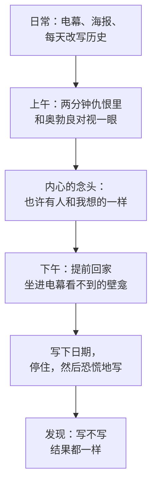

# 01｜温斯顿为什么要写下那第一行日记？

> 本篇核心问题：一个没有任何计划的小职员，为什么会在这个下午做出一件会让他被处死的事？

> **剧透提示**：本文只涉及第一部开头的情节（第一章至第三章），不涉及结局。

---

## 开篇：一个值得思考的问题

小说的第一句话是：四月里一个晴朗而寒冷的日子，钟敲了十三下。

钟敲十三下，这个细节读的时候很容易滑过去，可它其实是奥威尔在你踏进这个世界的第一秒，就悄悄告诉你：这里的时间和你熟悉的不一样。然后温斯顿·史密斯出场了：三十九岁，右脚踝上有一块静脉曲张的溃疡，身材瘦小，穿着党员统一的蓝色工装。他顶着风冲进「胜利大厦」，电梯又坏了，他只能一层层往上爬。每一层楼梯口，都有一张巨大的脸盯着他，下面写着：老大哥在看着你。

整本书最关键的一个动作，就发生在这天下午。他从抽屉里拿出一本从旧货店买来的、纸页微黄的厚笔记本，拧开墨水，写下了日期。

这一篇想问的，就是这个动作本身：一个没有计划、没有同伙、也谈不上勇敢的人，为什么偏偏在这一天，做了这件会要他命的事？

## 一、从故事开始

先看他是怎么准备的。

屋里的电幕是关不掉的，只能把音量调小。温斯顿选了一个特别的位置：客厅里那块电幕装得不太标准，旁边留出一个浅浅的壁龛，他坐在壁龛里，电幕的视线正好够不着他。能听见他，但看不见他。奥威尔特意写了一句：这间屋子古怪的格局，是他想到这件事的原因之一。

他拿起笔，写下「一九八四年四月四日」，随即停住了。因为他并不确定今年到底是不是一九八四年。他大概是三十九岁，大概生于一九四四或四五年，但「如今已经没有办法把任何一个日期确定到一两年之内」。接着他想到另一个问题：这本日记是写给谁的？给未来，给还没出生的人。可是未来如果和现在一样，就不会听他的；如果和现在不同，他现在的处境就毫无意义。

他卡住了，直到恐慌推着他写下一大段语无伦次的话：昨晚电影院里放的战争片，一艘载满难民的船被炸，观众看着一个胖子被机枪扫射沉入海里，笑声一片；有个无产者女人喊「不该在孩子面前放这个」，被警察赶了出去。写到这里他停下来，因为他发现，驱使他今天回家开始写日记的，另有一件更早的事——那天上午，在真理部的两分钟仇恨里，他和内党成员奥勃良对视了一眼。

## 二、真正的问题是什么？

把故事放一边，这里藏着一个很普通的问题：

> 一个人为什么需要把自己的想法写下来，即使没人会读到？

我们通常以为，写日记是为了记录，为了回忆，为了倾诉。可温斯顿的情形不同。他写日记的时候，已经预感到这本日记可能是他的死刑判决书。他很清楚：「思想罪」不是写下来才有，写不写都一样，「他已经犯下了——即使从来没有动过笔也已经犯下了——那种包含了一切罪行的基本罪行」。

那他为什么还要写？

因为他要的不是安全，而是**确认自己还存在**。在一个钟会敲十三下、日期无法确定、昨天的报纸会被改成另一个样子的世界里，一个人最基本的东西——我今天看到了什么，我昨天想了什么——都不再有证据可以依靠。日记是他对这个世界发出的一个很小的抗议：这件事发生过，我记得，它是真的。

## 三、人物为什么会这样选择？

用一个简单的链条来看温斯顿这天下午的选择：

他想要的是什么？是一个能证明自己并不孤单的信号。上午那一眼，是他很多年来第一次觉得，自己并不疯。他害怕的是什么？是被消灭——被「蒸发」，名字从所有记录里被抹掉，仿佛这个人从来没有存在过。他受到什么限制？电幕、思想警察、邻居的孩子，以及他自己长年养成的习惯：时刻管住自己的脸。

于是他的选择充满矛盾。他挑了一个电幕看不见的角落，却又让笔迹被电幕听着的屋子包围；他把字写得很小，却又在写满一页之后发现，自己无意识地写下了「打倒老大哥」，一遍又一遍。他先是想撕掉那一页，又意识到撕不撕都没有区别。**选择在这里不是勇敢，而是走投无路之后的诚实。**

## 四、作者真正想讨论什么？

这里需要把几个层次分开说。

**文本事实**：小说明确写了，开始写日记并不违法——「因为已经没有法律了」——但一旦被发现，会被处死，或者被送去强制劳动营二十五年。日记之所以危险，是因为它是**一个人可以对抗党所说的「现实」的唯一证据**。

**常见的文学解释**：评论家常把这一幕读成「个人意识的第一次觉醒」。温斯顿拿起笔，就是在一个要求所有人思想统一的社会里，第一次承认自己有一个「我」。这个读法有文本依据：全书最后被摧毁的，也恰恰是这个「我」。

**另一种可能的读法**：也有读者注意到，温斯顿这一天的动作并不全是自觉的。他说自己「几个星期来都在为这个时刻做准备」，但开写之后又发现自己忘记了本来要写什么；他写下的第一段是一团乱麻。一种可能的读法是：奥威尔并不想把他写成一个有清晰信念的反抗者，而是想写一个**被日常压得喘不过气、只是靠一点本能在挣扎的普通人**。这样，他后来的所有选择（旧货店、小屋、奥勃良）就都有了一条贯穿的线索：不是理想，而是本能。

## 五、把这个问题放回时代

奥威尔在一九四〇年代末写这本书，脑子里有两个现实。

一个是他亲眼见过的：一九三六至一九三七年他在西班牙内战中看到过各派的宣传如何把同一件事说成截然不同的样子，他后来在文章里写到，那种经验让他第一次觉得「客观真相」这个概念正在消失。另一个是他在英国广播公司工作期间对新闻审查、对宣传机器的近距离观察。

放进这个背景再看日记，就更容易明白：在一个事实可以被随意改写的世界里，**私人的记录本身就是一种证据**。这也是为什么，整部小说里，记忆、日期、照片这些看似琐碎的东西，会一次又一次回到画面中央。

## 六、作品是怎么写出来的？

开头这一章值得多看一眼，它用了三个很简洁的写法。

第一，**用环境替代解释**。奥威尔没有写「这是一个极权国家」，而是让你看到：楼梯口的海报、关不掉的电幕、带着玻璃门的大楼、味道像煮白菜的楼道。读者是自己得出结论的。

第二，**一个特别的空间**。壁龛这个细节很小，却是全书第一个「私人空间」的雏形。后面温斯顿会不断寻找类似的角落：树林、旧货店楼上的小屋，每一次都是在找电幕看不到的地方。壁龛，是这条线索的起点。

第三，**视角贴得很近**。叙述始终跟着温斯顿的所见所想走，读者只能知道他知道的。所以你会和他一起，在翻开日记的那一刻觉得心跳加速，也会在敲门声响起的时候，跟着他一起心一沉。

## 七、如果放到今天

很多人今天仍然会写日记，只不过换成了手机里的备忘录、社交平台上的一条动态。

可是这个场景问出了另一个问题：**当一个人所有的表达都会被保存、被看见、被分析的时候，他还有没有一个不会被看见的角落？** 温斯顿的壁龛是一个物理的角落，今天的角落更像是一种心理空间：有没有一件事，是你不打算告诉任何人、也不打算发出去的？

这并不是说要回到纸笔时代。这是说，那个下午的温斯顿给我们留下了一个朴素的提醒：能够不被看见，是一个人保持完整的条件之一。

## 八、小结

这一篇只想说清一件事：温斯顿写下第一行日记，不是因为他想反抗，而是因为他想确认自己还存在。

这个动作之所以重要，是因为它揭示了整本书最核心的冲突：一边是一个只想记住「发生过什么」的普通人，一边是一个要求所有人都不能记住的世界。后面发生的一切，都是这两种力量的碰撞。

## 下一篇

温斯顿走出壁龛，打开房门，门外等着的是邻居帕森斯太太。但在这之前，我们需要先回答一个更基本的问题：他所在的大洋国，究竟是一个什么样的世界？
