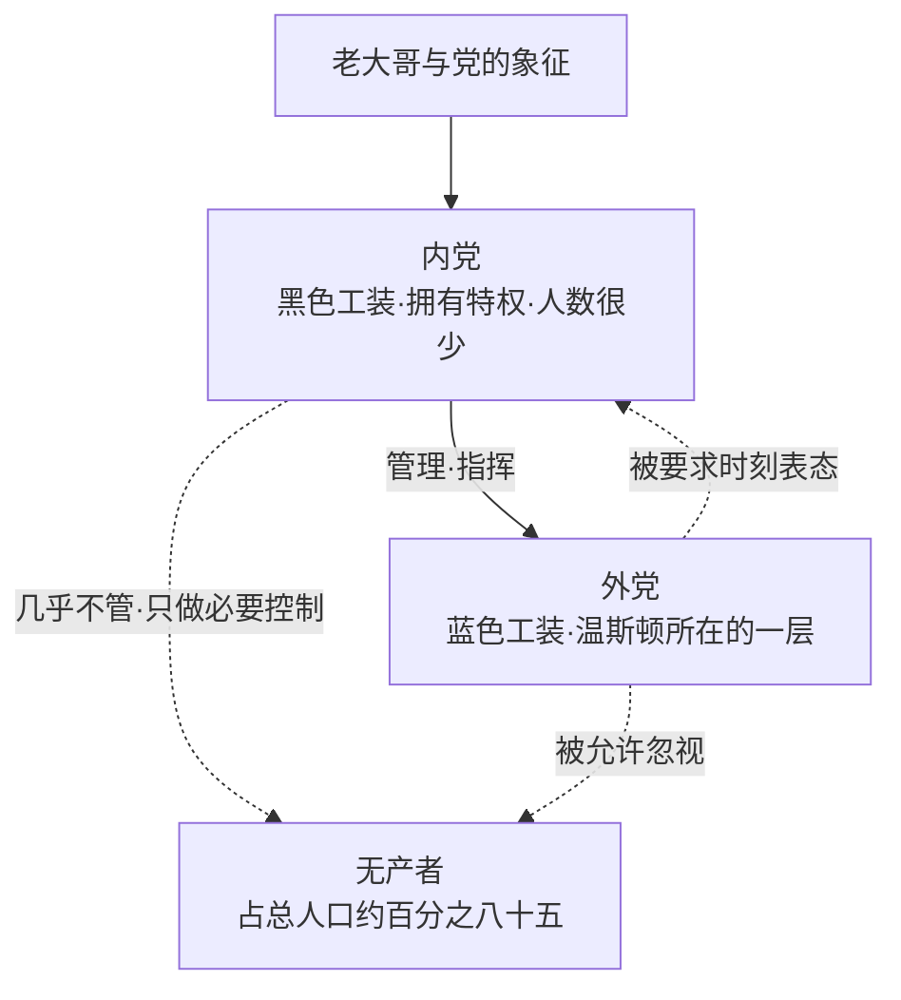

# 02｜大洋国到底是一个什么样的世界？

> 本篇核心问题：这个世界是怎么分层、怎么运转的？四个部的名字为什么都和它们做的事相反？

> **剧透提示**：本文主要涉及第一部第四至八章，只在个别处顺带提到后文，不涉及结局。

---

## 开篇：一个值得思考的问题

温斯顿走出家门，站在伦敦的街头，抬头就能看见四座白色的金字塔形大楼。小说里说，这四座楼各自占据一片天际线，在胜利大厦的屋顶上，你可以同时把它们全收进眼里。它们是政府的四个部：真理部、和平部、友爱部、富足部。

名字都很好听，也都很可疑。管新闻、娱乐、教育和艺术的叫真理部；管战争的叫和平部；管法律和秩序的叫友爱部；管经济的叫富足部。一个国家给自己的机构起名，通常想让人安心。可是奥威尔在这里做了一件很小、很狠的事：他把名字和职能并排摆在一起，不加评论，让你自己去发现它们对不上。

这一篇要回答的，是进入这本书之后最先要弄清楚的事：大洋国究竟是一个怎样的世界？谁在上面，谁在下面，每个人每天过的是什么日子？看清了这张结构图，后面每个人物的选择才有地方可以落脚。

## 一、从故事开始

先看那四座楼。

真理部在小说里是一座三百米高的白色混凝土金字塔，外墙上用优雅的字体写着党的三句口号，地面以上据说有三千个房间。温斯顿的工作就在这里，他的任务是把过去的报纸改成党需要的样子。这个部门的名字叫真理，干的是篡改。

和平部管的是战争。小说一开始就交代，大洋国正在和欧亚国打仗；可是温斯顿心里清楚，四年前的敌人明明是东亚国，大洋国当时和欧亚国是盟友。官方的说法是，大洋国一直在和欧亚国打仗，从来没有换过对手。这场战争是背景，不是本篇要讲的重点，这里只需要记住一点：它没有尽头，也看不出打算有尽头。

友爱部是最吓人的一座。奥威尔写得很具体：这座楼一扇窗户都没有。温斯顿从来没进去过，连靠近它半公里以内的机会都没有；要进去，得穿过铁丝网、钢门和暗藏的机枪巢，通往它的街道上还有穿黑制服的、长着一副大猩猩面孔的警卫来回巡逻。一个叫友爱的地方，不让光进去，也不让人出来。

富足部的情形，要到日常生活里才看得出来。官方的电幕每天念出一串串产量数字，一切都在增长，什么都比去年多。可是温斯顿的现实是另一回事：楼里的水管常年漏水，更新要等委员会批准，批一块玻璃有时要等两年；而且随时都有某样生活必需品断货，有时是纽扣，有时是鞋带，眼下是剃须刀片，只能去所谓的自由市场偷偷摸摸地找。名字叫富足，实际是匮乏。

## 二、真正的问题是什么？

把这些细节放在一起，会冒出一个很朴素的问题：

> 一个国家，为什么要给自己的机构起一个和实际职能相反的名字？

这不是奥威尔在耍小聪明。这些名字背后有一种逻辑：当一个政权需要人们每天都说出和现实不符的话，它迟早会让语言本身失去检验现实的功能。四个部的名字，是这个逻辑最先显露出来的地方。名字不再描述事物，只是在发出指令：你要把这个地方想成真理，想成和平，想成爱，想成富足。

所以这一篇真正想弄清的不只是「大洋国长什么样」，而是：这个世界为什么能让生活在里面的人，一方面每天亲眼看到匮乏，一方面又不得不相信富足？要回答这个问题，得先看人是怎么被分成三层的。

## 三、人物为什么会这样选择？

大洋国的居民大致分成三层：内党、外党和无产者。可以先用一张图把它们的位置摆出来。

温斯顿属于中间这一层。他穿蓝色工装，每年有三千张衣物配给券，一套睡衣就要六百张，所以他睡觉时干脆什么也不穿。他的午饭是食堂里统一发放的：一份粉灰色的炖菜、一块面包、一块奶酪、一杯不加奶的胜利牌咖啡，还有一片糖精。他靠胜利牌杜松子酒打发夜晚，这种酒的味道像硝酸，喝下去感觉像后脑勺被橡皮棍敲了一下。他住的胜利大厦电梯总是坏的，暖气总是半开，管道一到冬天就爆。

外党的生活不只是穷，更是被填满。书里写到，一个党员原则上没有空闲时间，除了在床上以外，几乎不该有独处的时刻；工作、吃饭、睡觉之外，就该参加集体娱乐。温斯顿有一次因为四月的天气太好，没去社区活动中心，而是自己到街上逛了一圈，他很清楚，这种缺席是会被记下来的。新话里甚至有一个专门的词形容这种倾向，叫「自己的生活」，意思是个人主义和古怪脾气。一个想有自己生活的人，是可疑的人。

内党是另一个世界。小说在这一部分里对他们着墨很少：他们穿黑色工装，偶尔出现在食堂或走廊里，其他党员见到他们走近会安静下来。关于他们住在哪里、吃什么，温斯顿并不真正知道。这也是奥威尔的安排：从外党的视角看过去，上面一层是模糊的，只是一种压在头顶的存在。

最底下是无产者，占总人口的百分之八十五。党对他们的态度很有意思。教科书说党把他们从资本家手里解放了出来，同时党的内部教义又说他们是天生的低等人，要像对待牲口一样用几条简单的规则管住。小说的叙述者解释说，只要他们继续干活和生育，其余的事情都无关紧要。绝大多数人家里连电幕都没有，民警也很少干预，赌博、啤酒、足球和电影填满了他们的生活。党甚至有一句口号，叫「无产者和牲口是自由的」。这句口号听上去像恩赐，读起来像宣判：你们不值得被管。

## 四、作者真正想讨论什么？

这里需要把几个层次分开。

**文本事实**。第一部第七章里，温斯顿在日记里写下那句著名的话：如果有希望，希望就在无产者身上。他的理由很清楚：党不可能从内部被推翻，外党的人彼此无法联合，反抗最多是一个眼神、一次语调的变化；只有无产者人数足够，只要他们意识到自己的力量，就可以像马抖掉苍蝇一样把党抖掉。但紧接着他又回忆了一个场景：街头曾经爆发出几百个女人的怒吼，他心头一跳，以为暴动开始了，走近一看，是一个卖锅的摊子断了货，大家在争夺一只铝锅。他问自己：为什么他们永远不能为真正要紧的事这样喊？

于是他写下另一句：除非他们有了意识，否则永远不会造反；而除非先造反，否则他们不会有意识。这是一个死结。

**作者的看法**。奥威尔是否真的相信无产者能拯救世界，书里没有给出一个简单的答案，叙事本身倒是带着犹豫：温斯顿后来去无产者的酒馆里，想找一个活过战前的老人问问「从前的日子是不是更糟」，得到的只是一堆零碎的往事。老人的记忆在温斯顿看来像一个垃圾堆，里面什么都有，就是没有答案。这一幕可以读成：无产者保存着记忆，却没有能力把记忆变成判断。

**常见的读法**是，这是奥威尔对政治希望的一种怀疑：他既同情下层，又看到下层在没有组织、没有语言的情况下无法行动。也有读者认为，这句话本身就是小说埋下的一个反讽，因为温斯顿越是在日记里相信它，越说明他没有别的指望。**一种可能的读法**是，这里并不是在评判无产者，而是在写温斯顿：一个孤立的人，必须给自己找一个希望所在的方向，而最方便的方向，是自己够不着的那一层。

## 五、把这个问题放回时代

奥威尔写这本书的时候，战争刚刚结束，欧洲的大部分城市还留着轰炸之后的瓦砾，配给制度在英国也还没有取消。小说里的衣物配给券、断货的日用品、被炸毁的街区，很多是那个年代的日常。胜利牌杜松子酒和胜利牌香烟，名字里带着战争胜利的口吻，实物却粗劣，这个反差是那个时代的真实气氛。

另一层背景是极权国家的宣传方式：宣布丰收，同时短缺；宣布胜利，同时配给。关于这一点，小说本身提供的最有力的一句评论，出现在温斯顿的一段反思里：现代生活真正的特点，不是残酷和不安全，而是它的光秃、灰暗和无精打采。党想要的是一个钢铁与混凝土的、巨大而闪亮的世界，而眼前的现实是一座衰败的城市，到处是漏水的房子，空气里有煮白菜和劣质厕所的味道。理想和现实之间的差距，是整个大洋国的底色。

## 六、作品是怎么写出来的？

奥威尔写这个世界，用的是一种近乎「清单」的手法。

第一，他不讲道理，只列物件。炖菜、糖精、杜松子酒、断了货的剃须刀片、漏水的管道、一条永远在修的走廊。读者不需要被告知这是个压抑的世界，因为这些物件已经替他说了。

第二，他把名字和实情并排摆放。四个部的名字、三句口号、「友爱」二字写在没有窗的楼上，全部是平静地陈述。他没有一句话在说「这是荒谬的」，荒谬自己从句子之间冒出来。

第三，他有意让上下两层都显得模糊。内党是黑色工装和一个远处的背影，无产者是街角的喧哗和一场关于锅的争吵。读者和温斯顿一样，只能站在中间这一层往上看、往下看，看到的都不完整。这种有限的视角，让我们更容易理解外党的处境：既不知道上面是谁，也不确定下面有没有力量。

## 七、如果放到今天

大洋国的分层，在今天也许可以拿来做一个朴素的提问：在一个组织、一个平台或一个社会里，你能看到的信息有多少，不能看到的有多少？

很多人今天的工作环境，也有「外党」的影子：每天的行为被某种指标记录，社交场合要表态，个人时间被各种集体活动、打卡和群消息填满，一个想安静待一会儿的人，会被问一句「怎么不参加」。这当然远远没有大洋国那么极端，但「没有独处的合理空间」这个感受，读过这本书的人大概不陌生。

同时，名字与实情不一致，也不是小说里才有的事。当一项政策、一个产品或一个机构的名称越是动听，越值得问一问：它实际在做什么，结果如何？这并不是要对一切名字抱怀疑，而是要保留一个习惯：把名称和它的作为放在一起看。

## 八、小结

这一篇想说清三件事。

第一，大洋国分成三层：内党在上，外党在中间，无产者在底层，占了绝大多数。外党的生活不只是贫穷，更是被各种集体活动、配给和监督填满；无产者几乎不被管，也因此不被当成人看待。

第二，四个部的名字和实际职能相反，不是修辞上的玩笑，而是这个世界的运转方式：让语言不再用来描述现实，而是用来发出指令。

第三，温斯顿在日记里写下的那句希望，指向了最底下一层，可是他自己也承认，那里的人还没有意识到自己的力量。他把希望放在一个够不着的地方，这本身就说明了他的处境。

## 下一篇

了解了这个世界的结构之后，一个问题就变得很具体了：为什么在这样的世界里，几乎不需要军队去镇压，也没有人敢站出来？答案藏在每个房间里那块关不掉的电幕上。
