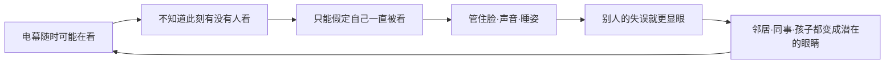

# 03｜电幕之下，监视为什么比暴力更有效？

> 本篇核心问题：大洋国几乎不需要军队镇压，为什么没人敢反抗？

> **剧透提示**：本文涉及第一部全部情节，另外会提到第三部开头帕森斯被捕一事，不涉及结局。

---

## 开篇：一个值得思考的问题

温斯顿在自己家里做的第一件事，是把背对着电幕。

这是个很小的动作。书里说，这样做更安全；可是紧接着，叙述者补了半句：他心里很清楚，就算是一个背影，也可能泄露什么。

整本书里有无数人被抓，但你翻开前面几十页，几乎看不到有人在街上被殴打、被拖走。大洋国的街头没有坦克，没有成队的士兵，最显眼的暴力象征是墙上的海报和空中偶尔掠过的一架直升机。可是所有人都在自觉地管住自己的脸、自己的声音、自己的睡姿。这就带来一个很有意思的问题：一个几乎不需要用暴力去维持的统治，是靠什么维持的？

## 一、从故事开始

先看电幕本身。小说第一章里，奥威尔用一段非常克制的文字交代了它的规则：电幕是一块嵌在墙上的金属板，可以把音量调低，但没有办法彻底关掉。它同时收发，温斯顿在它面前发出的任何声音，只要高过很低的耳语，都会被它收进去；只要他还待在它的视野里，就既能被听见，也能被看见。

接着是全书最关键的一段，大意是这样的：当然没有办法知道你在任何一个时刻是否正被监视。思想警察多久接一次线，按什么规律接，全靠猜。甚至可以想象他们一直在盯着所有人。可无论如何，他们想接谁的线就能接谁的线。你必须生活在——而且已经因为习惯成了本能地生活在——这样的假定里：你发出的每一个声音都被听见，除了在黑暗中，你的每一个动作都被审视。

注意这里的措辞：不是「你被监视」，而是「你必须假定自己被监视」。这个差别就是本篇要讲的东西。

窗外还有直升机。它在屋顶之间一掠而过，像一只苍蝇，停一下，又飞走，书里说那是巡逻队在窥探人们的窗户。但叙述者紧接着说：巡逻队不重要，只有思想警察重要。也就是说，可见的、会飞来飞去的监视反而是次要的；真正起作用的是看不见的那一部分。

电幕之外，还有一种监视更难防，那就是身边的人。

温斯顿的邻居帕森斯家里有两个孩子，一个九岁的男孩，一个七岁的女孩，都穿着「间谍团」的制服：蓝短裤、灰衬衫、红领巾。温斯顿去替他们家修堵塞的水槽，一出来，男孩举着玩具手枪从桌子后面跳起来，大喊：你是叛徒！你是思想犯！你是欧亚国的间谍！我要毙了你，我要蒸发你，我要送你去盐矿！姐妹俩围着他又喊又跳。温斯顿举起双手，心里却发毛，因为那孩子的神气太凶了，不太像在玩游戏。他走出门，脖子后面挨了一弹弓，男孩在门关上之前还喊了一声「戈德斯坦！」。

最让温斯顿难忘的，不是那一下疼，而是孩子母亲脸上那种无助的惊恐。他想：再过一两年，孩子们就会日夜盯着她，看她有没有不正统的苗头。报纸上隔三差五就会登出一则消息，说某个「小英雄」偷听到父母一句不得体的话，把他们告到了思想警察那里。

## 二、真正的问题是什么？

把这些场景放在一起，可以问一个很日常的问题：

> 一个人怎么会在没有人命令他的情况下，自己管住自己？

站在大洋国统治者的角度想想，如果每一个公民都需要一个真人看着，那得雇多少警察。而电幕和孩子提供了一种便宜得多的办法：不必真的看，只要让每个人觉得自己随时可能被看。

这就是监视和暴力的根本区别。暴力需要执行者，需要花力气，而且每一次动用都是对外部世界的一次展示，会引发怨恨。监视则让人把执行者的位置安在自己心里：我知道自己可能被看见，所以我先替你看住我自己。

## 三、人物为什么会这样选择？

先看温斯顿。他在整本书开头的一连串动作都是自我审查：背对电幕、表情管理、不在食堂里多看别人一眼。书里甚至专门有一个词，叫「面罪」，意思是脸上的表情不合适，比如在宣布胜利的时候露出不信的神色，这本身就是可以被惩罚的罪。他在食堂里怀疑那个黑头发的女孩在盯他，想的是自己的脸色刚才有没有露馅，是不是流露了焦虑，是不是嘴唇动了，一个神经质的抽动、一个不自觉的自言自语，都可能暴露。

再看帕森斯。他是温斯顿的同事，一个胖乎乎、体味很重的人，书里形容他是那种「毫无疑问地忠诚的苦力」，党的稳定靠他们，甚至比靠思想警察还多。他每天晚上准时出现在社区活动中心，津津乐道地讲孩子的光荣事迹：女儿在郊游时悄悄跟踪一个陌生男人两个钟头，最后把他交给了巡逻队，理由是那人穿了一双古怪的鞋，说明他可能是外国人。他说这话时满脸得意。他还说，孩子们最新领到的装备是一个听筒，贴在锁孔上能听到比耳朵多一倍的声音，「当然只是玩具，不过让他们有个正确的概念，对吧？」

温斯顿当时在心里算了一笔账：帕森斯太太迟早会被孩子举报，温斯顿自己会被蒸发，赛姆会被蒸发，奥勃良也会被蒸发；而帕森斯这类人，永远不会被蒸发。

可是，第三部开头，温斯顿被关进友爱部的牢房，被推进来的新囚犯里，竟然有帕森斯。他穿着短裤和运动衫，膝盖发抖，满眼悲惨。他说他是因为思想罪进来的，说话时，语气里既有对罪名的完全承认，又有对这个词会落到自己头上的难以置信。他是怎么暴露的？睡梦里，他反复说「打倒老大哥」。谁告发了他？「是我的小女儿，」他带着一种凄凉的自豪说，「她趴在锁孔上听见了，第二天就跑去找了巡逻队。七岁的孩子，聪明吧？我不怪她，我还为她骄傲呢，这说明我把她教育得合乎正道。」

他还对着电幕说，他当然有罪，党怎么会抓一个无辜的人呢？他甚至准备在审判时对他们说：谢谢你们在我走得更远之前救了我。

这几个人物排在一起，构成了一条清楚的线：温斯顿是在心里竖起防线的人，帕森斯是已经没有防线的人，孩子们是线的另一头，是被造出来的新监视者。三者的结构是一个闭环。

## 四、作者真正想讨论什么？

这里需要把几层说法分开。

**文本事实**：小说明确写了，电幕无法彻底关闭，会收发，观察的频率没有人知道；写了面罪这个说法；写了孩子被系统地训练成告发者，并说三十岁以上的人害怕自己的孩子，几乎是常事；也写了最忠实的帕森斯最终死于自己孩子的告发。

**作者观点**：奥威尔没有在小说里直接评论监视的原理，他在这里用的是叙事，而不是议论，这一点值得记住。至于他在小说之外怎样谈论极权主义对个人私生活的侵入，那属于另外的话题，这里不展开。

**常见的读法**：不少评论者把电幕的机制和边沁设想的「全景监狱」放在一起谈。边沁是十八世纪末的英国哲学家，他设想的是一种环形监狱，囚室围成一圈，中间立一座塔，塔里的看守看得见每一间囚室，囚犯却看不见塔里有没有人。关键在于，看守不必一直在场，囚犯只要觉得他可能在场，就会自己守规矩。后来法国哲学家福柯在一九七五年出版的《规训与惩罚》里，又把这个设计当作现代社会权力运作方式的一个比喻。需要强调的是，这是后世评论者的读法，边沁与福柯都不是奥威尔的原话，奥威尔是否有意参照全景监狱，目前缺乏可靠来源，不能确定。但这个比较之所以流行，是因为电幕的规则确实和它相似：不知道有没有人看，所以只能当作一直有人看。

**其他解释**：也有读者提醒，电幕的力量并非无处不在。书里的叙述者自己就说，没人知道他们多久接一次线。这既可以读成监视有漏洞，也可以读成漏洞本身就是设计的一部分：一个有漏洞的监视，反而让人更不敢赌。

**一种可能的读法**是，帕森斯的结局才是这一幕最冷的地方。他的悲剧不在被抓，而在被抓之后依然认同抓他的逻辑：他不恨女儿，反而为她的告发骄傲。这说明监视最彻底的效果，是让被监视者与监视者分享同一套价值。

## 五、把这个问题放回时代

奥威尔写这本书时，欧洲刚刚经历过一场与极权主义的战争，纳粹德国和苏联的告密制度早已不是秘密。苏联有一个常被提到的故事：一个叫帕夫利克·莫罗佐夫的男孩，据说在一九三二年检举了自己的父亲，后来被宣传成少年英雄。后世评论者常拿这个故事和小说里的「小英雄」做比较。奥威尔本人是否直接参考过这个故事，目前缺乏可靠来源，不能确定；这个故事本身的细节，历史学界也有争议。可以确定的只是：让孩子举报父母，不是奥威尔凭空想象的恐怖，而是那个年代人们已经隐约听说过的事。

另一个背景是，一九四〇年代的英国，战时的宣传、邮件检查和各种公共登记，使得普通人对「被记录」有了前所未有的体验。电幕这个具体的装置是虚构的，它所代表的感觉却不是。

## 六、作品是怎么写出来的？

这一幕的写法有三个特点。

第一，奥威尔大量使用「可能」「据说」「无从知道」。他写电幕的规则，没有一句确切的承诺：多久接一次线，是「猜测」；是否一直监视所有人，是「可以想象」。语气的含混本身就是内容，因为读者读着读着，也学会了不确定。

第二，他让孩子们的恐怖感，来自极轻的细节。一个玩具手枪，一个红领巾，一声「戈德斯坦」。孩子的喊叫是游戏，但眼神里的「算计过的凶狠」又不是游戏。书里把他们比作终将长成食人兽的虎崽，这个比喻很重，但它是通过温斯顿一瞬间的不安带出来的。

第三，他在第一部里埋了一个讽刺，到第三部才引爆。温斯顿在食堂里想，帕森斯永远不会被蒸发，这个判断在当时读来合情合理：他是最顺从的那一类。直到牢房里的那一幕，读者才发现，顺从并不能买来安全。这种前后呼应，让读者对「谁安全」这个问题产生了持续的不安。

## 七、如果放到今天

今天谈监视，容易直接联想到摄像头和数据。但这个故事真正指向的，是一种更细微的感觉：不确定有没有人在看。

比如，在一个有几百人的工作群里发言之前，很多人会先把话改几遍，原因是不知道谁会截图，不知道哪句话会在什么场合被拿出来；社交平台上，一条「已读」的提示，也会让人在回消息前多想几秒；在装了大量摄像头的公共场所，人们对「有没有人在看」的判断，往往并不基于真的有人看，而是基于「可能有人看」。这些都不是极端的例子，却都在运作同一个机制：我们开始替那个看不见的观察者先行检查自己。

当然，这不等于说今天的世界就是大洋国。最大的区别之一是，今天的许多记录，我们自己也是参与者、受益者；而且在大多数地方，被看见并不会直接导致被蒸发。但这个故事留给我们的问题依然成立：当你发现自己开始提前审查自己的时候，那个审查者是你，还是别人？

## 八、小结

电幕之所以比暴力有效，是因为它改变了人与权力之间的位置：权力不必出现，只要让人相信它可能出现。这一点，在温斯顿背对电幕的动作里，在帕森斯家孩子的游戏里，在帕森斯被女儿告发却满怀感激的那一幕里，都有清楚的体现。

监视的力量不在于真的看见，而在于让每个人永远不确定自己有没有被看见。久而久之，被监视的人会成为监视系统的一部分：先是自己的脸，然后是身边的人，最后是孩子。

## 下一篇

在这样一个人人自我审查的世界里，温斯顿却偏偏一步一步靠近了危险。一个胆小、体弱、并不英勇的人，为什么会走上反抗这条路？
