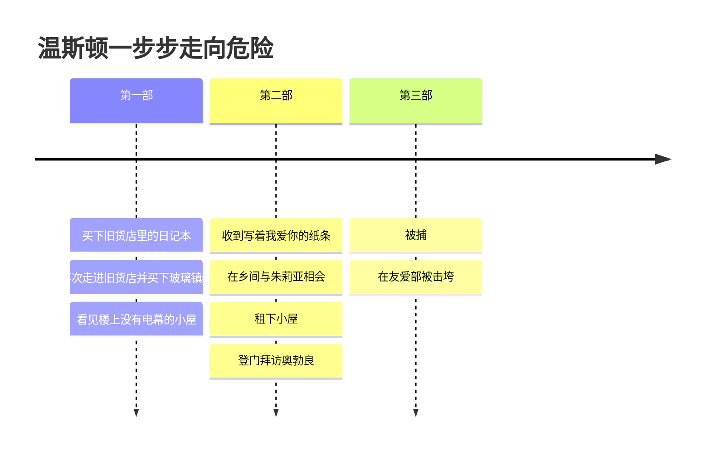

# 04｜温斯顿为什么会走上反抗这条路？

> 本篇核心问题：一个胆小、体弱、并不英勇的人，为什么会一步一步靠近危险？

> **剧透提示**：以下内容包含关键剧情与结局。

---

## 开篇：一个值得思考的问题

如果让你在小说里挑一个最不像反抗者的人，温斯顿大概会排在前几位。

他三十九岁，右脚踝上有一块静脉曲张的溃疡，每天早上起床先咳一阵，咳到整个人蜷在地上；做早操的时候，电幕里那个声音尖厉的女教练会当众点他的名，说他动作没做到位。他怕疼，怕被打，怕那个叫友爱部的地方。他心里很清楚自己迟早会死在那里，却还是一步一步往那个方向走去。

这不合常理。真正的勇士往往是在信念里长出来的，温斯顿身上没有这种东西。他没有读过什么禁书，没有师承，没有同志，也谈不上有什么政治纲领。那么，是什么在推着他？

## 一、从故事开始

答案要从他的过去里找。

第一部里有一场梦：他梦见母亲抱着幼小的妹妹，坐在一艘下沉的船舱里，隔着越来越深的绿色海水抬头望着他。梦里没有任何责备，只有一种静静的认识：他们是为了让他活下去才去死的，这是事物不可避免的秩序。温斯顿醒来之后想到，母亲的死，是一种在今天已经不可能发生的悲剧，因为那是只有在还存在私人感情、友谊和忠诚的年代才有的东西。

这个梦的底下，压着一件他很多年没敢想的事，直到第二部里，他在小屋里重新梦见母亲，整个记忆才浮上来。那时候战乱刚过，食物很少，他饿得发慌，总想多吃一口。有一天分到一块巧克力，本该三个人平分，他却大声要求整块归他。母亲劝他不要贪心，吵了很久，最后她掰下四分之三给他，剩下四分之一给妹妹。妹妹拿着，呆呆地看着，他忽然冲上去，一把抢过妹妹手里那一小块，夺门而逃。母亲在身后喊他回来，他停了一下，没有回头。他看到母亲把孩子搂进怀里，她的姿势告诉他妹妹快要死了。他跑下楼梯，手里的巧克力在发黏。

等他饿得回家，母亲和妹妹已经不见了。这在当时已经很常见。他一直不知道她们是死了、进了劳改营，还是被送去了收容所。他对朱莉亚说：「直到这一刻之前，我一直以为是我害死了我的母亲。」又补了一句：「不是身体上的杀害。」

注意这件事的分量：温斯顿的整个成年生活，都是在这件没被说出口的事旁边展开的。他的父亲、母亲、妹妹，在他十岁出头的时候，大概被卷进了五十年代的第一批大清洗。那一场清洗里，家庭的消失没有告别，没有仪式，没有名字。这就是他最初被「没有记录」的东西刺痛的地方：不是理论，是一个孩子手里发黏的巧克力。

与他有过婚姻的人是凯瑟琳。他们只在一起过大约十五个月。这个女人高挑、金发、动作舒展，一张脸称得上高贵，直到你发现脸背后几乎什么都没有。温斯顿给她起过一个外号，叫「人形录音机」，她脑子里装着的每一句话都是口号，党递给她什么荒唐的东西她都吞得下去。亲热对她来说是一种「对党的责任」，她每个星期定时提醒他，把它当作要完成的任务，有时她管它叫「造个孩子」，有时就直接叫「我们对党的责任」。没有孩子，两个人就分开了。

后来他对朱莉亚讲过一次几年前的郊游：他们在肯特郡迷了路，走到一个白垩矿坑的边缘。他忽然发现崖壁缝里长着一丛两种颜色的千屈菜，一枝开着品红色，一枝开着砖红色，却长在同一条根上。他叫凯瑟琳过来看，她探身过去，他一只手扶在她腰上。四下无人，没有麦克风，一阵念头闪过：只要轻轻一推。他没有推。朱莉亚说：「你为什么不推她一把？我会的。」他回答：「是的，如果当时的我是现在的我，也许会。」

## 二、真正的问题是什么？

把这些碎片摆在一起，问题变得朴素了：

> 一个人的反抗，一定要有信仰吗？

温斯顿的故事给了一个出人意料的答案：未必。支撑他的东西，不是一套主义，而是一个很小、很固执的东西，叫做「这件事发生过」。巧克力的事发生过，母亲和妹妹存在过，那丛颜色不同的花长在同一条根上，一个人的记忆不应该被别人改写。

所以他的反抗从来不是向前的，而是向后的：他在追问「原来是什么样」。他需要的不是一个更好的未来，而是一个可以核对的过去。

## 三、人物为什么会这样选择？

他走的路，是由一连串小得几乎看不出来的越界铺成的。

先是日记本，一个旧货店里的小东西，他当时也说不清自己为什么要买。后来他又鬼使神差地走回那家店，书里说，他的脚自己把他带回去的。店主查灵顿先生是个六十岁上下的老头，说话柔和，带着一点过时的体面。温斯顿在小桌子上看见一块半球形的厚玻璃，里面嵌着一小片粉红色的珊瑚。他立刻付了四块钱买下。书里写得很准：吸引他的与其说是美，不如说是它身上那股属于另一个时代的气息，以及它明显的无用。对一个党员来说，任何旧的东西，任何美的东西，都有些可疑。

然后是楼上的那个房间。里面有床、旧钟、壁炉，窗外是一个鹅卵石的院子，最关键的是，没有电幕。「这里没有电幕！」他忍不住低声说。老头说：「我从来没有装过那种东西，太贵了，再说我也从来没觉得需要。」就在那一刻，温斯顿心里闪过租下这间屋子的念头，一个疯狂而不可能的念头，被他当场掐掉，却没有掐死。到了第二部，他对朱莉亚提出这个想法，她出人意料地爽快答应，两个人都清楚这是疯狂的事，仿佛有意让自己离坟墓近一些。

回头看这条线，它有一个特点：每一步都很小，每一步都能给自己找一个理由。买本子，是因为纸好；买镇纸，是因为好看；去看房间，是因为随便看看；租房子，是因为想有个地方独处。没有一次是「我决定要反抗了」。书里有一句话说得更透：他早就在最初那个秘密的念头里，把终点认下了；从念头到文字，从文字到行动，最后一步在友爱部里等着他。

## 四、作者真正想讨论什么？

这里需要把几个层次分开。

**文本事实**：温斯顿在日记里写过两句话。第一句是：「我知道怎么做，但我不知道为什么这样做。」第二句是：「自由就是可以说二加二等于四的自由。如果这一点被承认，其余的一切都随之而来。」这两句话已经把他的立场说得很明白：他不要一套新的世界观，他只要承认「显而易见的东西」是对的。他在那个时刻想到的是：常识是异端中的异端，而最可怕的不是他们会杀死你，是他们也许是对的。

**常见的读法**是，温斯顿代表了一种基本的、前政治的人性：对真实的执着、对私人感情的渴望，是权力最难彻底拿走的两样东西。他后来之所以爱上朱莉亚，也和这一点有关：对他来说，一个人的身体、一次不为党服务的亲热，是对「一切都被规定」的世界的反抗。

**其他解释**：也有读者对这个人物不那么宽容。他固执，却也软弱；他自诩清醒，却一再自欺。他对无产者的期待，就是其中一个例子，他在日记里写下希望在他们身上，却从来没有认真和他们说上过话，唯一一次去酒馆，也只问出一堆无用的碎片。他对奥勃良的信任也是同类：他想要一个同盟，于是把一个眼神读成了同盟。这个人的执念是真的，他的幻想也是真的，两者并存。

**一种可能的读法**是，奥威尔刻意把一个不够英雄的人放在英雄的位置上。温斯顿身上有气味、有伤口、有恐惧，也有卑劣：他曾恶狠狠地想强暴并杀死朱莉亚，他曾在孩提时抢走妹妹的食物。他不是一个值得崇拜的人，却是一个值得认同的人，因为读者无需成为英雄就能理解他：他只是不想让一件真的事变成假的。

最后，这个人被击垮了。关于怎么击垮、为什么能击垮，那是另一个问题，这里不展开。需要强调的只是：他的力量和他的弱点，出自同一个地方。他对真实的执念使他敢迈出那几步，也使他在失去一切证据之后，无处可去。

## 五、把这个问题放回时代

奥威尔写下这个人物的时候，脑子里装的是亲眼见过的东西：西班牙内战中同一件事被不同报纸说成完全不同的样子，一些真实发生过的事在宣传里被抹去。他后来在文章里谈到过这种经历对他的冲击。因此，温斯顿对「真实」的执念并不是一个文学上的抽象，更像是奥威尔本人那一代人在二十世纪的经验里变得格外刺眼的东西。

另一方面，温斯顿的家庭在小说中是被清洗吞没的。父亲、母亲、妹妹，没有一个人留下过一张照片、一个名字。个人的消失、记录的消失，在那个时代的欧洲不是遥远的故事。

## 六、作品是怎么写出来的？

奥威尔用了几个物件，来承担温斯顿内心里说不出口的东西。

玻璃镇纸是最醒目的一个。它沉、静、透明，里头封着一片珊瑚。温斯顿看着它的时候，觉得可以钻进那个玻璃做的世界里，在里面让时间停住。它后来被他放进了与朱莉亚的小屋，成了这个私人空间的象征，也是整本书里最脆弱的东西，因为玻璃一摔就碎。

那丛两色的花，是另一个细节。它出现在一个几乎变成谋杀的瞬间：一个人站在悬崖边，手搭在妻子腰上，眼睛却在看一朵花。这个画面把温斯顿全部的矛盾压缩在了一起：他能注意到一件不起眼的、真实的事，也能因此放过一个机会。

此外，奥威尔始终让叙述贴着温斯顿的视角走，所以读者能感受他的犹豫，也无法比他更早知道真相。

## 七、如果放到今天

温斯顿的故事在今天还有一个很具体的回声：很多人的坚持，不是来自某个宏大的立场，而是来自一件小事上的「不肯改口」。

比如一个人在会议上，面对一份明显有出入的数字，说了一句「这个数据我核对过，不是这样」；比如一个人在社交平台上，面对越来越统一的说法，仍然坚持把自己亲眼看到的东西如实写下；又比如，一个家庭保留着一些旧照片和旧信件，不是为了怀旧，而是为了在需要时有东西可以对照。这些举动并不英勇，通常也不会带来什么好处，但它们和温斯顿的日记有同样的结构：我记得，它是真的。

也要看到另一面。温斯顿的故事同样提醒我们，只靠对真实的执念是不够的，它需要和别人建立真实的连接，需要判断，需要识别幻想。执念没有错，错的是把自己的希望放在不该放的地方。

## 八、小结

温斯顿走上反抗之路，不是因为信仰，也不是因为勇气，而是因为一连串很小的越界，每一步都出于对「原来是什么样」的不甘心：一块巧克力，一个消失的家庭，一块玻璃里的珊瑚，一丛颜色不同的花。

他的力量在这里，弱点也在这里。他执着于真实，所以敢写下日记、买下镇纸、租下小屋；也因为执着，他需要有人来分享这份真实，于是把希望交给了无产者，把信任交给了奥勃良。看清他是怎样的人，才能看清后面的事为什么会发生。

## 下一篇

温斯顿并不是唯一违反规矩的人。在他身边，有一个年轻得多、务实得多的女孩，同样在做危险的事，却和他走的是完全不同的路。裘莉亚的反抗为什么和温斯顿不一样？
