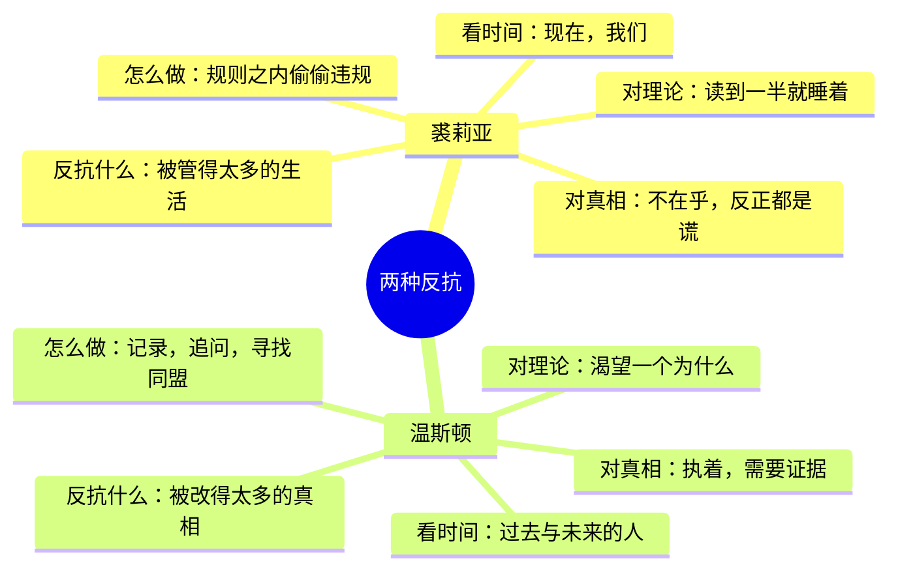

# 05｜裘莉亚的反抗为什么和温斯顿不一样？

> 本篇核心问题：同样是违反规矩，两个人的反抗究竟差在哪里？

> **剧透提示**：以下内容包含关键剧情与结局。

---

## 开篇：一个值得思考的问题

一张折成小方块的纸条，递到温斯顿手里的时候，他以为那是陷阱。

他花了整个上午，一直在算这张纸条会是什么：思想警察的传唤、一道自杀命令，或者一个更荒唐的念头，说不定是传说中的兄弟会在找他。到手的却是一行潦草的字，写得很笨拙：我爱你。

这一行字几乎可以当作裘莉亚这个人物的名片。她不写口号，不写暗号，不写什么「推翻党」。她只做了一件具体、直接、也非常危险的事，而且做得毫不犹豫。同样是违反规矩，温斯顿花了几个月才敢买一本日记，她却几乎没有思考过就越了界。这两个人的反抗，为什么看起来这么不一样？

## 一、从故事开始

先说纸条是怎么来的。

第二部开头，温斯顿在走廊里碰到那个黑头发的女孩，她的右臂吊在绷带里，走近时脚下一绊，整个人摔了个趴。温斯顿本能地过去扶她，她借着这三秒钟，把一个纸团塞进了他的手心。从头到尾，两个人面对的是电幕，脸上没有一丝多余的表情。书里明说这是故意的；一种可能的读法是，连绷带和摔倒的位置，都是她事先算好的，好让他一定会过来扶。

这是一个在严密监视下精心做出的动作，而且做得漂亮。第一部里，温斯顿对她的印象恰恰相反：他恨她，恨她身上那股曲棍球场、冷水浴、集体远足和「一心向党」的气味，认为她是那种有机会就会检举他的好党员，这份厌恶后来他亲口对她承认过：有一阵子，他甚至认真想过用鹅卵石砸碎她的脑袋。

再看相会那一幕。五月二日，温斯顿坐火车去乡下，车厢里挤满了假日出游的无产者，一家老小为的是去找亲戚、顺便买点黑市黄油。他沿着小路走，踩着一地的蓝铃花，采了一把花。裘莉亚从背后轻轻按了一下他的肩，示意他别出声，领着他穿过灌木，来到一块她早就踩过点的空地：四周都是细小的白蜡树苗，没有一棵粗到能藏麦克风。她告诉他：「我以前来过。」他对她说：「我三十九岁，有一个甩不掉的老婆，有静脉曲张，还有五颗假牙。」她说：「我根本不在乎。」

接着她把腰间那条鲜红的「少年反性同盟」腰带扯下来，扔在树枝上，从工装口袋里摸出一块巧克力。那不是配给的东西，深色、发亮，包在银纸里。「黑市上弄的，」她满不在乎地说，「我就是长得这副样子，一副好党员的样子。我在间谍团当过小队长，每星期有三个晚上给反性同盟做义务工作，游行时总举着横幅的一头，总是笑容满面，从不偷懒，口号喊得比谁都响。这是唯一保险的办法。」

## 二、真正的问题是什么？

在这一幕里，两个人的差别已经藏好了：

> 一个人反抗的，是「被管得太多的生活」，还是「被改得太多的真相」？

对裘莉亚来说，党的问题很简单：它不让你过得快活。她后来对温斯顿说得更透：生活就是这样，你想好好过，「他们」想不让你过，你就想办法违规，尽量别被抓住。她觉得「他们」想夺走你的快乐，就像你想躲开被抓一样自然。她恨党，骂得很粗，却没有一个关于党的总体看法。除了碰到自己生活的地方，她对党的教义毫无兴趣。

而温斯顿恰恰反过来。他需要问的是：为什么会这样？党为什么要这么做？过去到底发生了什么？这是一个人在追问意义。

## 三、人物为什么会这样选择？

书里对裘莉亚的描写，不是浪漫化的。

她二十六岁，住在一个和三十个女孩共用的宿舍，嫌那里「一股女人味，我恨死了」。她在小说司，工作是维修写小说的机器，她管的是一台又大又不好伺候的电动机，她喜欢动手，对机器得心应手，但对成品毫不在意：「我不太爱看书。」在她看来，书就是和果酱、鞋带一样要生产出来的商品。她曾经被选进一个叫「色情科」的分部，专门给无产者制造廉价淫秽读物，供他们偷偷摸摸地购买，还以为自己买到了违禁品。她对那里的评价是：「全是垃圾，其实很无聊，只有六个情节，翻来覆去地换。」

她十六岁有了第一次恋爱，对象是一个六十岁的党员，后来为了躲避逮捕自杀了。她的评语是：「也好，要不然他们会从他嘴里问出我的名字。」从那以后，她经历过好几个人。她看待世界的方式，就是一个很简单的算术：「你要快活，他们不让，你就想办法违规。」

也正因为长年在体制里生活，她比温斯顿更清楚这个体制是怎么运转的。书里有一句判断：在某些方面，她比温斯顿敏锐得多，也更少受党的宣传影响。比如，她随口说战争根本没有发生，每天落在伦敦的火箭弹，多半是政府自己放的，「就是为了让大家保持害怕」。温斯顿听了，觉得这个想法他从来没有过。她还告诉他，在两分钟仇恨里，她最大的困难是忍住不笑。她在公开场合喊「处死叛徒」，已经喊过无数次，可是那些人的名字她一个也没听说过，对他们的罪行半点也不信。她从孩提时代起就学会了怎么「做个好党员」：什么时候欢呼，什么时候喝倒彩，这就够了。

但这种务实的眼光有一个明显的边界：她只在事情碰到自己的时候才质疑党。温斯顿对她说，他说飞机在革命前就有了，她从小在学校学到的却是飞机由党发明，她觉得这事「谁发明的有什么关系」；他上学时，党还只认领直升机。他告诉她，四年前大洋国的敌人明明是东亚国，她甚至没注意到敌人换过：「我以为我们一直在和欧亚国打仗。」她对「真假」这件事本身不感兴趣。

最能说明问题的，是温斯顿对她讲自己撞见过一张可以证明党在造假的照片，后来亲手把它扔进了记忆洞。她的反应是：「那你担心什么呢？这世界天天都在杀人。」他想让她明白，过去正在被整个抹掉；她却说：「我愿意冒险，但要为值得的事，不是为一张旧报纸。」他说也许下一代人会接着干，她说：「我对下一代没兴趣，亲爱的，我对我们有兴趣。」

温斯顿回了一句话，也就是这篇开头问题的另一个入口：「你只是从腰部以下造反。」注意，这句话是温斯顿说的，不是裘莉亚的自我描述，也不是叙述者的结论。他半带戏谑地说出口，她听了觉得妙极了，抱住他笑。这句话很容易被当成对她的评语，其实它更多说明温斯顿的眼光：他觉得有深度的反抗必须有思想，而她只有身体。这个判断，究竟公不公平，读者可以自己想。

## 四、作者真正想讨论什么？

这里要把几层意思分开。

**文本事实**：小说清楚写了，裘莉亚对理论毫无兴趣。第二部里，温斯顿从兄弟会得到那本据说能解释一切的书，在小屋里念给她听，是她自己说「大声念吧，那样最好」；念着念着，他发现房间里安静下来，她侧着身子睡着了，一缕黑发垂在眼前，呼吸均匀。书里对她的态度有一句总结：只要他一谈到党的教义、双重思想、过去可以改写、客观现实不存在，她就变得无聊和困惑，说自己从来不留意这种东西。她有一个「令人不安的习惯」，就是睡着。

**作者的观点**：奥威尔没有在小说之外评论过这个人物，所以不能说他本人对裘莉亚是怎么看的。能确定的，是叙述者在这一段里提出了一个很有意思的观察：党的世界观，在无法理解它的人身上最容易成功。他们可以被迫接受最荒谬的颠倒，因为他们从来没有完全掌握所要求的事情的严重性。「由于不理解，他们保持着神智正常。」一粒玉米会毫无变化地穿过鸟的身体，什么痕迹也不留。

**常见的读法**是，裘莉亚代表一种「身体的、直觉的、生活层面的」反抗，温斯顿代表「思想的、记忆的、历史层面的」反抗，两者互补，也都有局限。她活得更好：她知道怎么藏，怎么躲，怎么躲开巡逻队。他看得更远：他知道自己失去的是什么。

**其他解释**：也有读者，特别是从性别角度读这本书的批评者，认为奥威尔对裘莉亚的处理有失偏颇：她成了一个只有身体、不爱读书、不关心思想的人，似乎是为了衬托男主人公的深刻。支持这种批评的依据，就是温斯顿那句「腰部以下」，以及叙述里对她「不聪明」的反复强调。但也有人指出，书里同样让她在好几处比温斯顿更清醒，比如对战争的怀疑、对兄弟会的怀疑，以及对「做一个好党员」这种表演的熟练掌握。这个形象是否公平，没有定论。

**一种可能的读法**是，这两个人合起来才是一个完整的「人」，各缺一半：只有生活而没有真相的人，可以活下去，但不知道自己丢了什么；只有真相而没有生活的人，知道自己丢了什么，却无法活下去。

## 五、把这个问题放回时代

裘莉亚的形象，来自一种很具体的时代现实：在二十世纪中叶，无论是纳粹德国还是苏联，都有大量普通人并不真正相信官方意识形态，只是学会了怎么表演相信。他们会在集会上喊口号，回到家里说笑话，对政治的不满大多停留在日常的具体麻烦上，不会上升为一个整体判断。这样的人，在极权国家里并不少见。

也正因此，裘莉亚的故事不是一个边缘的故事。她是体制最理想的「用户」：不反对，不理解，不抵抗，在需要的时候表演，在不需要的时候偷偷享受。党要的未必是狂热信徒，更常见的是她这样的人。

## 六、作品是怎么写出来的？

奥威尔写裘莉亚，用了几个很具体的手法。

第一，用动作代替自白。纸条、绷带、摔倒、扯下腰带，这个人物的性格是从做事里出来的。她几乎没有大段的内心独白，读者是通过她怎么选藏身的空地、怎么避开麦克风、怎么在林中空地脱下衣服，而那个动作，恰好就是温斯顿梦里的那一个，才认识她的。

第二，用一个小道具，同时表示两件相反的事。那条鲜红的腰带，是反性同盟的标志，是纯洁的象征。她把它扯下来扔掉，等于把一个身份摘掉；可是她前一刻还系着它，也是她表演「好党员」的一部分。她的反抗始终在表演和脱掉表演之间。

第三，睡着。她一再在温斯顿说到真相问题时睡着，她对世界的态度，被一种不用解释的方式写了下来。

## 七、如果放到今天

今天的生活里，裘莉亚式的人其实很多。

比如，在一个要求大家表态的环境里，很多人会照着要求发言、转发，回到私下，说的却是另一套。他们并不是想改变什么，只是想把自己的日子过得稍微舒服一点，在规则允许的缝隙里，给自己留一点空间。这种做法常常被称为「现实」，并不完全是贬义：它让很多人在艰难的环境里保存了自己。

而温斯顿式的人也有：他们坚持记录，坚持核对，不愿意让一件事被改成另一个样子，即使这件事对自己没有任何好处。这两种人在现实里通常是同一批人，只是在不同的时候，扮演不同的角色。

关键的问题是：你愿意为「生活」让出多少「真相」，又愿意为「真相」让出多少「生活」？这个问题没有标准答案，但小说让我们看见了其中的代价。

## 八、小结

这一篇想说的只有一件事：裘莉亚和温斯顿都在反抗，但反抗的东西不一样。裘莉亚反抗的是生活被管得太多，所以她更像一个幸存者，知道怎么躲、怎么活、怎么在规矩的缝里找到空间；温斯顿反抗的是真相被改得太多，所以他更像一个见证者，记得、追问、坚持。

两种反抗都是真的，也都有边界。后来他们先后落入同一个地方，又在背叛之后再次相遇，那是另一个故事了。眼下只需要记住：她的务实和他的执念，从一开始就不在同一个频道上。

## 下一篇

有一个人，是这两种反抗共同的出口：温斯顿一次又一次地想到他，裘莉亚也认为他值得信任。为什么温斯顿会把性命交给奥勃良，这个只看过几眼的人？
