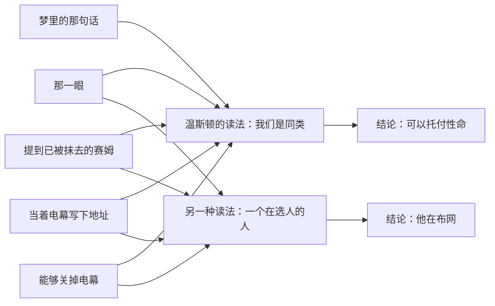

# 06｜温斯顿为什么愿意相信奥勃良？

> 本篇核心问题：所有迹象都是危险的，他为什么还是把命交给了一个只看过几眼的人？

> **剧透提示**：以下内容包含关键剧情与结局。

---

## 开篇：一个值得思考的问题

两分钟仇恨里的那一眼，温斯顿后来想了很多年。当时他确信，内党成员奥勃良和他想的是同一件事；一秒钟之后，那张脸又恢复了和所有人一样的平静，他自己也立刻开始怀疑那一眼是否真的发生过。

可是怀疑并没有阻止他。他在日记里写的每一页，最后都是写给奥勃良的；他在最害怕的时候想起的，是奥勃良；他甚至对裘莉亚说，有时真想直接走到奥勃良面前，告诉他「我是党的敌人，请帮帮我」。

这就是本篇要问的：一个活得谨慎到连背影都要管住的人，为什么会在这个问题上放弃谨慎？他看到的证据，说穿了只有一个眼神和一场梦。

## 一、从故事开始

先把证据摆出来。

第一条是那个梦。第一部里，温斯顿回忆说，大约七年前，他梦见自己穿过一间漆黑的屋子，旁边有人说了一句：我们将在没有黑暗的地方相见。话说得很轻，几乎随意，像是陈述而不是命令。他当时没怎么在意，后来才一点点觉得它重要。他记不清是先做的梦还是先见过奥勃良，也说不出什么时候认定那个声音是奥勃良的，但认定本身是存在的。他对这句话的解释是：没有黑暗的地方，是一个想象中的未来，一个人永远看不到，但可以凭预感去分享。

第二条是那一眼，也就是前面提到的两分钟仇恨里的对视。

第三条出现在第二部。有一天，温斯顿在走廊上被一个人从身后叫住，回头一看就是奥勃良。他用一种特有的、与大多数内党成员不同的庄重礼貌，说他读过温斯顿在《泰晤士报》上写的新话文章，写得很优雅；还说前不久跟一位朋友谈起，那位朋友是这方面的专家，名字一时想不起来。温斯顿的心咯噔一下：那只能是赛姆，而赛姆不仅死了，还被「消灭」了，是个不存在的人，提起他的名字是极其危险的事。奥勃良偏偏提了。温斯顿的结论是：这是一个暗号，用一点小小的思想罪，把两个人变成了同谋。随后奥勃良又说，新话词典第十版有几册内部样本，他自己有一本，温斯顿也许有兴趣，可以到他家来取。他当着电幕的面，在一个小本子上写下地址，撕下来递过去。

温斯顿认定，这就是奥勃良在说：如果你想见我，我在这里。他过后记住地址，把纸条丢进了记忆洞。

第四条，是那场登门拜访。他和裘莉亚分别赶到一栋豪华公寓，地毯深蓝，柔软如天鹅绒，空气里有好食物和好烟草的味道，电梯无声，仆人穿白色上衣。奥勃良伏在绿罩灯下的桌前，对他们的到来毫无反应，先在讲述器上口述了一条满是新话的公文，然后站起来，走到电幕前，按了一下墙上的开关，电幕里的声音戛然而止。

「你能关掉它！」温斯顿脱口而出。

「是的，」奥勃良说，「我们可以关掉。我们有这个特权。」

接下来的场面更像一场仪式。温斯顿说出准备好的那番话：我们认为有一个反对党的秘密组织，你是其中一员，我们是党的敌人，是思想罪犯，也是通奸者。奥勃良叫仆人马丁坐下，说：「马丁是自己人。」然后端出一瓶暗红色的酒，说：「这叫葡萄酒，你们在书里读到过吧，外党很少能喝到。」第一杯，他们为「我们的领袖」干杯，他指的是戈德斯坦。

然后是一连串问话，语气像背诵教义问答。你们准备好献出生命吗？准备好杀人吗？准备好用各种手段破坏，导致几百个无辜者死亡吗？准备好背叛祖国吗？如果需要，准备好往一个孩子脸上泼硫酸吗？每一个问题，温斯顿都回答：是。直到最后一个：你们准备好分开，永远不再见面吗？

「不！」裘莉亚抢着说。温斯顿却停了很久，舌头无声地动，先试着发一个字，再试着发另一个，直到说出来之前，他自己也不知道会是哪一个。最后他说：「不。」

奥勃良说：「你说出来是对的，我们需要知道一切。」

他随后说明兄弟会的规矩：你们是在黑暗里战斗，永远在黑暗里。你们不会知道它有一百个成员还是一千万个。被抓之后你们会招供，这是不可避免的。他还说了一句话：「我们是死人。」临走时，温斯顿试探着问：「在没有黑暗的地方？」奥勃良点点头，毫不惊讶：「在没有黑暗的地方。」好像他听懂了这个暗指。

最后一次，是在第三部。温斯顿被关在没有窗户、灯永远不灭的牢房里，门开了，进来的是奥勃良。温斯顿忘了电幕的存在，叫了出来：「他们把你也抓来了！」

「他们很久以前就抓住我了。」奥勃良说，语气带着温和的、近乎遗憾的讽刺。「你知道的，温斯顿。不要欺骗自己。你知道，你一直都知道。」

后来，在审讯的某个时刻，他对温斯顿说：「我告诉过你，如果我们再见面，会是在这里。」

## 二、真正的问题是什么？

把这些排在一起，问题可以问得很朴素：

> 一个人在什么情况下，会把含糊的信号当成确凿的证据？

注意，这不是在问温斯顿「蠢不蠢」。书里其实给过他清醒的瞬间：走进那间公寓、看着奥勃良朝自己走来的时候，他心里闪过一个念头：他有什么证据，说明奥勃良是个政治阴谋家？只有一个眼神，一句模棱两可的话，此外都是他自己的臆想，而那臆想的根据是一场梦。他看到了所有的漏洞，却没有退。

所以关键不是缺乏判断，而是需要。

## 三、人物为什么会这样选择？

想想温斯顿的处境。他每天改写历史，没有一个可以说真话的人，他的妻子是「人形录音机」，他的同事要么是帕森斯，要么是赛姆，而赛姆已经消失。他最担心的是自己疯了：他写过，一个疯子可能就是一个人的少数派。这时候出现一个人，只要这个人的眼神里有一点点共鸣，就足以证明他不是疯子。

所以，他对奥勃良的信任里，有一半是在信任奥勃良，另一半是在信任自己的感觉。如果奥勃良是敌人，那么他这么多年的「认出」就是一场错觉，他对自己头脑的最后一点把握也要塌掉。他不能让这件事是错的。

还有一个细节，值得停下来看：裘莉亚对这件事的反应。他把这种亲密感告诉她，她并不觉得鲁莽，她习惯凭脸判断人，觉得温斯顿凭一道眼神信任奥勃良，这很自然。她也理所当然地认为，几乎所有人都在私下痛恨党，只要觉得安全就会破坏规则。两个同样孤独的人，彼此给对方的判断盖了印。一个人的幻想被另一个人确认，就更像事实了。

下面这张图，把同一组线索的两种读法并排放出来：

同样的五个线索，既可以读成同盟的暗号，也可以读成圈套的诱饵。区别不在线索，在读它的人：一个渴望被理解的人，会选第一种；一个不需要被理解的人，才可能选第二种。

## 四、作者真正想讨论什么？

这里需要把几个层次分开。

**文本事实**：小说明确写了，奥勃良确实是思想警察一方的人，而且早就是，他亲口说「他们很久以前就抓住我了」；后文的叙述还交代，思想警察盯了温斯顿整整七年，连他日记封面上那一点白色灰尘，都被人小心地放回了原处。小说也写了，兄弟会存不存在，他拒绝回答，说温斯顿到死都不会知道答案。小说同样写了，在公寓那场戏里，奥勃良说过的几句话，实际上和温斯顿自己的话几乎重合。比如他说「我们是死人」，而这句话，早先是温斯顿在教堂钟楼里对裘莉亚说的。

**作者的观点**：奥威尔没有在小说外评论过这个人物的设计，所以不能说他本人怎样看待这个人物。

**常见的读法**是，奥勃良是党的化身，是诱捕者，是一位冷静、有教养、自以为在启蒙的审讯者；他的魅力恰恰是设计的一部分：那个摆弄眼镜的动作，在书里被写成「奇怪地文明」，像一位十八世纪的贵族递鼻烟盒。这样的人，比一个穿黑制服、挥警棍的人更容易让温斯顿放下戒备。

**其他解释**：也有读者提出，小说在这里留下了一个空白：奥勃良说的「七年」是否是真的？他是不是真的在梦里说过那句话？温斯顿在恍惚中听见一个声音说「这七年来我一直守护着你，我会拯救你，我会让你变得完美」，但书里明说，他并不确定那是不是奥勃良的声音。更值得注意的是，在公寓里，「没有黑暗的地方」这句话是温斯顿先说出口的，奥勃良只是点头，「好像他听懂了这个暗指」。「好像」是温斯顿的感觉，不是确证。也就是说，那个梦里的声音，究竟是不是奥勃良，读者没有独立的证据。

**一种可能的读法**是，这是奥威尔对孤独的一次精确描写：一个人最容易被骗的时候，不是在他愚蠢的时候，而是在他渴望理解的时候。这个圈套不需要伪造任何事实，它只需要给一个孤独的人留下一个恰好够用的缝隙。

## 五、把这个问题放回时代

奥威尔写这本书时，欧洲刚经历过各种以假组织诱捕真反对者的政治手段。比如二十年代，苏联国家安全机关设立了一个假的反苏组织「信托」，诱使流亡者与之联系，史学界对这起行动有不少记录。奥威尔是否直接参考过这类事件，目前缺乏可靠来源，不能确定；但诱捕反对者的做法并不罕见，是那个时代的人们普遍知道的事。

他本人在西班牙内战里也亲眼见过，一方如何把另一方说成是间谍和叛徒，同志之间如何互相怀疑。在那样的环境里，「你相信谁」不是一个抽象的哲学问题，而是一个能决定命运的现实问题。

## 六、作品是怎么写出来的？

这一段的写法，有一个很特别的地方：它几乎是为「读两遍」设计的。

第一遍读，读者和温斯顿一样紧张：那个眼神，那个梦，那个地址，一步步让人相信。第二遍读，就会发现破绽早就摆在那里：奥勃良当着电幕写下地址，这对一个真正的地下人员几乎是不可能的；他能随手关掉电幕，说明他有别人没有的权限；他提起赛姆，是一次测试；整场问答，他像在背教义，语气里带着微微的玩笑，「好像在说：这是不可避免的，但我们让生活重新值得过的时候，就不会做这些」，这正是温斯顿最想听到的话。

另一个手法是视角。叙述始终贴着温斯顿，读者所知道的，和他一样多。所以奥勃良的每一个动作，都先经过温斯顿的渴望，然后才到达我们。他的魅力是被温斯顿「看」出来的，包括「他绝对不会被打败」的感觉。

第三，那句「在没有黑暗的地方」，在全书里反复出现，先是梦，再是问答，最后是牢房。同一句话，意义从一个未来的希望，变成了一个永远亮着灯的囚室。这个回环，是全书最冷的一处伏笔。

## 七、如果放到今天

温斯顿的这种经验，今天并不陌生。

比如在网络上，一个陌生人的几句温和的话，一个看起来和自己有相同想法的账号，都可能让人觉得「终于有人懂我」。以情感陪伴建立信任、再诱导转账的网络诈骗，常被称为「杀猪盘」，各地警方都有过通报，受骗的人里不少是长期孤独、缺少倾诉对象的人。骗子并不需要多聪明，他只需要给对方留下一个「被理解」的位置。

再比如，推荐算法总是让我们看到与自己看法相近的内容，让人觉得「大家都这样想」，这也是同一种机制的温和版本。

这当然不是说不能信任任何人。小说留给我们的，是一个更具体的提醒：当你发现自己特别想相信某个人的时候，不妨先问一句，我是在相信证据，还是在相信自己的需要？

## 八、小结

温斯顿把命交给奥勃良，靠的是一个眼神、一场梦、一个地址、一场仪式般的问答。每一条单独看都含糊，合在一起，却被他读成了完整的证明。

这不是愚蠢，而是需要。一个长期没有同伴的人，会把一个眼神读成一个同盟，因为他必须这样读。圈套之所以成立，不是因为设圈套的人伪造了什么，而是因为他看准了对方想要什么。

## 下一篇

走完人物，接下来要走进权力的机器。温斯顿每天的工作，是把过去的报纸改成党需要的样子，改的人自己难道不知道在撒谎吗？谎言为什么可以被例行公事地生产？
