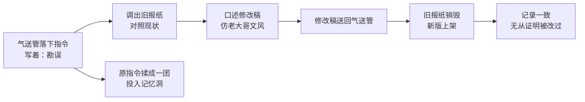

# 07｜谎言为什么可以被例行公事地生产？

> 本篇核心问题：真理部每天改写报纸，改的人自己难道不知道在撒谎吗？

> **剧透提示**：本文主要涉及第一部第四章，并略带提及后文对改写历史的回顾；不涉及结局。

---

## 开篇：一个值得思考的问题

多数人想象谎言的方式，是一个人坐在暗处，咬着牙决定欺骗别人。小说里的真理部不是这样。

那里是一间长长的、没有窗的大厅，两排隔间，纸张沙沙作响，人们对着话筒低声口述，像一间普通的文书处理中心。温斯顿每天早上上班，先叹一口气，拉过「说写机」，吹掉话筒上的灰，然后展开从气送管里掉出来的几个小纸卷。接下来的几个小时，他会把一位领袖的预言改成已经发生的事实，把一份生产预测改得和实际产量对得上，再凭空造出一个从未存在过的英雄。

这件事里最令人不安的，不是他做了什么，而是他做的时候的状态：熟练、专注，甚至有一点满足。

于是问题来了：一个明明知道自己在伪造的人，为什么能够一天一天地干下去？

## 一、从故事开始

先看那个办公隔间。墙上有三个孔：一个小气送管收发书面指令，一个大一些的收发报纸，侧墙上还有一道带铁丝网的长方形缝，是丢弃废纸用的。整栋楼里这样的缝成千上万，人们给它们起了个外号叫「记忆洞」。废纸一丢进去，就被一股热气流卷走，送进藏在大楼深处的熔炉。小说对这个外号只用了一个轻描淡写的说法：不知为什么，大家都这么叫。

当天的四张指令，都是缩写过的内部行话，大意分别是：某月某日《泰晤士报》上老大哥的演讲「报道有误」，请「勘误」；某季度的生产预测「有误印」，请核对；某部关于巧克力的说法「引用有误」，请勘误；还有一则牵涉「非人」，请彻底重写。

四件事各有各的做法。老大哥预言非洲前线会有一场欧亚国的进攻，结果敌人实际打的是印度南部，那就把演讲稿里的预言改成打在印度南部。第四季度的消费品产量预测，被后来公布的实际数字证明大错特错，那就把预测改得和实际数字相符。至于巧克力：二月份，富裕部曾作出「绝不在一九八四年削减巧克力配给」的郑重保证，而温斯顿心里清楚，配给将在本周末从三十克降到二十克。他要做的，是把原来的保证换成一句「恐怕四月里有必要削减」的预告。每改完一件，他把修改稿夹在报纸上塞回气送管，再把原来的指令揉成一团，扔进记忆洞。

最长的一件活儿，是第四张。一位叫威瑟斯的内党要员，不久前还在老大哥的每日命令里被点名表彰，如今所属机构被解散，人已成了「非人」。温斯顿不能只是把表彰删掉，那太显眼。他需要换一篇内容，完全无关的内容。念头几乎是自己跳出来的：奥吉尔维同志。

这位同志在三岁时拒绝一切玩具，只肯要鼓、冲锋枪和模型直升机；六岁加入少年侦察队；十一岁检举了谈话内容有犯罪倾向的叔叔；十七岁做了青年反性同盟的地区组织员；十九岁设计了一种手榴弹，首次试验就炸死了三十一名欧亚国俘虏；二十三岁，他在印度洋上空被敌机追击，带着重要文件，把机枪绑在身上，从直升机里跳进深水。他不喝酒，不抽烟，立誓独身，除了英社的原则没有别的话题。温斯顿甚至考虑要不要追授一枚勋章，最后放弃了，理由是勋章会带来太多没必要的交叉核对。

这位英雄从未存在过。几行铅字加两张伪造的照片，他就会存在了。

## 二、真正的问题是什么？

> 一个明知是谎言的行为，是怎么变得像日常工作一样平常的？

注意这一问和「他们是不是坏人」不太一样。小说没有给真理部写一个狞笑的恶棍，只给了一套流程。要看懂这套流程，得先看它做了哪几件事。

第一，**换名字**。所有指令都不写「伪造」，只写「勘误」「核对」「误印」「引用有误」。小说明确说了，无论书面指令还是口头交代，从来不会说或暗示要去造假，永远是「为了准确而纠正差错」。当一件事的名字从「造假」换成「勘误」，做这件事的人就不必每次都和自己的良心谈一遍。

第二，**拆开来做**。温斯顿手里这篇活儿，对面隔间的蒂洛森很可能也在做，也许有十几个人同时在写各自的版本，最后由内党里的某个人挑一版，再编辑，再启动一整套交叉引用，被选中的那一版就「进入永久记录，变成真理」。每个人只做一个环节，没有人是撒谎的责任人。

第三，**销毁证据**。原指令进记忆洞，旧报纸被收回，新报纸替换上架，同一天的《泰晤士报》哪怕已经被改了十几次，架上仍然只有一份，仍然印着原来的日期。办公室里最大的一个部门，干的就是满世界收缴被取代的版本。所以改完之后，谎言和真相之间已经没有可以并排放一起看的东西。

第四，也是最诡异的一层：**连被改的对象本身，也未必有真话可对照**。温斯顿在调整产量数字的时候冒出一个念头：这甚至算不上伪造，只是用一堆胡话换另一堆胡话。比如那份靴子的预测是一亿四千五百万双，实际产量被报为六千二百万，他改成五千七百万，好让「超额完成」的惯例说法成立。可无论哪个数字，离真相都一样远，很可能一双靴子也没生产过，甚至没有人知道生产了多少，也没有人在乎。统计数字原样是幻想，纠正后还是幻想。

## 三、人物为什么会这样选择？

这一章的人物，以温斯顿为主。他知道，而且他明确地知道。他私下对这一套清楚得很，所以才会买日记。但小说在这一章里让他做了一件令人难堪的事：**他把活儿干得很漂亮**。

文本里有两句话几乎直接说破了：温斯顿「生活中最大的乐趣就在于工作」；那些最繁难的活儿，「可以像沉入数学题的深处一样沉进去」，手头除了对英社原则的理解，和对党想说什么的估计，什么依据也没有。他对此很在行。

用一张图看他当天的工作流，会更清楚地看到这套流程把「决定撒谎」这一步藏到了哪里：

这条线上，没有任何一个节点叫「决定欺骗」。每一步都是一个小动作：读、对、写、送、扔。温斯顿站在中间，他的才能（模仿文风，判断党想要什么）恰好被用在这条线的最顺手的位置。

那么他为什么不停下来？至少文本给了三条线索。其一，他没有可以停下来的地方：不干这份活，就是被注意。其二，他想要的是一份有难度的、能让人暂时忘记自己的工作，这是一个人在高压下很自然的需要。其三，也许是最关键的一条，他在这一章里并没有把自己和这个系统截然分开。写奥吉尔维的时候，他一边觉得荒唐，一边想：奥吉尔维一小时前还不存在，现在已经是事实了；奇怪的是，人可以造出死人，却造不出活人。这句感慨里有惊叹，有一点手艺人的得意，也隐约有一点恐惧。

至于隔壁的人，小说有意不写他们的内心。办公室里那个整天从报刊里删除蒸发者名字的小个子女人，丈夫几年前就蒸发了；那个把「不合时宜的诗」改成「定本」的安普尔福思，对韵脚有惊人的天赋。**他们知不知道，小说没有交代，也许这正是要点**：流程的运转并不依赖于答案。

## 四、作者真正想讨论什么？

**文本事实**：真理部的修改不是偶尔为之，而是全天候的、制度化的，范围涵盖报纸、书籍、期刊、传单、影片、录音、漫画、照片，凡是可能有政治意味的一切文字和影像。工作用语掩盖了作伪的性质。证据被系统地销毁。这些都是第四章明写的。

**作者观点**：奥威尔在随笔《政治与英语》里写过，政治语言是为了让谎言听起来像真话。这一章里的「勘误」「核对」，大概是这个想法在小说里最冷静的示范。

**常见的读法**：不少评论者把这一章读作对极权官僚制的刻画：恶不一定表现为狂热，也可以表现为照章办事。有读者因此联想到汉娜·阿伦特在一九六三年的《艾希曼在耶路撒冷》里提出的「平庸之恶」，指的是一个不思考自己行为后果、只把自己当作机器零件的人。不过这个联想是后来的读者做的，阿伦特谈的是真实的战犯审判，两者不能简单划等号。

**另一种可能的读法**：一种可能的读法是，这一章真正令人不安的地方是它**没有要求任何人相信**。奥吉尔维同志不需要温斯顿相信，也不需要读者相信，只需要在记录里有一个位置，「和查理曼、尤利乌斯·恺撒存在的方式相同，凭借的证据也相同」。换句话说，谎言的目标不是说服，而是**取代记录**。至于人心里怎么想，是另一套机制的任务。

## 五、把这个问题放回时代

奥威尔写这本书的时候，有几样经验近在眼前。他在一九四一至一九四三年间在英国广播公司工作，亲身经历战时的新闻筛选与宣传措辞；在西班牙内战期间和之后，他看到过同一场战斗在不同报纸上变成完全不同的故事。同一时期，苏联的出版物对被清洗者的处理，是重印书籍和图片、抹去名字，这是历史上有据可查的做法。

有两点需要说明：第一，真理部具体对应哪一个机构，小说外没有可靠的一一对应，一些常见说法是读者和传记作者的推测，奥威尔本人并没有逐条确认。第二，小说的力度不在「影射哪里」，而在于它把一件历史上通常由多个机构、多种手段分头完成的事，浓缩成一间办公室，让读者能看清一个人是怎么站进去的。

## 六、作品是怎么写出来的？

这一章的写法有三个值得看的地方。

**用公文写罪行。** 开头那几行缩写指令，读起来像工单。奥威尔不加评论，让读者自己去感受文字的冷与平。同一个事实，若是用愤怒的语气写出来，读者会同情温斯顿；用工单写出来，读者会先感到自己也可能做这份工作。

**用清单制造节奏。** 四张指令、四种做法，一件接一件，难度从低到高，最难的留在最后，像一个人摆好午饭先吃简单的菜。这个顺序本身就在描写温斯顿的心态：他是在享受工作的。

**用一个荒诞的小人物收尾。** 奥吉尔维的生平写得又长又细，每一项都是党想要的美德叠加，连他放弃勋章的理由都是行政成本。这个人物像是由一张检查清单拼成的。读者读到他从直升机上跳下去时，会发现自己在笑，随即又意识到：这样的人，真的会在某一天被端上广播。

## 七、如果放到今天

今天没有记忆洞，但有几件事可以拿来对照，也能看到两种相反的方向。

一是**可留痕的修改**。正规的新闻机构在改动已发布的报道时，通常要附上更正说明；维基百科每个词条的历史版本都能翻到，互联网档案馆也在长期保存网页的旧版本。这些制度的共同点，是让「改过」本身成为可被查询的事实。它们恰好是真理部流程的反面：真理部要消灭的是改动的痕迹。

二是**悄悄的改动**。服务条款、产品说明、公开数据在没有标注的情况下被更新，原来的版本再也找不到，这样的事在现实中并不罕见。多数情况下它不是什么大阴谋，只是一次例行更新。但读过这一章的人会留意：「没人注意到」和「没留下记录」，是两件不同的事。

三是**数字的自我服务**。任何要求逐级上报指标的组织里，都会有人把数字「调整」得更好看。经济学里有一条常被引用的说法，大意是：一个指标一旦变成考核目标，它就不再是好指标。它不需要谁决心造假，只需要每个人都按要求把表填完。

## 八、小结

这一章回答的问题是：改的人知道不知道？答案是，知道也无妨。

一套足够好的流程，不需要执行者相信谎言，只需要他不必为谎言负责：名字被换了，工作被拆开了，证据被烧掉了，剩下的只是一份做得好不好的活儿。谎言可怕之处，往往不在于有人撒了它，而在于撒谎已经成了一种不需要决心的工作。

## 下一篇

温斯顿在记忆洞里销毁的东西，远不只是一份指令。十来年前，他唯一一次真正攥在手里的、能证明党在撒谎的证据，也被他这样丢进了火里。控制了过去，究竟意味着什么？
