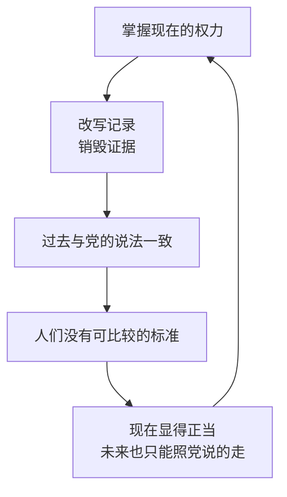

# 08｜为什么控制了过去，就能控制未来？

> 本篇核心问题：党的第二句口号为什么说：谁控制过去，谁就控制未来？

> **剧透提示**：本文涉及第一部第三章的一段思考、第七至八章，以及第二部中温斯顿向裘莉亚讲述旧事的一段；不涉及结局。

---

## 开篇：一个值得思考的问题

大洋国的党有三句广为人知的口号：战争即和平，自由即奴役，无知即力量。它们刻在真理部的白色外墙上，隔着几条街都看得见。

还有第二类口号，不那么响亮，是温斯顿在做早操时想起来的：

> 谁控制过去，谁就控制未来；谁控制现在，谁就控制过去。

第一次读到时，它很像一句绕口令。后半句更怪：「现在」怎么能控制「过去」？过去不是已经发生的事吗？

这一篇想问的是：这句话到底在说什么，为什么说它抓住的是极权统治最深的一条逻辑，而不只是一句修辞？

## 一、从故事开始

先听温斯顿自己怎么想。在第三章，他一边做早操一边琢磨：党说大洋国从来没有和欧亚国结过盟，可他自己清楚，四年前两国还是盟友。「但这个知识存在于哪里？只存在于他自己的意识里，而这意识很快就会被消灭。」如果所有人都接受党强加的谎言，所有记录都讲同一个故事，那么谎言就进入历史，变成真理。

这种恐惧，他认为比酷刑和死亡更可怕：党可以伸手进过去，对某件事说「它从未发生」。

然后是第七章里那张照片。它是整本书里唯一一次，温斯顿手里真正握过「证据」。

事情发生在一九七三年前后。那时他在一叠刚从气送管掉出来的文件里，发现一张被人忘在里面的半页旧报纸，大概是十年前的《泰晤士报》上半截，所以日期还在。上面有一张某次党的集会的照片，纽约的代表们站成一排，正中间是三个人：琼斯、阿伦森、卢瑟福。这三位是革命元老，早年被捕，被迫当庭认罪，招认自己在某个日子里去了欧亚国的领土，和敌方参谋部勾结。可是这张照片说明，同一天，他们在纽约。认罪全是编的。

温斯顿的反应是：先用另一张纸盖住它。幸好展开的时候，这一面对电幕来说恰好是颠倒的。他强迫自己端坐了大约十分钟，没有碰它，之后才连同其他废纸一起扔进记忆洞。「再过一分钟，它大概就已经变成灰了。」

十一年后，他回头想这件事，有两个念头。一个是：如果是现在，他大概会把照片留下来。另一个更令人沮丧：就算从灰里把它救回来，它也未必还是证据了。因为在他发现照片的时候，大洋国的敌人已经从欧亚国换成了东亚国，那三个人的认罪早该被重写成另一套说法，重写了几遍，已无从知道。

## 二、真正的问题是什么？

> 一个人为什么需要「过去」？他拿它来做什么？

这里不妨把话说得直白一点：过去，是用来比较的。

你觉得今天的日子好不好，很大程度上是拿昨天和前年比出来的。你觉得一个人是不是在说谎，是拿他以前说过的话比出来的。你觉得一个政府的承诺可不可信，是拿它上次的承诺有没有兑现比出来的。**没有过去，现在就成了一团没有刻度的东西，好坏都无从说起。**

这就是口号前半句的意思。谁掌握了人们对过去的认识，谁就掌握了衡量现在的尺子，进而也就掌握了人们对未来的期待。党要让人们相信「今天比从前好」「党的预言从来没有错」，只需要保证没有任何东西可以拿来比。

后半句则回答「怎么做到」。谁手里有现在的权力，谁就能决定哪些记录保留，哪些记忆被允许说出口。权力在现在，过去因此是可改的。**权力把现在写进过去，过去反过来为现在背书。**

这是一个闭环。小说没有说它从哪个点开始，也没有必要说。

## 三、人物为什么会这样选择？

温斯顿接下来的两个动作，一个是把照片丢掉，一个是去酒馆找老人。两者看起来相反，其实出于同一个处境。

他丢掉照片，是因为他怕。那十分钟里他最担心的，是电幕灵敏到连心跳都能听见：脸可以控制，呼吸可以控制，**心跳控制不了**。恐惧让他把唯一的证据交给了火。十一年后他又悔，但那种悔里有一个很细的发现：「他手里曾握过它三十秒，这件事本身，好像仍然让他觉得有点不同。」党对过去的控制，是不是因此稍微松了一点？毕竟一件如今不存在的证据，「曾经存在过」。这是一个微弱的、几乎只能靠信念支撑的安慰。

第八章里，他走进一家无产者的酒馆，是因为同一个念头：证据没了，那就找活人。老人估计至少八十岁了，革命发生时已是中年。党员里几乎没有人还保留着革命前形成的想法，能给他一个诚实说法的，只能是这样一个无产者。

他把想问的都摆了出来：课本说从前人们吃不饱、孩子十二个小时做工、资本家戴大礼帽、住大宅子，是真的吗？老人听到「大礼帽」就来了精神：是啊，好多年没见过了，最后一次戴是在他嫂子的葬礼上，还是租来的。听到「走狗」又想起海德公园里一个演说家喊的「资产阶级的走狗」。温斯顿问他从前是否要见了资本家脱帽，他说：是，他们喜欢人碰碰帽子，我不赞成，但也常做。再问有没有被推到阴沟里，他讲了一个赛艇之夜里碰上一个穿礼服戴大礼帽的年轻人、被一把推得差点撞上公共汽车的故事，讲得活灵活现。

温斯顿越听越无力。老人的记忆「只是一堆杂物」：一场和工友的争吵、一次找自行车打气筒、一个早已去世的妹妹脸上的神情。**所有真正相关的事实，都在他的视野之外。**

回到我们的问题：这两件事说明了什么？说明过去的失效不是一次性的，而是两层。书面层的证据被销毁，活人记忆这层又无法替代，因为人的记忆从来是碎片，装不下制度性的判断。温斯顿想要的是一把尺子，他得到的是一堆细节。

第二部里还有一个旁证。他后来把这张照片的故事讲给裘莉亚听。她先问：「他们是你的朋友吗？」然后说：「那有什么好担心的？人不是随时都在被杀吗？」温斯顿努力解释，说过去从昨天起就被实际取消了，每一份记录都被销毁或伪造，每一本书都被重写，每一个日期都被改动，「历史已经停止了。除了一个没有尽头的现在，什么也不存在，而在这个现在里，党永远是对的」。他也知道自己唯一的证据，只在自己脑子里。裘莉亚对此无动于衷，连敌人从东亚国换成欧亚国这件事，她也记得含含糊糊：「我以为我们一直在跟欧亚国打仗。」这并不是说她愚钝，她对战争本来就不相信。只是，**一个对过去无所谓的人，对党来说是最省事的人**，因为她连尺子丢了都不觉得疼。

## 四、作者真正想讨论什么？

**文本事实**：小说在这里没有给出一个结论，而是反复让温斯顿陷入同一种困惑。他自己的概括是：走出酒馆之后，他想到二十年内，「革命前是否比现在好」这个简单的大问题将再也无法回答。其实现在已经无法回答，因为幸存者「没有能力把一个时代和另一个时代作比较」。他们像蚂蚁，能看见小东西，看不见大的。当记忆失效、记录被篡改，党声称改善了人类生活的说法就**必须被接受**，因为「已经没有、而且永远不会再有任何标准可以拿来检验」。

**作者没有直接说的**：值得注意的是，奥威尔让温斯顿保留了一个很有分寸的怀疑：党的历史书「也许在某种程度上仍是真的，甚至可能完全是真的」。书里写到课本里关于资本家和大礼帽的那些话，他连「是否真有过大礼帽」都不敢肯定。问题不在于课本一定是假的，而在于**没有任何办法证明它是真还是假**。

**常见的读法**：这一部分常被读作对历史篡改的批判，也被拿来与「集体记忆」的研究放在一起读：法国社会学家哈布瓦赫在二十世纪二十年代就提出，记忆并不只是个人头脑里的东西，它要靠社会共同的框架来维持。当框架被拿走，个人的记忆就会变得零碎，难以成立。

**一种可能的读法**：酒馆一节也可以读作奥威尔对另一种浪漫想象的提醒。在不少左翼叙述里，「普通人的记忆」被当成对抗官方叙述的最后依靠；奥威尔让这位老人的记忆既不可靠也不重要，好像是在说：**个人经验不能替代制度性的记录**。这是读者的推测，小说里没有哪句话这样说。

## 五、把这个问题放回时代

小说写于二十世纪四十年代后期，那时欧洲刚刚经历一场宣传战。照片的篡改在当时已有具体先例：苏联出版物里，被清洗的人物被从历史照片和书籍中抹去，其中最常被引用的例子是列宁演讲照片中的托洛茨基。这类修版有大量史料可查。奥威尔对这类事情很敏感，他的许多文章都在谈论宣传与事实的关系。

需要说明的是，琼斯、阿伦森、卢瑟福是虚构人物。读者常把他们联想到三十年代莫斯科审判里的老布尔什维克，但奥威尔没有明确这样指认。能确认的是这一点：他看到了一种可能，**只要记录和记忆都在同一只手里，一段历史就可以被改得毫无痕迹**。

## 六、作品是怎么写出来的？

这几章有三处写法，值得拿出来看。

**往回套的叙述。** 照片的故事是在一九八四年的现在讲一九七三年的事，而一九七三年的事里又包含了更早的审判、认罪、咖啡馆里的见面。每一层都靠温斯顿「大概记得」「应该是」来衔接。叙述的结构本身，就像记忆在一层层变模糊，读者很快也不确定哪个年份是对的。

**一个间谍片式的细节。** 照片刚展开时，碰巧「对电幕来说是上下颠倒的」，他再赶紧盖上一张纸。这个细节让读者的心跳也跟着温斯顿一起加速，同时也提醒：在这个世界里，**拥有真相是一项需要体力的工作**。

**一场喜剧性的落空。** 酒馆那一节几乎是喜剧。老人和酒保为了「品脱」吵起来，酒保说「你年轻的时候我们都还住在树上」；温斯顿问「是哪场战争」，老人说「都是战争」。让一场关乎历史的追问落在啤酒价格和膀胱上，让读者在发笑中感到失重，这是奥威尔处理这个主题的聪明之处：他没有把失忆写成悲壮，而是写成了寻常。

## 七、如果放到今天

今天的情形和小说不完全一样：不是没有记录，而是记录太多，也太容易被改。

第一，**照片不再自动是证据**。图像编辑和生成技术的普及，让「有图有真相」这句话越来越难成立。业界已经出现了给图片附带来源和修改记录的技术标准（例如内容来源与真实性联盟，简称 C2PA，推动的做法），它的思路正是让一张图保留自己的「来历」。

第二，**记录会无声消失**。皮尤研究中心在二〇二四年发表过一项研究，发现二〇一三年还能打开的网页，十年后约有百分之三十八已无法访问。没有人下令删除，它们只是没人维护了。过去不一定要被销毁，被遗忘就够了。

第三，**家庭里的「酒馆老人」**。很多人都有过这样的经验：想问问长辈从前的事，却发现问不出来，因为问题问得太大。温斯顿问「从前是好还是坏」，老人只能回答啤酒。口述史的工作者通常的做法恰好相反：问具体的事，哪一年，在哪里，谁在场。这也许是酒馆一节留给今天读者的一个很实际的提醒：想留住过去，要趁人还记得时把细节记下来。

## 八、小结

这一篇只想讲清一件事：党的这句口号，说的是**比较的权力**。

控制了过去，就是拿走了所有可以拿来比较的东西，于是现在无从评价，未来无从期待。温斯顿丢掉的那张照片，和酒馆里问不出来的那些话，一件是证据的消失，一件是记忆的无力，合起来，就是一个人失去尺子的过程。

## 下一篇

不只是记录和记忆，党还想动手改造语言本身。如果有一种语言，词越来越少，少到某些念头根本没有词可以说，人还能想出反抗吗？
