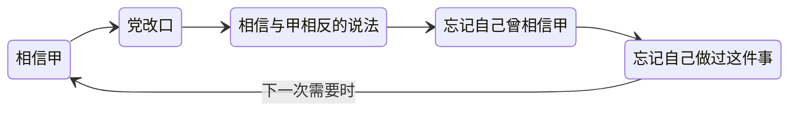

# 10｜一个人怎么能同时相信两个相反的事实？

> 本篇核心问题：双重思想是怎么回事？它是自我欺骗，还是一种能力？

> **剧透提示**：以下内容包含关键剧情与结局。本文涉及第一部第三章与第五章、第二部中戈德斯坦的书、第三部帕森斯入狱的情节，以及书末附录。

---

## 开篇：一个值得思考的问题

人们说起「口是心非」，通常是指一个人嘴上说一套，心里想一套，自己是知道的。双重思想不是这个。

小说里最难懂的一个词，是在第三章里随着温斯顿做早操的动作冒出来的。他想起党的口号，想起「现实控制」，想起它在新话里的名字：双重思想。然后他的思路沉进一个迷宫，并且给出一份差不多是定义的清单：知道，又不知道；有意识地说着精心编造的谎，却完全相信自己诚实；同时持有两种互相抵消的意见，明知它们矛盾，却两个都信；用逻辑去对抗逻辑；一边否认道德，一边以道德自居；该忘记的就忘记，需要时再拉回记忆，用完再忘；**而最重要的是，把同样的过程用在这个过程本身上**。

那是最精微的地方：有意识地制造无意识，然后再对自己刚刚做过的催眠行为失去意识。「甚至要理解『双重思想』这个词，也得用上双重思想。」

这一篇想问的是：这到底是一种什么东西。糊涂？自欺？还是某种需要练习的本事？

## 一、从故事开始

先看党自己怎么定义。在第二部里，温斯顿读到戈德斯坦的书，里面有一整段专门谈这件事。书里说，双重思想就是「同时在头脑里持有两种互相矛盾的信念，并且同时接受它们的能力」。党的知识分子知道自己的记忆该往哪个方向改，所以知道自己在对现实做手脚；但靠着双重思想，他又让自己相信现实没有受到侵犯。

接下来有一句关键的话：这个过程必须是有意识的，否则做不精确；但它也必须是无意识的，否则会带来虚假感，进而产生罪恶感。

这就是所谓的「循环」：要改写记忆，就得记得往哪改；改完之后，要忘记自己改过；而「忘记自己改过」这个动作本身，也得被忘记。书里的说法是「谎言总是比真相快一步」。

书里还提到一个词：黑白（blackwhite）。它有两层互相矛盾的意思。用在对手身上，指无耻地硬说黑是白，与明摆着的事实相反；用在党员身上，指党的纪律要求时，忠诚地愿意说黑是白。但它还有第三层：**真心相信黑是白，更进一步，知道黑是白，并且忘记自己曾经相信过相反的东西。**

## 二、真正的问题是什么？

> 同时相信两个相反的东西，是一个人犯的错，还是一个人学会的本事？

小说的回答很明确：是本事。而且它不是天生的，是训练出来的。

戈德斯坦的书讲得很具体：党员从小接受一套精神训练，围绕三个新话词展开：「罪止」（crimestop）、黑白、双重思想。最基础的一层是罪止，指像出于本能一样，在任何危险念头的门槛前停住，包括不去领会类比，不去发现逻辑错误，不去理解与英社相悖的最简单的论点，对任何可能通向异端的思路感到厌烦或抵触。书里把它概括成一个词：**护身的愚蠢**。但光是愚蠢不够，往上一层是黑白，要求对事实有「每时每刻、不知疲倦的灵活」。把这些统摄起来的，是双重思想。

下面用一张图表示它的循环结构：

这条线上没有哪一步是「糊涂」。它需要的是精确，所以才要有意识；又需要不被良心打扰，所以又必须无意识。

### 用三句口号试一试

三句口号可以当作三个练习题，看看它们在一个党员的头脑里分别怎么放。

**战争即和平。** 一个党员每天听着火箭弹的爆炸声，参加仇恨活动，同时在「和平部」的招牌下上班。这两个词不需要被调和，只需要各自在需要的时候被拉出来用。他不去问它们怎么会是一回事，这一问，就走到了罪止要求他停下的门槛。

**无知即力量。** 这是戈德斯坦的书里，谈双重思想的那一章的标题。就个人而言，它的意思是：知道自己不该知道什么，是一种本事。「护身的愚蠢」不是真的蠢，是一种会自动绕开危险问题的灵敏。

**自由即奴役。** 这句最费解，也最能说明双重思想的位置。赛姆说过，等「自由」的概念被废除，这样的口号就不会存在了，因为矛盾也不存在了。换句话说，眼下的党员之所以需要双重思想，是因为「自由」这个词还留在他们的脑子里，他们必须一边保留它，一边让它不起作用。

这三个例子有一个共同点：**党员并没有被要求找到一个让它们讲得通的解释，只被要求说出来、感觉到、不追问。**

## 三、人物为什么会这样选择？

要看这种本事在人身上是什么样子，不妨看三类人。

**帕森斯：做得最彻底的普通党员。** 他是温斯顿的邻居，三十五岁，一个长大了的少年侦察队员，浑身出汗，一脸蛙相，对党充满孩子气的热情。食堂里，他兴致勃勃地讲女儿怎么盯上一个穿奇怪鞋子的人并把他交给巡逻队。同一顿午饭里，电幕说有人游行感谢老大哥把巧克力配给「提高」到二十克，而温斯顿记得，前一天才宣布过配给要降到二十克。他在想：他们能接受吗？结论是：能。帕森斯接受得轻松，用温斯顿的话说，是「带着动物般的愚蠢」。

后来，帕森斯自己进了牢房。他走进来，嘴里念叨着「思想罪」，几乎要哭出来，语气里既承认了自己有罪，又带着对这个词竟然落到自己头上的难以置信的惊恐。他说自己是睡梦中说了「打倒老大哥」，被女儿隔着钥匙孔听见，告发了。「当然我有罪！你不会以为党会逮捕一个无辜的人吧？」他还说，到了审判时他要对他们说：「谢谢你们在为时未晚之前救了我。」他为女儿感到骄傲：这证明他把她教育得正确。

帕森斯是这套东西最彻底的产品：他能相信党一贯正确，**并且在被党毁掉的时候仍然这样相信**。

**赛姆：看懂了，照样吞下去。** 同桌的赛姆呢？温斯顿想：赛姆「也吞下去了，是以一种更复杂的方式，其中包含着双重思想」。这是更令人不安的一类：他并不蠢，他明白那是怎么回事，却也有办法让自己不去在意。

**党的核心层：最精的练习者。** 戈德斯坦的书里有一句：双重思想最精妙的实践者，是发明它的人，他们知道这是一整套精神上的欺骗系统。书里的总结是：「理解得越多，迷惑就越深；越聪明，越不清醒。」

温斯顿则是这套体系里的一个失败品。一种可能的读法是：他能把双重思想描述得这么准，恰好说明他没有学会，他还看得见那个本该被遗忘的东西，还记得，所以才痛苦。

## 四、作者真正想讨论什么？

**文本事实**：小说里，双重思想被写成一种有自我指涉的技术（它要求连使用这个词都要用到它），并且是一种被训练的、对不同人有不同程度的能力。它的功能，书里写得很清楚：让党既能坚持自己永远正确，又能随时改变说法。

**作者没有直接说的**：附录里有一个旁证，说明双重思想是新话的过渡工具。一九八四年，旧语还在通行，说话时可能想起词的原义，但一个受过良好双重思想训练的人，不难避免这一点；再过两三代，这种可能就消失了。赛姆也说过，等自由的概念被废除，就不会再有「自由即奴役」这样的口号。换句话说，**双重思想是语言还没完工之前的临时脚手架**。

**常见的读法**：不少读者把它读作自我欺骗的极端形态，也有人把它与认知失调联系起来。后者是心理学家费斯廷格在一九五七年提出的理论：当一个人同时持有互相冲突的认知，或者做了与自己信念相反的事，会产生一种不适，从而倾向于通过改变信念、改变行为或者给自己找理由来化解。一个常被引用的实验（费斯廷格与卡尔史密斯，一九五九年）是：受试者做完一项枯燥的任务后，被请去对下一个人说它很有趣，付他一美元的人，比付他二十美元的人，后来更倾向于说自己真觉得它有趣。一般的解释是，一美元不足以为这句谎话提供外部理由，只好改变自己的看法。

**三者的异同**，是这一篇想讲清楚的核心，一种可能的读法是：

- **和自我欺骗**：相同的地方是欺骗者和被骗者是同一个人。不同的地方在于，自我欺骗通常是个人为了心里好受而做的，往往是被动的、不自觉的；双重思想则是被要求的、被训练的，而且是**选择性开关**：要用时用，不用时放下。
- **和认知失调**：认知失调是对一种自发倾向的描述，人们通常通过**去掉矛盾的一边**来恢复平静；双重思想则要求**两边都留着**，同时又不觉得不适。费斯廷格的理论说明人为什么不能忍受矛盾，双重思想则是一套教人忍受矛盾的纪律。奥威尔写书比费斯廷格早八年，我们没有证据说二者之间有影响关系。
- **和虚伪**：虚伪者知道自己在装。戈德斯坦的书明确说，那些矛盾「不是偶然的，也不是普通的虚伪的结果，而是有意的双重思想练习」。

**另一种读法**：也有读者认为，奥威尔写的是一种夸张的极限，现实中的人做不到这么彻底；真实的人更接近「分隔」，把相冲突的想法放在不同的场合，使它们不至于碰面。如果这样读，小说里那份清单不是心理学描述，而是政治讽刺。

## 五、把这个问题放回时代

奥威尔在一九四五年写过一篇《民族主义札记》，谈的是一种他称为「对现实漠不关心」的心理：为了自己所认同的阵营，人们可以对明摆着的事实视而不见。这篇文章常被看作双重思想的先声。小说把这种倾向推到极致，让它从一种个人毛病变成制度所需要的技术。

戈德斯坦的书里有一句话，说明党为什么需要它：统治的秘诀，是把对自己永远正确的信念，同「从过去的错误中学习」的能力结合起来。一个只会坚持的统治者会僵化，一个只会改正的统治者会失去威信，双重思想让两者并存。

## 六、作品是怎么写出来的？

这个概念的写法有两处值得看。

**先给体验，再给定义。** 第三章里，双重思想不是被解释的，而是被念出来的：一个接一个并列的短句，每个都是「知道又不知道」，句子越来越长，到最后一句话把自己绕了进去。读者读完的感觉，就是有点晕。戈德斯坦的书里是同样的内容，但换了冷静的文风。同一个概念，一次用文体，一次用论述。

**让定义吞掉自己。** 「甚至理解这个词也要用到双重思想」，这句话让读者无法把它当作外部对象来观察。你要明白它，就得进入它。这是奥威尔在小说里最聪明的一个陷阱。

## 七、如果放到今天

首先要克制：不能把所有口是心非都叫作双重思想。大部分人的言行不一，只是普通的虚伪、懒惰或者妥协，他们心里是清楚的。

有一个可以核对的案例，比较接近。一九八六年挑战者号航天飞机失事后，物理学家费曼在调查委员会的附录里写到，管理层估计的发射失败概率大约是十万分之一，而一线工程师的估计大约是百分之一。同一个机构里，两个相差千倍的数字同时存在，各自被信奉，互不干扰。这不是谁在撒谎，更像是**组织里的人各自选择了不去对齐两套说法**。

另一个更日常的例子是，人们常在一个场合批评某种行为，在另一个场合因为自己的处境而做同样的事，却并不觉得矛盾。这是心理学中「分隔」或「动机性推理」的范畴，不是双重思想，但它们是同一条谱系上的轻量版本。

看清这条界线，有一个实际好处：**一旦你能清楚地说出自己两个想法冲突在哪里，你就还没有被它支配**。温斯顿的痛苦，在这个意义上是一个证据。

## 八、小结

双重思想不是糊涂，不是撒谎，也不是单纯的自欺。它是一种被要求、被训练、有自我指涉的精神技术，它需要的恰恰是清醒：清醒到知道往哪改，又能把这个清醒也抹掉。

这也是它最令人不安的地方：**它把良心的功能拿走了，却没有让人变得不聪明。**

## 下一篇

一个人的头脑可以被训练，那么情绪呢？两分钟仇恨、仇恨周、胜利杜松子酒……情绪为什么也要被定期定量供应？
