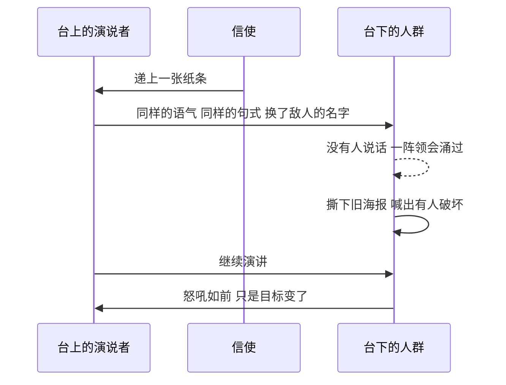

# 11｜为什么情绪也要被定期定量供应？

> 本篇核心问题：两分钟仇恨、仇恨周、胜利杜松子酒……情绪为什么也要配给？

> **剧透提示**：本文涉及第一部第一章的两分钟仇恨，第二部的仇恨周片段，第二部中裘莉亚谈禁欲与狂热的一段话，并略涉及开头那位黑发姑娘后来的身份；不涉及结局。

---

## 开篇：一个值得思考的问题

真理部的记录司，每天上午十一点前后，职员们会把椅子从隔间里拖出来，在大厅中央围着那块大电幕摆好。没有人通知，大家都知道要做什么：两分钟仇恨开始了。

这件事排进日程的方式，和开会没有区别。有时间，有地点，有固定的主角，连节目内容也只是「每天略有不同」。它是一种被安排好的情绪，像配给的肥皂和香烟一样，到点就发。

一个想控制人的政权，第一反应通常是禁止：禁止说什么，禁止做什么。但在这里，它做了一件更奇怪的事：**它主动给人分发愤怒。** 这一篇想问的就是：为什么？管住一个人的行为不够吗？为什么还要管他的感觉？

## 一、从故事开始

先看那个上午。

一阵像没上油的机器一样刺耳的噪音炸开，大电幕上出现了伊曼努尔·戈德斯坦的脸，「人民公敌」。他是曾经的党的领袖之一，后来叛变，逃亡，从此成了一切罪恶的源头。那是一张瘦长的脸，一头蓬乱的白发，下巴上有一撮山羊胡，鼻尖上架着眼镜，看上去聪明，又透着一种可鄙的老年傻气。他一边攻击党，一边要求言论自由、出版自由、集会自由、思想自由，背后是一队队欧亚国士兵面无表情地行军，军靴的节奏垫在他的声音下面。

不到三十秒，屋里一半的人已经忍不住叫喊。第二分钟，仇恨升到了狂热：人们跳起来，吼叫，试图盖过那个羊叫一样的声音。温斯顿身后的黑发姑娘喊着「猪猡」，抄起一本厚重的新话词典砸向屏幕，砸中了戈德斯坦的鼻子，弹了回来。就在高潮的一刻，戈德斯坦的声音真的变成了羊叫，脸也变成一张羊脸，羊脸又化成一名向前冲锋的欧亚国士兵，端着冲锋枪，似乎要从屏幕里跳出来；前排有人下意识往后缩。然后，在大家如释重负的叹息中，那个敌对的形象融进了老大哥的脸，黑发、黑胡子，沉静而有力。接着是三句口号。人群随即爆发出缓慢而有节奏的低吟：「B-B！……B-B！」

温斯顿也在其中。他对这个制度的不满，他对老大哥的厌恶，一概没有帮上忙。小说里说，最可怕的不是被迫演戏，而是**无法不加入**。不出三十秒，任何伪装都成了多余；一股由恐惧和报复欲组成的狂喜，像电流一样穿过所有人，让你不由自主地变成一个龇牙咧嘴的狂人。

第二个场景，在仇恨周的第六天。

经过六天的游行、演说、标语、电影、蜡像、鼓号、坦克和飞机，人们对欧亚国的仇恨已经沸腾到这种程度：如果当时能抓到那两千名预定在最后一天公开绞死的欧亚国战犯，群众会当场把他们撕碎。就在这时，宣布了：大洋国其实并没有和欧亚国打仗，大洋国是在和东亚国打仗，欧亚国是盟友。

当时温斯顿就站在伦敦中心广场的人群里。台上一位内党演说者，一个瘦小、长臂、满头谢顶的人，一手攥着话筒，一手在空中抓挠，正在历数敌人的暴行。讲到二十分钟左右，有人递上一张纸条。他边念边继续讲，声音、神态、内容都没变，但名字换了。**一个字也没有人说，一阵领会就从人群中涌过。** 然后骚动起来：广场上的海报和标语全错了，一半的横幅上画着错误的脸，这是破坏，是戈德斯坦的特务干的。海报被撕下，横幅被踩碎，少年侦察队员爬上屋顶剪断彩带。不到两三分钟，一切结束。演说者没有停，只是又讲了一分钟，群众的怒吼重新爆发，只是目标换了。

温斯顿事后回想，最让他印象深刻的是：演说者是在一句话的中间换的，不但没有停顿，连句法都没断。

## 二、真正的问题是什么？

> 管住行为已经很难了，为什么还要去管情绪？

先分清两件事。**行为管理**，管的是你做什么：电幕盯着你的脸，思想警察盯着你的言论，邻居的孩子盯着你睡觉时说了什么。**情绪管理**，管的是你在什么时候，对什么，感到什么。

小说里没有把二者混为一谈。戈德斯坦的书对党员的要求写得很直接：他「不应有私人情感，也不应有热情的间歇」，要生活在对国外敌人和国内叛徒的持续狂热的仇恨里，为胜利而欢呼，在党的权力和智慧面前自我卑贱。书里还说，枯燥而不满足的生活所产生的不满，被「有意识地转向外部并消散」，手段之一就是两分钟仇恨。

这里有一个很实在的逻辑：不满是一种压力。行为管理可以挡住它的出口，却挡不住压力本身。一个靠恐惧运转的政权，如果让压力无处可去，迟早会在某个缝里爆出来。所以它做了更聪明的事：**自己造一个出口，并且规定出口通向哪里。**

不过，小说里的仇恨并不只是「泄压阀」。心理学里关于「宣泄」的流行想法，认为发泄愤怒能让人平静；但后来的研究，如布什曼在二〇〇二年发表的实验，发现让人通过击打沙袋来「发泄」，反而会让随后的攻击性变强。奥威尔当然不是在引用这类研究，不过小说里的两分钟仇恨更接近后者：它不是把情绪放掉，而是把情绪**充电**，再导向需要的地方。裘莉亚后来有一句话说得很直接。

## 三、人物为什么会这样选择？

先看温斯顿，他是这一篇里最好的证人。

他是一个对制度心存厌恶的人，他厌恶老大哥，所以在仇恨里有一刻，他的恨意根本不是冲着戈德斯坦去的，而是冲着老大哥、党和思想警察，那时他甚至对屏幕上那个孤独的、被嘲笑的异端有一点同情。可下一个瞬间，他又和周围的人融为一体，觉得人们说的关于戈德斯坦的一切都是真的，对老大哥的暗中憎恶变成了崇拜。小说用了一个比喻：这股怒气是**一种抽象的、没有方向的情绪，可以像喷灯的火焰一样从一个对象转向另一个对象**。

随后他又做了一次转向，这次是自己有意为之：他把恨意从屏幕上的脸移到了身后的黑发姑娘身上，想象各种暴行。他很快明白了为什么：因为她年轻、漂亮，却一副无性的样子，他想和她上床而永远不会成功，而她腰间缠着象征贞洁的鲜红腰带。

这就接上了裘莉亚的看法。第二部里，裘莉亚对党的禁欲主义有一个比温斯顿更尖锐的理解：性的匮乏会引发歇斯底里，这对党有利，因为它可以转化成战争狂热和对领袖的崇拜。她说：「做爱的时候，你在消耗精力，事后你觉得快乐，什么都不在乎。他们不能容忍你有这种感觉。他们要你时刻充满精力。这一切游行、欢呼、挥旗，不过是变了酸的性。」温斯顿觉得这话非常对，贞洁和政治正统之间有一种直接而密切的联系。

用这个眼光回头看，青年反性同盟的红腰带，不只是一个道德符号。它是一道闸：把一种能量截住，好让它从另一个口子出来。

于是，小说里的「出口」清单其实相当完整：

- **仇恨**：有方向的、定时的、集体的。
- **胜利杜松子酒**：温斯顿下班回家，倒一杯下肚，像吃药，脸涨得通红，眼泪直流，过一会儿，世界开始显得愉快一些。
- **彩票**：由富裕部管理，对无产者来说是几乎唯一的公共大事，是他们的「欢乐、愚行、麻醉剂和智力刺激」。党员都知道，大奖大半是虚构的，得奖人并不存在。
- **廉价娱乐**：给无产者的是附录里所说的「普罗饲料」：粗劣的娱乐和虚假的新闻。小说里也提到，记录司那边有专门用机器写出来的小说、廉价的色情读物、感伤的歌曲。

这些东西的共同点是：它们都是**出口**，但没有一个通向任何实际的改变。

## 四、作者真正想讨论什么？

**文本事实**：小说明确写了情绪的可替换性。两分钟仇恨的对象，是一个「比欧亚国或东亚国更恒定」的戈德斯坦；仇恨周里，对象换了，人群的怒气原样保留。温斯顿观察到，被撕掉的海报，被归因于戈德斯坦的特务破坏，也就是说，**连政权自己的变更，也被转化为新一轮仇恨的材料**。

**常见的读法**：把这一部分读成对极权社会群众动员的刻画，对应二十世纪的大型集会、公审和对「人民公敌」的反复口诛笔伐。奥威尔一九四〇年评论希特勒《我的奋斗》时指出，希特勒向德国人提供的不是舒适，而是「斗争、危险和死亡」，而人们回应了。这是一个相关的背景：政权不只是压制情绪需求，而是**供应**。

仇恨对象的急转，也常被读者与一九三九年的一件真实事件对照：苏德互不侵犯条约签订后，各国共产党的宣传口径在短时间内急转。不过，奥威尔是否以此为蓝本，目前缺乏明确的说明，只能说它们读起来相似。

**另一种可能的读法**：值得注意的是，奥威尔没有让温斯顿站在仇恨之外。他恨这个制度，仍然会在仇恨里叫喊；他想象的暴力对象，甚至是他后来爱上的人。一种可能的读法是：奥威尔想说的是，**这种机制的有效，并不取决于你认不认同它**。你可以在心里反对，身体却已经加入。这对读者是一个不太舒服的提醒：不要把「被操纵的人」都想成别人。

## 五、把这个问题放回时代

这一章写于二十世纪四十年代后期。奥威尔那一代人亲眼看到的是：纳粹的群众集会，斯大林时期的公开审判，以及战争期间两边的宣传。他在一九四五年的《民族主义札记》里谈到，同一种狂热可以在不同的对象之间转移，强度不变。

需要诚实地说一句：两分钟仇恨具体取材于哪一种历史仪式，没有可靠的单一来源，可以确认的是，这类「有组织的集体情绪」在他的时代是现实。

## 六、作品是怎么写出来的？

这几个场景的写法，有三处值得看。

**从日程写起。** 仇恨是「快到十一点了，大家搬椅子」，这个开头把它写成了一件行政事务，之后的狂热才显得更惊人。

**逐步变形的画面。** 戈德斯坦的脸，先是羊，再是士兵，再是老大哥，每一次变形都像镜头切换，叙述者在这几行里把节奏放得很快，读者几乎被一并卷进去。这是奥威尔让读者「体验」仇恨，而不仅是「理解」仇恨。

**用一个长句写完，再用一个短句收掉。** 仇恨周那一段，先用一个极长的排比，铺陈六天的游行和口号，积蓄到最高点，然后突然一句：就在这时，宣布了。落差本身就是主题：**所有这些积累起来的激情，在一句通知面前，毫无抵抗力。**

## 七、如果放到今天

今天没有一个固定的「两分钟」，但有几件事可以核对。

第一，**愤怒的传播力确实更强**。纽约大学的布雷迪等人在二〇一七年发表于《美国国家科学院院刊》的研究，分析了五十多万条围绕有争议的道德与政治议题的推文，发现每多一个带道德情绪的词，推文的扩散量大约增加两成，且这种传播主要发生在持相同立场的人群内部。这不是说有人在设计愤怒，而是说，如果信息按被转发的多少来推送，愤怒就更容易被看见。

第二，**敌人可以换，情绪留着**。很多人都有过这样的经历：网络上一件让人愤怒的事，几天后被另一件事取代，愤怒没有减少，只是换了对象。

第三，要克制一点。**不是所有愤怒都是被喂出来的**。对不公正的愤怒是正当的，也是推动改变的力量。一个可以随手使用的小检验，是借仇恨周那一幕问自己：如果今天让我愤怒的对象突然换成另一个，我的愤怒会跟着换吗？如果会，那这份愤怒也许更多属于「出口」，而不是属于那件事本身。

## 八、小结

这一篇想讲清的是：党要管的，不只是你做什么，还有你在什么时候、对谁、感到什么。

禁止仇恨，只会让它找别的路；给它一个规定好的方向，却可以把它变成燃料。两分钟仇恨之所以有效，不是因为人们相信戈德斯坦有多坏，而是因为情绪本身可以先于对象存在，对象可以随时更换。

## 下一篇

仇恨周那天，在人群的混乱里，有个看不清脸的人拍了温斯顿的肩膀，说他的公文包掉了。包里的东西，就是那本传说中的书，一本据说能解释一切的书。它到底说了什么，为什么读完之后，温斯顿反而离陷阱更近了一步？
