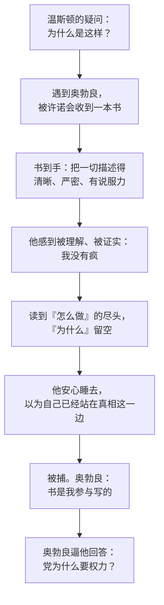

# 12｜那本能解释一切的书，为什么也是陷阱？

> 本篇核心问题：温斯顿读到的《寡头集体主义的理论与实践》到底说了什么？它为什么还是陷阱？

> **剧透提示**：以下内容包含关键剧情与结局。本文涉及第二部第九章温斯顿读书的过程、随后的抓捕，以及第三部里奥勃良谈到这本书的片段。

---

## 开篇：一个值得思考的问题

那本书在温斯顿的公文包里躺了整整六天，他没有打开过。

这个细节很有意思。一个冒着杀头的风险去找一本禁书的人，拿到手之后居然一直不看？原因很简单：那是仇恨周，他和整个真理部的人一起，在五天里干了九十多个小时的活，要把「与欧亚国交战」从所有纸面上抹掉，换成「与东亚国交战」。公文包就在他的脚边、在他的身下，陪他吃饭、陪他睡觉，他累到连翻开的力气都没有。

等到终于有了一个下午，他爬上杂货店楼上的小屋，煮上咖啡，坐进那把破扶手椅，翻开书。接下来是全书里最安静的一段阅读，也是最危险的一段阅读：他自以为在得到真相，其实是走进了别人早就铺好的路。

这一篇想问的是：一本把世界讲得这么透的书，为什么反而是陷阱？

## 一、从故事开始

先看场景。小屋里没有电幕，窗外有孩子的喊声，一只钟在滴答。温斯顿后来想：这是幸福，是永恒。

书没有书名，封面是黑的，装订粗糙，纸页边缘磨得发毛，像是经过了很多人的手。扉页上写着书名和作者：伊曼纽尔·戈德斯坦，《寡头集体主义的理论与实践》。他先读了一小段第一章的开头，停下来享受「我正在安全地读这本书」这件事，随手一翻，又翻到第三章接着读。

裘莉亚到了。他说「我拿到那本书了」，她回答「哦，拿到啦，好」，兴趣不大，转身去煮咖啡。直到两人在床上躺了半个钟头，他才靠着床头重新念起来，从第一章开始，大声念给她听。她闭着眼说：「你念吧，你一边念一边给我解释。」念了没多久，她还说着「我在听，接着念，真好」，然后就睡着了。

他合上书，放到地板上，替两人盖好被子。他想：这本书并没有告诉我任何我不知道的东西，它只是把我已经知道的整理成了系统。他还想：「我懂得怎么做，却不懂为什么。」

## 二、真正的问题是什么？

书里到底写了什么？抓三条主线就够了。

**第一，三种人。** 有史以来，社会里都分上、中、下三层。上层想保住位置，中层想取代上层，下层（如果它有什么目标的话）想消灭一切等级。历史总是同一个循环：中层打着自由和正义的旗号，拉下层一起推翻上层，成功之后又把下层按回原处，自己变成新的上层。书里还说，只有下层从来没有成功过，哪怕是暂时的。而这一次的新上层不同，它「知道自己在做什么」：它明白保住权力的唯一牢靠办法，是让财产归集体所有，让控制权落进一个小团体手里；它还明白，真正的危险不是外敌也不是群众造反，而是自己人头脑里生出怀疑，以及一群能干又无处施展的人另起炉灶。所以问题是「教育」问题，是持续不断地塑造统治集团自己的头脑。

**第二，战争的用处。** 这是第三章「战争即和平」的主题，也是整本书里最有想象力的一段。三个超级大国彼此谁也吃不掉谁，也没有什么值得真打的东西，战争因此不是为了赢。它的作用是把机器生产出来的剩余物资白白用掉：造一座漂浮堡垒，耗掉的人力够造几百艘货轮，造完很快过时报废，再造一座。这样，社会永远处于短缺，永远靠近匮乏的边缘，人们才会觉得手里那点特权珍贵无比，才会觉得「把全部权力交给一小撮人」是围城中的必然。书里还有一句很冷的话：一个真正永久的和平，和一个永久的战争是一回事。因为只要没有外部压力去检验一个社会，它里面什么荒唐的东西都可以成立。

**第三，无知为什么是力量。** 第一章的标题是「无知即力量」，书里没有简单地宣布这个口号，而是花了大量篇幅讲「怎样控制人的头脑」：党员被盯得连睡梦中的话都不放过，既要有正确的观点，还要有正确的「本能」；为了让这一切运转，要靠双重思想，让一个人同时相信两件矛盾的事，并且忘记自己做过这件事。统治者最需要的心理状态，书里叫作「受控制的疯狂」。

读到这里，你会发现这本书几乎回答了温斯顿此前所有的疑惑：为什么永远在打仗，为什么历史总在改，为什么物资永远不够。可在书里最关键的地方，它断了。书写到「这个动机的实质是……」，后面就没有了，因为温斯顿读到的只是节选，念到这里，裘莉亚睡着了。

## 三、人物为什么会这样选择？

温斯顿读这本书的状态，值得单独看一眼。

他感到的不是兴奋，而是安心。奥威尔写得很准：这本书「令他着迷，或者更确切地说，令他安心」。它说出了他自己想说却理不清楚的话，出自一颗和他相似、却强大得多、系统得多、少些恐惧的头脑。他得出一个结论，后来成了整个情节里最讽刺的一句：最好的书，是那些告诉你你早已知道的东西的书。

这一刻他对自己的评价也变了。书让他确信：「自己并没有疯。」身处少数，哪怕少数只剩一个人，也不意味着疯狂；他睡前还喃喃念着一句：「理智不是统计数字。」他觉得这句话藏着很深的智慧。

这里要看清楚的是：温斯顿当时最缺的不是知识，而是同伴和证明。一个长期孤立、对自己的判断没有把握的人，最容易被一份「你是对的」的材料征服。他并不是不够聪明，而是太需要被确认。越渴望被确认，越不会去怀疑那份确认是从哪里来的。

至于裘莉亚，她的反应恰好是对照。她对「书」本身没有热情，对「理论」也没有耐心，她说过自己更关心此刻：活下去，享受，偷偷违一点规。她在他念书时睡着，也是一种清醒：不懂「为什么」，对她不是缺憾。温斯顿则不同，他一直想要的就是那个「为什么」。而这恰好是他的破口。

## 四、作者真正想讨论什么？

先把几个层次分开。

**文本事实。** 第三部里，奥勃良问他：你读过那本书，它告诉你什么你不知道的东西了吗？温斯顿反问：「你读过？」奥勃良答：「我写的。应该说，是我参与写的。没有哪本书是一个人写出来的，你知道。」温斯顿问书里写的是不是真的，奥勃良说：「作为描述，是的。至于它给出的方案，纯属胡说。」那个方案就是：知识逐渐积累、启蒙逐渐扩散、最终无产者起义、党被推翻。他补充说：这些你自己早就料到了，书里就是这么写的。他还说过，党追捕这本书却毫不在意，因为「这本书是销毁不了的」，哪怕最后一本没了，党也能几乎逐字重写出来。

也就是说，书的描述部分是真的，诱人的部分是假的。它做了两件事：让温斯顿把党看得更清楚，同时把希望的位置安放在他早就愿意相信的地方，也就是无产者身上。

**常见的读法。** 一种常见的读法认为，这是一个「书中书」的设计，奥威尔借它把自己对极权社会的分析讲了出来（有批评家把它与伯纳姆的管理者革命理论联系起来，奥威尔本人在一九四六年写过一篇评论伯纳姆的文章），同时又用奥勃良的一句话，把这套分析变成圈套的一部分。另外，在小说的设定里，戈德斯坦是那个「曾和老大哥并肩的叛徒」，这个形象常被读者对应到托洛茨基。但这是读者的联想，奥威尔在书里并没有点名，所以只能说是常见的读法，不能当成作者明说的意图。

**另一种可能的读法。** 一种可能的读法是：诱饵的力量并不在于它撒谎，而在于它说得几乎全对。这样一来，温斯顿很难事后说服自己：我被骗了。他看到的每一条描述都能和他的生活经验对上，于是对那条他没有亲身验证的结论，也一并信了。也有读者认为，奥勃良「参与写作」这一说法本身也未必可信，因为他一贯在说话时混着真话与假话，真假无从核对。这一点书里没有交代，应当承认读者只能停在这里。

## 五、把这个问题放回时代

奥威尔写作的年代，是各种大型理论互相竞争的年代。人们读到的是「历史规律」「阶级斗争」「管理者革命」，它们都声称自己解释了一切。奥威尔对这种解释一切的冲动保持着警惕：一种理论一旦自称包办全部答案，它就很容易变成一种让人不再提问的工具。

历史上也确有把「反对派」本身变成诱饵的做法。二十年代苏联秘密警察设立的假反苏组织「托拉斯」，就是靠让流亡者相信国内有一个真实的反对势力来引他们回国落网。奥威尔是否直接参考过这类事例，目前缺乏可靠来源，不能确定；但这个逻辑，书里的兄弟会和戈德斯坦的书，用的是同一把钥匙。

## 六、作品是怎么写出来的？

这一段在写法上有三个值得留意的地方。

第一，**节选，而不是全文。** 奥威尔没有让读者读完整本书，只给了第一章和第三章的片段，而且是倒着来：先第三章，再回头念第一章。这样处理有两个好处：避免小说变成一篇论文；更重要的是，他让这本书在一个关键位置断掉，把读者的好奇心留给后面的审讯室。

第二，**读者和温斯顿同时落入圈套。** 如果你读书时也觉得「这分析真透彻」，你的反应和温斯顿几乎一样。直到奥勃良说出那句「我写的」，你才发现，自己的信任被利用了。小说在这里不是向读者说明什么，而是让读者亲自犯一次温斯顿的错误。

第三，**把理论放在一个有身体的场景里。** 这段阅读发生在床上、在夏天的下午、在一个女人的呼吸旁边。理论有多冷，场景就有多暖。奥威尔把最冷的东西放进最暖的房间，这种反差本身就是预告：这间屋子不是安全的。

## 七、如果放到今天

今天的人也常有这种体验：刷到一篇或者看完一个视频，把一件复杂的事讲得头头是道，看完心里一松，觉得「原来如此，我早就觉得是这样」。

这种松弛感值得稍微警觉一下，不是说那篇内容一定错，而是有两个简单的自检问题：第一，它告诉了我哪些以前不知道的东西，还是只是替我已有的想法加了一层漂亮的包装？第二，它讲清楚了「怎么运作」，那它对「接下来我能做什么」说了什么？一份只让你更加确信、却不让你多做一点事的材料，有时只是让人安心，而不是让人明白。

推荐系统按你的喜好推内容，也在无形中做同一件事：把你已经相信的东西，以更好的文笔重新念给你听。

## 八、小结

这本书不是谎言，这正是它危险的地方。它把「怎么做」讲得很透，在最关键的「为什么」处停住；它给温斯顿一个归属感和一个出路，而出路恰好是被允许的出路。

在奥勃良手里，它既是对世界的真实描述，也是对温斯顿的一次测试，看一个渴望答案的人，会不会为了答案放下戒心。他放下了。

## 下一篇

书里没有回答的那个「为什么」，要等温斯顿进了友爱部才有答案。但在那之前，他先要面对一个名字：101 号房间。为什么一个人在最后关头，会喊出那句话？
