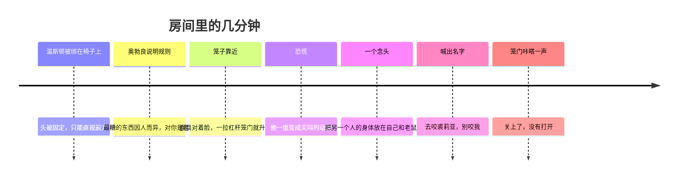

# 13｜101 号房间为什么能摧毁一切抵抗？

> 本篇核心问题：一个人为什么会在最后关头，选择背叛自己最爱的人？

> **剧透提示**：以下内容包含关键剧情与结局。本文涉及第三部友爱部的牢房与 101 号房间的整场戏，不写最后的咖啡馆场景。

---

## 开篇：一个值得思考的问题

在这本书里，温斯顿对裘莉亚说过一段话，大意是：他们迟早会被抓，到时候会招供，每个人都会招供，那没有办法，「招供不是背叛」。真正的背叛，是让他不再爱她。裘莉亚回答：这是唯一一件他们做不到的事，他们能让你说任何话，但没法让你相信，「他们进不去你里面」。温斯顿听了，觉得有了底气。

这是全书里最像信念的一段话：外面的一切都可以被拿走，里面那一小块是别人够不着的。

101 号房间的任务，就是验证这句话。验证的结果，在一阵尖叫里出来了。这一篇想问的是：一个人为什么会在最后关头，把自己最爱的人推到老鼠面前？

## 一、从故事开始

故事要从牢房里听到的几个字说起。

温斯顿被捕后先被关进一间拥挤的临时牢房，那里有普通罪犯，也有几个党员。党员都不说话，吓得发抖；偶尔听到两个女党员挤在一起时压低声音念叨了几个字，其中有「一〇一号房间」。他不懂是什么。

然后，一个接一个的人被带走。诗人安普尔福思被穿蜡像脸的年轻军官念出这个号码，带走了。后来又有一个女人被点名，脸色一下子灰败下去，缩成一团。最让他难忘的是那个饿得像骷髅一样的男人：同牢房的一个犯人出于不忍，递给他一块面包，立刻被电幕吼住，被一个壮实的看守一拳打得满嘴是血，连假牙都断成了两半。接着军官看着骷髅脸的人，说：「一〇一号房间。」

那个人当场跪下了。他喊：我什么都招，你们让我签字就签；你们要我招出别人，说是谁，我就说；我有老婆，有三个孩子，最大的还不到六岁，你们当着我的面割断他们的喉咙，我站着看；但是别带我去一〇一号房间。他环顾牢房，想找一个替死鬼，抬手指向刚才被打的那个人：「你们该带走他，他才是反党的。」看守把他拖起来，他抱住板凳的铁腿，嚎叫着，一只手的指头被踢断，被拖走了。

这一幕要紧的地方是：这个人并不是什么懦夫，他是在把自己能够交出去的一切，一件一件摆出来。唯一要保住的，是不去那个房间。

后来，温斯顿自己也在牢房里想过：如果我能让自己多受一倍的痛来救裘莉亚，我愿意吗？他对自己说：「愿意。」可紧接着他又承认，这只是一个理智的决定，因为他应该这样决定，他并没有真的感觉到。在这个地方，除了疼痛和对疼痛的预感，什么也感觉不到。

## 二、真正的问题是什么？

奥勃良后来对他讲的一段话，是理解这一场戏的钥匙：

> 对每个人来说，总有一样东西是无法忍受的。勇敢与怯懦与此无关：从高处坠落时抓住绳子，并不怯懦。

按这个说法，101 号房间不是在测一个人「勇不勇敢」，而是在找一个人身上那根最敏感的神经，然后按住它。老鼠对温斯顿是这样，对别人是火、是活埋、是溺水，是「完全无关紧要的小事」。奥勃良说得很清楚：「世界上最糟的东西，因人而异。」

所以，这个问题实际问的是：当一个人在极端恐惧里作出选择，那个选择还算不算他「真正的意愿」？

## 三、人物为什么会这样选择？

先把过程摆出来，再说为什么。

有几点要看仔细。

**第一，奥勃良从头到尾没有叫他说出任何名字。** 温斯顿问他「你要我做什么」，奥勃良没有直接回答。「做什么」是温斯顿自己想出来的。在黑色的恐慌里，他拼命想，想到「只有一件事能救我：必须在自己和老鼠之间，放进另一个人的身体」。然后他看到，在整个世界上，只有一个人可以被他推出去。

这个细节让这一幕比一般的酷刑戏更狠：不是被逼供，而是被逼着自己找出那条出路。

**第二，之前所有的准备都没有派上用场。** 他在更早的时候就知道：面对疼痛，没有英雄。他也早就对自己说过「愿意替她多受一倍的痛」，却承认那只是理智上应该这样想。对恐惧的预演，和恐惧真的到来，不是一回事。

**第三，他在最后一秒才「看见」那个念头，不是计划好的。** 书里写他「一度是疯的，是一只尖叫的动物」，然后从那片黑暗里「抓住一个念头」冲出来。这不是一个谋算，更像一种反射。但反射产生的，是一个在清醒状态下他绝不会同意的行为。

还有一个对照值得一提。温斯顿在兄弟会的誓词问答里，对「向孩子脸上泼硫酸」「做假、勒索、传播疾病」「自杀」都答了「愿意」，只有被问到「是否准备与对方分开，永不再见」时，他犹豫了很久才说出「不」。那一刻他守住了裘莉亚。他在抽象的世界里，什么都愿意放下，只有一件除外；而 101 号房间，要的正是那「一件」。

## 四、作者真正想讨论什么？

这里需要把几层说法分开。

**文本事实。** 温斯顿喊出了那句话，笼门没有打开。书里没有描写他看见了什么，没有叙述老鼠碰没碰他，只是写他「向后坠落，穿过地板，穿过大地、海洋、大气，进入星与星之间的空间」，然后听到一声咔嗒，笼门关上了。

**常见的读法。** 常见的读法是：这一幕证明了奥威尔对人性的一个判断，一个人的信念和忠诚是有「破点」的，没有人能保证自己永不崩溃。这个读法有文本支持：奥勃良早就说过「那里没有英雄」，并让温斯顿亲身验证了疼痛的绝对性。

**另一种可能的读法。** 一种可能的读法是：101 号房间最残忍的不是肉体的恐惧，而是它把温斯顿此前的那条界线抹掉了。他曾经坚持：「招供不是背叛，感情才是」。他在牢里受尽折磨时，一直守着这一条，甚至对奥勃良说「我没有背叛裘莉亚」，奥勃良也承认「是的，这是真的」。可在这里，他是主动把她交出去的，连奥勃良都没有开口要。因此，这场戏否定的不只是他的勇气，而是「里面有一块地方，是别人进不去的」这个信念本身。

也有读者认为，这一幕不该被读成「人性本恶」，而是一种提醒：不要用「如果是我就不会」去审判别人。这种读法在文本里同样站得住，因为奥威尔从没把这个场景写成对温斯顿的道德谴责，叙述语气一直是冷静的、近乎同情的。

## 五、把这个问题放回时代

奥威尔写这本书时，欧洲刚刚经历了三十年代的莫斯科公审：许多资深党员在法庭上认了子虚乌有的罪，说出一些听起来不可思议的话。当时的西方观察者为此争论不休：他们是被打垮了，被威胁了亲人，还是被说服了？这个问题在小说里被推到极端：既不是单纯的屈打成招，也不是真心悔过，而是把一个人的内部结构，拆到只剩一个反射。

从这个角度看，101 号房间是一种对「真实的忠诚」的压力测试，它的结论很冷：忠诚和爱可以由情感维持，却无法保证在最大压力下不被替换。

## 六、作品是怎么写出来的？

写法上，这一幕值得记住的是「延迟」。

奥威尔没有一上来就说 101 号房间里有什么。他先让这个数字在牢房里反复出现：被低声提起，被一个个人念出，最后变成骷髅脸男人的哭喊。读者还不知道里面是什么，却已经从每个人的反应里感到：这是最坏的东西。温斯顿自己问「一〇一号房间里有什么」，奥勃良答：「你知道里面有什么，每个人都知道。」

到了真正的场景，奥威尔又换了一种写法：不加评论，只摆道具。两张铺绿呢的小桌子，一个铁丝笼，一个像击剑面具的东西，一个杠杆。他把一件东西的使用方法讲得很清楚，让读者自己想象后果。最后高潮发生时，叙述则直接离开了现场，掉进宇宙，只剩一声笼门的声响。这样处理的好处是，真正的恐怖不是被描写出来的，而是被留白出来的。

## 七、如果放到今天

今天不会有一个专门的房间，但「找到对方最怕的东西，然后按住它」的逻辑一点不陌生。

最直观的例子是所谓的「虚拟绑架」电话诈骗：骗子并不需要掌握多少信息，只要让你听见一个像是亲人的哭声，让你相信孩子在他们手里，一个平时很理智的人，几分钟内就会按对方的话去转账。这件事教给人的不是「那些人太笨」，而是同一个事实：恐惧一旦指向最在乎的人，判断力会被压到最小。

这一点还提示了另一件更实际的事：制度和关系，不应当把任何人放在「必须靠意志力证明忠诚」的位置上。一个让人必须在亲人与良心之间二选一的环境，本身就是不公平的。

## 八、小结

这一篇只回答一个问题：温斯顿为什么会背叛裘莉亚。

答案是：他并不是因为不爱她，而是因为那个房间的设计，就是找到他最无法承受的东西，并给他一条只能靠交出别人才能走的路。奥勃良没有说服他，没有命令他，只是安排好条件，等他自己说出口。

这一刻之后，他曾经相信的东西，包括「里面没人进得来」，已经不能成立了。

## 下一篇

笼门关上之后，温斯顿被放了出来。他回到栗树咖啡馆，坐在老位置上，对着棋盘，手指在桌面的灰尘里写下几个字。那是全书的最后一幕，也是最难读的一幕：他为什么说出「我爱老大哥」？
