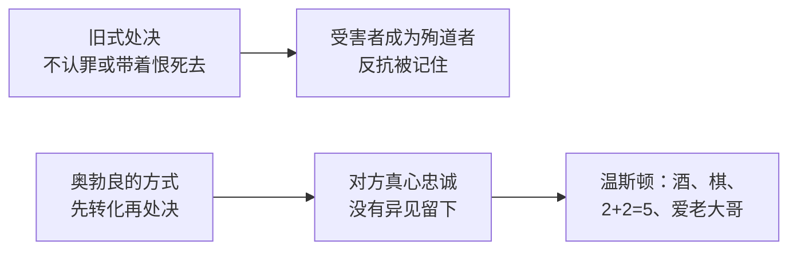

# 14｜「我爱老大哥」为什么是全书最恐怖的一句话？

> 本篇核心问题：结局为什么比死亡还让人不安？

> **剧透提示**：以下内容包含关键剧情与结局。本文涉及第三部第六章（栗树咖啡馆）的整个场景，以及此前奥勃良关于「转化」的几段话。

---

## 开篇：一个值得思考的问题

读完《一九八四》，很多人的第一反应不是难过，而是一种说不清的发冷。温斯顿没有死，没有被处决，他活着，坐在一家咖啡馆里喝酒。小说的最后一句话也没有任何暴力：「他爱老大哥。」

这一句话，比整本书里所有的酷刑都更让人不舒服。为什么？一个人活着，并且自己觉得幸福，为什么会比死亡更可怕？

这一篇想回答的，就是这个问题。

## 一、从故事开始

先看场景。

栗树咖啡馆几乎空着，一道阳光斜斜地照在落了灰的桌面上，时间是下午三点，叫作「寂寞的一刻」。温斯顿坐在他的老位置上，盯着空杯子。侍者不用吩咐就会走过来，往杯里倒胜利牌杜松子酒，再从另一个瓶子里滴几滴丁香味的液体。他的桌子永远给他留着，哪怕店里满座，因为没有人愿意离他太近。

他变胖了，脸色红得发粗，连秃头都泛着深粉色。他有一份薪水比从前更高的闲职，一周去两次真理部的某个落满灰的办公室，隶属于一个「小组的小组」，在讨论新话词典第十一版里，逗号该放在括号里面还是外面。账单是一张脏纸条，他总觉得他们收得比应收的少，他也不数喝了多少。

电幕在播报非洲战线的紧急消息：一支欧亚国军队正在南下。他想到这一点，涌起一阵很模糊的激动，然后就没了。（书里随手加了一句括号：大洋国一直在和欧亚国交战。口气像在说常识，可读过前面的人都知道，这个「一直」有多不可靠。）侍者送来棋盘和当天的《泰晤士报》，翻在象棋残局那页：白先走，两步将死。他抬头看老大哥的画像，心想：白棋总是赢。自古至今没有哪一个棋题是黑棋赢的。这不就象征着善永远战胜恶吗？

然后他用手指在桌面的灰尘里，几乎无意识地写了几个字：

2+2=5

接下来，他想起了不久前的那次见面。

三月的一个公园里，冻土像铁一样硬，他远远看到她。她变了，腰粗了，也硬了，像他曾经从废墟里拖出来的一具尸体，沉得像石头。她额头上有一道疤。他把手搭在她腰上，她没有回应，也不躲。两人坐到两把铁椅子上，隔着一点距离。她先开口，很平淡：「我出卖了你。」他说：「我出卖了你。」她看了他一眼，里面是厌恶。她接着说：有时他们威胁你的东西，你承受不了，连想都不能想，你就说「别对我，对别人，对某某人」。事后你可以假装那只是为了让他们停手，其实不是，当时你是真心的，你希望那件事发生在别人身上。「从那以后，你对那个人的感觉就不一样了。」他说：「是的，你的感觉就不一样了。」

没有别的话可说。风把单薄的工装吹贴到身上，她说要赶地铁，他们说「我们得再见面」，谁也没有再提起。他跟了几步，忽然觉得这样跟着又冷又没有意义，他想的不是离开她，而是回到栗树咖啡馆，那里暖和。几分钟后，他让一小群人隔开了自己和她，转身往反方向走。

此刻电幕里的音乐变了调，出现一个「沙哑的、嘲讽的、黄色的音符」，有人在唱：

「在那株伸展的栗树下，我卖了你，你卖了我。」

他的眼泪涌了上来。

## 二、真正的问题是什么？

这个结局的可怕，不在于发生了什么，而在于没发生什么。

没有人逼他。电幕在放音乐，没有人在拷问，没有人盯着他。书里甚至写了：「没有人在乎他做什么了，没有哨声叫醒他，没有电幕训斥他。」他喝酒，是因为他想喝；他想起公园里的她，是因为他想起。

一个人如果在被胁迫的时候说「我爱老大哥」，我们知道那是假话，同情他。可如果他在没有任何人看着、没有任何人逼迫的时候，自己流着泪承认「我爱」，我们就无法再找到那个仍在抵抗的人了。

所以这一篇真正的问题是：当一个人的内心已经被改写，他还算不算「受害者」？

## 三、人物为什么会这样选择？

要理解这个结局，不能只看最后一页，要看温斯顿一路是怎样一点点被改掉的。

回到第三部，奥勃良说过一段很关键的话：党和过去的迫害者不同。过去的专制者满足于「消极的服从」，甚至「最卑微的屈从」，党不满足。「当你最终向我们屈服，必须是出于你自己的自由意志。」他们并不因为异端的抵抗而毁掉他，只要对方还在抵抗，他们就不毁掉他。他们要「把他的内心夺过来，重新塑造」，让他从心底成为自己人，「然后才杀他」。他还说，即使是以前的清洗里被处决的人，在被带过走廊、等子弹的那一刻，仍旧可以把反叛锁在头骨里。「而我们在把脑子弄完美之后，才把它打碎。」

温斯顿其实早已把这一点想清楚了，而且怀着一种隐秘的算计。在被一点点转化的路上，他想：只要最后十秒钟，在子弹打进后脑之前，让恨意在心里炸开，他就赢了。「怀着恨死去，那就是自由。」这是他在被转化的路上，为自己保留的最后一块地方。

最后一章，把这块地方也拿走了。结尾他幻想中的子弹，终于来了，但这一次他等的是它「长久期盼」的到来，他的灵魂「像雪一样白」，一切都被原谅了。那个他曾经计划好要用来恨的瞬间，变成了一个被爱填满的瞬间。

这个转变是怎样发生的？书里没有一场「说服」的戏，只有一个小细节：一阵胜利的号声响起，电幕宣布非洲战线大捷，半百万战俘，「历史上最伟大的胜利」。咖啡馆外面的人群在欢呼。温斯顿一动不动，可他在脑子里奔跑，混进了人群，欢呼到震耳欲聋。十分钟之前，他心里还对战况有迟疑；现在，那个「最后的、不可缺少的治愈」，终于发生了。

注意，他想象中的胜利是他自己预判的，那一枚棋子「白骑士」的走法，他觉得是自己「想」出了那支舰队。胜利的消息，等于是对他的想象、对他的信念的确认。他终于与世界重合了：他想的和党说的一样。

## 四、作者真正想讨论什么？

分清几个层次。

**文本事实。** 小说结尾，温斯顿「战胜了自己」，他「爱老大哥」。他想起了「真正的微笑」：他花了四十年才明白，那撇黑胡子下面藏着什么样的笑。叙述是平静的，甚至有些抒情：「哦，残酷的、不必要的误会！哦，固执的、任性的、离开了慈爱胸怀的流亡者！」这些句子读起来像一首赞美诗，叙述者的语气和温斯顿的心情在这里合而为一。

**常见的读法。** 常见的读法是：这是对极权最彻底的描绘。它不是消灭反抗者，而是消灭「反抗」这个念头本身。党赢的方式，是让对方不再需要被镇压。因此，结局的恐怖，是「胜利者不需要刽子手」。

**另一种可能的读法。** 也有读者注意到，温斯顿在这个结局里并不是完全转化成功的：他在灰尘里写「2+2=5」，这行字究竟是顺从的象征还是一种无意识的残存？同样的字在牢房里写下时，他是在训练自己「相信」；在咖啡馆里写下时，他是「几乎无意识地」写的。一种可能的读法是，奥威尔在这里留了一个很小的缝隙：这个人已经不能说「不」，但他的手还在写。但需要诚实地说，书里没有明说这个缝隙是否有意义，读者可以保留这个解读，但不宜把它当成作者的明确安排。

## 五、把这个问题放回时代

奥威尔写下结局的年代，是欧洲刚刚见识过极权政权如何让人「自愿」认罪的时代。三十年代莫斯科的公审，被告在法庭上滔滔不绝地指控自己；纳粹统治下，有人在运动里真心实意地相信自己在做对的事。观察者对这些现象有一个共同的疑问：这些人是被胁迫的，还是被改变的？

奥威尔选择让两者连成一线：先胁迫，再改变，最后连胁迫的痕迹也消失。到那一步，从外面再也看不出区别：一个被转化的人，和一个本来就忠诚的人，行为上毫无差别。这就是为什么这个结局很难被「反抗」：你无法反抗一个没有看守的牢房。

## 六、作品是怎么写出来的？

这一章有几个写法上的选择，值得留意。

**第一，场景是日常的。** 一杯酒、一盘棋、一份报纸。奥威尔没有用阴暗的灯光或者酷刑来强化恐惧，反而把最后一幕放在阳光下，一个下午三点钟。这样写，让恐惧来自「普通」，而不是「异常」。

**第二，几个旧意象都回来了，但意义反了。** 咖啡馆在第一部里是「不祥的地方」，曾经有三个被赦免的老党员在这里下棋，温斯顿远远看着，觉得他们是行尸走肉；现在他自己坐到了同一张桌子旁。那三个人面前摆着棋子却没人下，现在，温斯顿的棋盘也只是消磨时间的东西。歌谣也是一样，最早在电幕里响起，被三个人听见，如今轮到他听。

**第三，句子在变短。** 前面的篇幅里，叙述者一直跟着温斯顿的思路绕来绕去，到最后几句，句子越来越短，越来越肯定：「一切都好，一切都好，斗争结束了。他战胜了自己。他爱老大哥。」没有任何反讽的标记，这就是它让人不安的原因：叙述者好像也被说服了。

## 七、如果放到今天

在今天，最贴近这个结局的不是极权，而是一种更日常的变化：长期待在一个环境里，人会逐渐把环境的要求当成自己的愿望。

比如，一个长期在高压考核里的人，可能不再觉得「加班」是被迫的，而是真心觉得自己「喜欢拼」；一个被算法推荐包围的人，会觉得自己的喜好是自己选的。这些当然不是极权，也不能和小说相提并论。但它们提供了一个可核对的提问方式：我现在想要的这个东西，是我自己想要的，还是长期被安排之后，才变成我想要的？

这个问题没有标准答案，但值得偶尔问一问，尤其在你觉得「一切都很顺」的时候。

## 八、小结

温斯顿的结局，不是被杀，而是被改。他最后坐在咖啡馆里，喝着酒，流着泪，说出那句话的时候，没有任何人逼他。

这就是奥勃良所说的「我们不满足于消极的服从」：党要的不是一个怕它的人，而是一个爱它的人。比起死亡，这是更彻底的消灭：消灭的不是身体，而是那个本来可以说「不」的人。

## 下一篇

在改写温斯顿的过程中，有一个场景最让人难忘：奥勃良举起四根手指，问他是几根。「2+2=5」为什么成了全书最著名的一句话？权力真的能重新定义现实吗？
