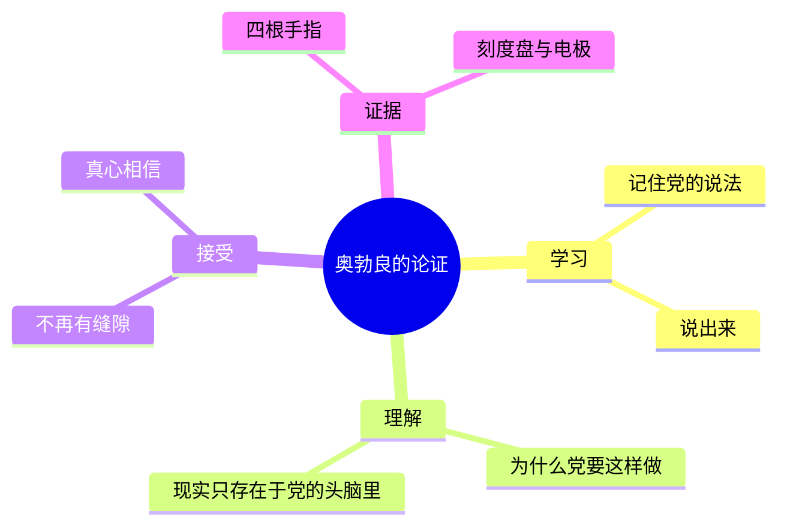

# 15｜「2+2=5」：权力能否重新定义现实？

> 本篇核心问题：奥勃良的审讯想证明什么？现实究竟在不在一个人的头脑之外？

> **剧透提示**：以下内容包含关键剧情与结局。本文涉及第三部第二、三章中奥勃良的审讯与「教学」，并回顾第一部第七章日记里的一句话。

---

## 开篇：一个值得思考的问题

温斯顿在日记里写过这样一句话：

「自由就是可以说二加二等于四。如果这一点被承认，其余的一切都会随之而来。」

写这句话时，他正处在一种近乎绝望的清醒里：党要人不信自己的眼睛和耳朵，这是它「最后的、最根本的命令」。他想，要守住的就是那些显而易见的、近乎愚蠢的、却是真的东西。石头是硬的，水是湿的，没有支撑的东西往地心掉。守住这些，别的才有可能。

后来，这句话在审讯室里被一个人原样念了出来，念的人是奥勃良。他先问「还记得你在日记里写的吗」，然后举起四根手指。这是全书最著名的一幕。可以问：这场戏只是在折磨一个人让他说错话，还是想证明一件更大的事？

## 一、从故事开始

先看审讯是怎么展开的。

温斯顿被绑在床上，一个刻度盘连着他的身体，指针往上走，疼痛就往上走。奥勃良站在旁边，语气像个医生，又像耐心的老师。他先说了一段话：你的病在于记忆有缺陷，你把没发生的事当成发生过的。接着他提起那句口号：「谁控制过去，谁就控制未来；谁控制现在，谁就控制过去。」重点在他接下来问的：过去存在吗？存在于哪里？

温斯顿一步步被引到答案上：过去只在记录里，只在记忆里。「党控制所有记录，也控制所有记忆。」奥勃良说，所以现实根本不在外面：「现实不是外在的。现实只存在于人的头脑里。不是个人的头脑，个人会出错，而且很快就会消亡；只存在于党的头脑里，党的头脑是集体的、不朽的。党认为是真的，就是真的。」

他随即抬起左手，藏起拇指，四根手指伸向温斯顿，问：几根？

「四根。」

「如果党说不是四根而是五根，那是几根？」

「四根。」

指针升到五十五。「几根？」「四！四！我还能说什么？四！」指针再升。「五！五！五！」「不行，温斯顿，没用，你在撒谎，你仍然觉得是四。几根？」他最后喊：「四，五，随你要什么，只求停下来。」

注意，奥勃良要的不是他说「五」。他一次次说「你在撒谎」。后来，温斯顿在疲惫里低声说：「我会看到五根，如果我能的话。我正在努力看到五根。」奥勃良问他：「你想说服我你看到了五根，还是真的想看到它们？」温斯顿答：「真的看到。」「再来。」

这一幕之后，他被打了一针，一股暖流涌遍全身，他望着奥勃良那张又丑又聪明的脸，心都翻转了，觉得此刻比什么时候都更爱他。

后来，另一种仪器贴上了他的太阳穴，一道无声的闪光，他的脑子里像被挖空了一块。奥勃良问他大洋国和谁交战，他想不起来；告诉他是东亚国，他说「是」；举起手指，他看到了五根，「那一刻有一种明亮的确定感」，每一个新的暗示都填满一块空白，变成绝对的真理。它很快就消退了，但他记得：二加二可以是五，也可以是三。奥勃良说：「现在你看到了，这至少是可能的。」

## 二、真正的问题是什么？

先把几个说法分开，免得绕晕。

**说法一：党能让你说「二加二等于五」。** 这谁都相信，在刑讯面前，任何话都能说出口。这不是奥勃良想证明的。

**说法二：党能让你相信「二加二等于五」。** 这是他真正在做的。他说要的是「治愈」，要的是你「真的看到」。

**说法三：只要党这样认为，二加二就真的等于五。** 这是他在口头上讲的：现实就在人的头脑里，没有别的地方。

问题是，从一到三，是一级一级往上爬的。第一级靠暴力，第二级靠暴力加很长时间的训练，第三级靠一个哲学论断。而奥勃良想证明的是：这三级其实是同一回事。如果一个人能被改到「真的看到五根手指」，那么对他来说，那个世界里就是五。外面有没有一个「四」，对他、对所有被改过的人，已经没有区别。

所以这一场的真正问题是：现实不在头脑之外，是不是一个可以被权力验证的命题？

## 三、人物为什么会这样选择？

奥勃良给这个过程起了名字：重新整合有三个阶段，「学习，理解，接受」。第二阶段，他对温斯顿说，现在要进入了。

学习，是温斯顿此前一直在经历的，被打、被饿、被逼着认罪。理解，是第三章里的长篇谈话：为什么党要权力？答案是：「为了权力本身。」不是为了大多数人的幸福，不是为了财富，而是纯粹的权力。「权力不是手段，是目的。」奥勃良说：「迫害的目的是迫害，折磨的目的是折磨，权力的目的是权力。」

然后他说到现实。权力不仅要管人，还要管事。他说：「我们控制物质，因为我们控制头脑。现实在头骨里面。」

温斯顿反驳了，这一点值得认真看。他说：你们连气候和重力都管不了；地球上曾经有几百万年没有人；岩石里有史前动物的骨头；星星有的离我们一百万光年。每一条，都是一个常识性的、「实在论」的反驳。奥勃良一条一条回答：骨头是十九世纪的生物学家编造的；你见过那些骨头吗？星星不过是几公里外的火；地球是宇宙的中心；需要航海时，我们可以假定地球绕着太阳转，「我们可以有两套天文学」。

温斯顿缩回去了。他知道自己是对的，他甚至知道有一个词可以形容这个论点，可他想不起来。奥勃良替他说出来了：唯我论。「但你错了，这不是唯我论。是集体的唯我论，如果你愿意这么叫。可那是另一回事，其实是相反的。」

这里值得停一下。把它拆成最简单的话：

- **实在论**认为：世界不依赖人的看法而存在。你信不信，石头都是硬的。
- **唯我论**认为：只有我的头脑是确定存在的，其余的都可能是我的想象。
- **奥勃良的版本**是第三种：世界只存在于「党的头脑」中。它既不是「我想怎样就怎样」，也不是「世界在那儿」，而是「谁掌权，谁说了算」。

所以，他嘴上说的是认识论，手里握着的是刻度盘。这是整场戏最重要的细节：这场辩论从头到尾不公平，对话的一方手里有一个杠杆。温斯顿说不出话，不是因为他没有道理，而是因为每次他说出道理，指针就往上走。

温斯顿最后一次抵抗，是一种信念，不是论证。他说：我不知道，也许是某种精神，某种原则，你们永远克服不了的……人的精神。「你认为自己是人吗？」「是。」「如果你是人，温斯顿，你就是最后一个人。你们这一类已经灭绝了，我们是继承者。你明白你是孤独的吗？你在历史之外，你不存在。」据多种传记资料，这本书早期的暂定书名是《欧洲最后一个人》，这句话和它的联系是读者常常想到的。温斯顿在这里被迫担当的，正是这个角色，「人类精神的守护者」。奥勃良说着，把他拉到镜子前，让他看一个骨架一样的、满是污垢的躯体。看吧，这就是「人」。

于是这个角色也变成了刑具。他的自我安慰，被用来羞辱他。

## 四、作者真正想讨论什么？

分几层说。

**文本事实。** 在奥勃良的叙述里，党要的不只是服从，还有信仰。他强调「不满足于消极的服从」。同时，文本里有一个很重要的限制：奥勃良自己承认「为了某些目的」，党也承认外部世界，航海要用、预测日食要用。小说里戈德斯坦的书也写过一句：在哲学、宗教、伦理、政治里，二加二可以等于五，但设计一支枪或一架飞机的时候，它们必须等于四。就是说，党并不真的把现实废除了，它只是在不影响自己的地方，让人按它的意思去看。

**常见的读法。** 常见的读法是：奥威尔在这里写的是他最深的忧虑，就是「客观真相」被权力吞没。他在一九四三年发表的《回顾西班牙内战》里写过，他对那个时代最可怕的感觉，是「客观真相的概念正在从世界上消失」；还说，如果领袖说某件事「从没发生过」，那它就从没发生过；如果他说二加二等于五，那二加二就等于五，这个前景比炸弹更让他害怕。这几句话几乎就是小说审讯场景的雏形。

**另一种可能的读法。** 一种可能的读法是：奥勃良的论证在哲学上并不严密，他自己也在用「双重思想」绕过它；真正起作用的不是论证，而是痛苦加上孤独加上被理解的渴望。也有读者认为，这一场戏最令人不安的地方不是奥勃良的观点，而是温斯顿对他的感情：打完针之后，他想的是：也许人想要的与其说是被爱，不如说是被理解。这使得这场戏不只是一场逻辑的失败，而是一次亲密关系的操控。

## 五、把这个问题放回时代

奥威尔的写作背景里，这个问题不是书斋里的玄想。三十年代的莫斯科审判上，被告承认了不可能的罪行；他在西班牙亲眼见过同一件事被不同阵营说成相反的样子。他在一九四三年那篇文章里说，他怕的不是谎言本身，而是一种世界：在这个世界里，领袖可以控制的不只是未来，还有过去。

另一个常被读者联想到的例子，是同一时期苏联在遗传学上的官方路线（李森科事件）：科学结论由政治来裁定。奥威尔是否有意参考过它，目前缺乏可靠来源，不能确定，这里只当作同一类现象的对照。

中国人对这种场面其实不陌生。「指鹿为马」的故事，赵高在朝堂上指着鹿说是马，说是鹿的人事后都被他清算了。重点不是赵高真的认为那是马，而是他想看谁肯顺着他说。奥勃良比赵高多走了一步：他不满足于看谁顺着说，他要所有人都真的看到马。

## 六、作品是怎么写出来的？

这场戏在写法上有三点值得留意。

**第一，用最小的道具。** 四根手指，一个刻度盘。整个哲学讨论落在一个孩子也能看懂的动作上：数手指。读者不需要懂任何哲学，就能知道被逼的是什么。

**第二，把施害者写成「老师」。** 奥勃良一直耐心、体贴，甚至带着遗憾。他说话的口气像个希望学生进步的老师：「你是个慢学生，温斯顿。」这使得暴力不再只是暴力，而成了一种「教育」。读者很难反感他，这正是可怕之处。

**第三，让主人公「知道自己对」。** 在整场审讯里，奥威尔没有让温斯顿变傻。他一再强调：温斯顿知道自己是对的，他只是无法证明。这使得读者与他站在一起，也体会到那种「我明明知道，却说不出来」的窒息。

## 七、如果放到今天

今天最直观的例子，是我们越来越难凭「看到」去确认一件事。一张图、一段视频，可能是拍的，也可能是生成的；一个说法在群里转了几十遍，转得多了，它给人的感觉就像是真的。

这并不是说我们进入了奥勃良的世界。区别在于：现实的反击仍然有效。一件事是否发生过，总会在别处留下痕迹，可以交叉核对。石头不会因为你不相信就变软，这是实在论朴素的一面，也是它在今天仍然有用的地方。

小说让人警觉的，是另一个方向：当一个社会习惯于「多数人这样说所以是真的」，它离「党认为是真的就是真的」，只差一个有能力惩罚异议的人。

## 八、小结

奥勃良想证明的，不是人会说错话，而是「对」和「错」都可以服从命令。他的办法不是辩论，而是疼痛、孤独和一点点被理解的温柔，直到温斯顿自己不再需要一个外在的「四」。

小说没有让奥勃良的哲学获胜，它让他的刻度盘获胜。这个区别很重要：现实并没有被证明不存在，只是一个人在无法承受的压力下，放弃了为它辩护。

## 下一篇

读到这里，一个问题自然浮现：写下这样一本书的人，是谁？他自称是民主社会主义者，为什么要写出这样黑暗的小说？奥威尔为什么要写这样一本书？
