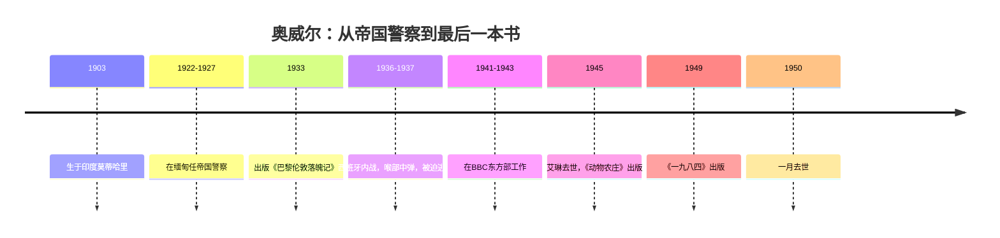
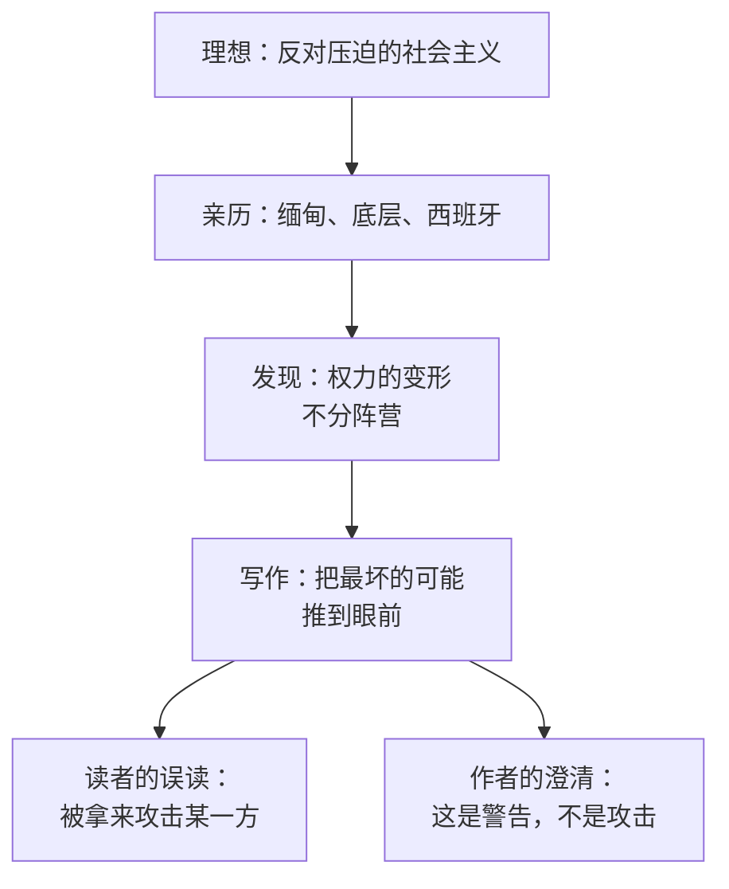

# 16｜奥威尔为什么要写这样一本书？

> 本篇核心问题：一个自称民主社会主义者的人，为什么写出了这样一部黑暗的小说？

> **剧透提示**：本文不涉及具体情节，只在需要时提到作品名和它的整体立场。

---

## 开篇：一个值得思考的问题

一九四九年六月，《一九八四》出版刚过一周，奥威尔就收到了一个麻烦的问题。

问的人是美国联合汽车工人联合会的一位官员弗朗西斯·亨森。他想把这本书推荐给工会会员，却发现美国一部分保守派报刊正在热烈夸奖它，说它是对英国工党政府的当头一棒。他担心自己推荐的是一本反社会主义的书，于是写信向奥威尔求证。

这个误会的荒唐之处在于：写这本书的人，一辈子都自称社会主义者。他生在殖民地官僚家庭，上过伊顿公学，在缅甸当过帝国警察，后来却一头扎进贫民窟和矿区，最后站到了西班牙的战壕里。这样一个人，写出一本被人拿去攻击社会主义的小说，是不是自己把自己的立场弄丢了？

这一篇想回答的，就是这个问题：一个自称民主社会主义者的人，为什么写出这样一部黑暗的小说？

## 一、从故事开始

先把这个人的路线走一遍。这一节不讲小说，讲写小说的人。

他本名埃里克·阿瑟·布莱尔，一九〇三年六月二十五日生于英属印度的莫蒂哈里，后来用「乔治·奥威尔」做笔名。他进了伊顿公学，一九二一年底离校，没有上大学，而是去考了帝国警察。一九二二年十月启程前往缅甸，在那里当了将近五年警察，一九二八年三月辞职。这段经历后来变成了小说《缅甸岁月》和随笔《绞刑》《射象》。一个替帝国执法的人，亲眼看见帝国怎样对待被统治的人，这是他对「权力如何变形」的第一手观察。

辞职之后，他去了巴黎和伦敦，在底层打零工、洗盘子，睡收容所。一九三三年出版的《巴黎伦敦落魄记》就是这段日子的记录，这是他用奥威尔这个名字出版的第一本书。

真正的转折在西班牙。一九三六年底他去了巴塞罗那，加入马统工党（POUM）的民兵，上了阿拉贡前线。一九三七年五月，他在前线被一颗狙击手的子弹打中喉咙，差一点丢了命，据传记资料，子弹险险避开了主动脉。他回到巴塞罗那养伤的时候，城里的政治气候已经变了：马统工党被指为「托派」和「法西斯的内应」，遭到取缔，他和妻子艾琳成了被追捕的对象，最后设法坐火车逃出西班牙。他后来在《向加泰罗尼亚致敬》里写下了这一段。

之后是一九四一至一九四三年，他在英国广播公司（BBC）东方部工作，面向印度做文化节目，也近距离看到了战时宣传是怎么运转的。一九四五年八月，《动物农庄》出版，这是他第一本真正的畅销书。同年三月，妻子艾琳在一次手术中因麻醉反应去世，那时他正在欧洲大陆做战地记者。之后他搬到苏格兰的朱拉岛，在偏僻的农舍里写完了《一九八四》。他一直有肺结核，一九五〇年一月二十一日去世，距离这本书出版不到八个月。

## 二、真正的问题是什么？

把人生放一边，这里藏着一个很普通的问题：

> 当一个人真心相信某种理想，他有没有资格、有没有必要，去写这个理想可能走向的最坏结果？

很多人的直觉是：不应该。你是社会主义者，就应该为社会主义说话；写反面的东西，等于给对手递刀子。这也是一九四九年那些保守派报刊的算盘：他们想把一本警告书改装成一本攻击书。

可奥威尔的思路正好相反。在他看来，一个信念要是没有被最坏的可能检验过，就不算经得起检验。他在意的从来不是「哪个阵营的理论更漂亮」，而是「不管挂着什么招牌，权力一旦不受约束会变成什么」。

## 三、人物为什么会这样选择？

这一篇的「人物」是奥威尔自己。用同一条链条来看他：

他想要什么？他想要一个没有阶级压迫的社会，同时又不想要谎言和恐惧。为什么想要？因为他在缅甸见过殖民压迫，在底层见过贫穷，在西班牙见过理想怎样被内部的清洗吞掉。他害怕什么？他害怕的不只是对手，而是自己这一边也能做出同样的事。他受到什么限制？一九三七年回到英国之后，他发现自己对西班牙的看法在左翼圈子里并不讨好，这是传记里反复提到的处境。他最后的选择是什么？照自己看到的写下去。

西班牙的经验大概是最关键的一步。他自己在一九四六年的随笔《我为什么写作》里说得很直白：一九三六至三七年西班牙战争和其他事件「扭转了局面」，此后他知道了自己站在哪里。接着是那句常被引用的话，大意是：自一九三六年以来，我写下的每一行严肃作品，直接或间接，都是反对极权主义、拥护民主社会主义，就我所理解的民主社会主义而言。

注意最后那半句。它不是装饰，而是整个立场的钥匙：他拥护的是「他所理解的」民主社会主义，而不是任何一个已经挂着这个名字、握着权力的政党。

## 四、作者真正想讨论什么？

这里需要把几个层次分开。

**作者明确说过的**：一九四九年六月十六日前后，奥威尔回复了亨森的信。据传记和研究文献的转引，他在信里说：这本书不是对社会主义或英国工党的攻击，而是对中央集权经济可能出现的扭曲的一种揭示，这些扭曲在共产主义和法西斯主义里已经部分地实现了。他还说，他并不认为他所描绘的那种社会必然会到来，但他相信，某种与之相似的东西可能会到来。此外，出版社还发出过一份据说来自他口述的声明，结尾是那句广为流传的话：不要让它发生，这取决于你。这句话的来历有些复杂：有资料说它出自出版人沃伯格发布的新闻稿，而不是奥威尔亲口说出的遗言，坊间所谓「临终警告」的说法，更多来自后来的影视和转述。所以这里更稳妥的说法是：它是当时随书流传的声明里的话，其意思与他在信里的立场一致，即这是一本关于「可能」的书，而不是关于「必然」的书。

**文本事实**：小说里统治大洋国的主义叫「英社」，也就是「英国社会主义」的缩写。这一点常被拿来当作「攻击社会主义」的证据。

**主流解释**：研究者通常把「英社」看成对一种过程的描写：一个以平等为名的运动，在夺得权力之后，把名字留着，把内容掏空。小说里被攻击的不是平等的理想，而是借理想之名行事的权力垄断。

**另一种可能的读法**：也有读者认为，奥威尔对左翼的批评带有强烈的个人色彩，是西班牙的痛苦经验让他把某些现象推到了极端。这个读法并不否认他的立场，而是提醒我们：一本警告书的力度，来自作者的亲身伤口，也可能因此带着某种偏重。一种可能的读法是：这两种说法并不矛盾，正因为他是自己人，批评才有这样的分量。

至于另一些流传很广的说法，需要放在「常见的说法」里看：比如小说里的「真理部」以战时英国新闻部（设在伦敦大学评议大厦）为原型，据说奥威尔的妻子艾琳战时就在新闻部工作；又如「友爱部的 101 号房间」得名于 BBC 广播大楼里一间会议室。这些说法在传记和 BBC 的介绍里都能见到，但我没有找到奥威尔本人对此的明确说明，因此只能当作「常见的说法」，不宜当成定论。

## 五、把这个问题放回时代

一九四九年的世界，处在一个很难说真话的节点。一边是刚刚打赢纳粹的西方，另一边是苏联和它的盟友，冷战的格局正在成形。在这种时刻，一本批评极权的书几乎注定会被拉进阵营之争。

奥威尔的难处是：他两头都不讨好。右边的人想征用他，左边的一些人怀疑他。他自己曾在一九四〇年代多次公开批评过对苏联的盲目崇拜，也在文章里为社会主义辩护。这一切在今天读来有一种很清晰的连贯性，但在当时，一个站在中间、两边都批评的人，往往同时被两边误读。

所以我们才需要把他那封信和那些声明读成他对读者的「提前纠偏」：他知道这本书会被借走，他想在被借走之前，先说明它原本是干什么的。

## 六、作品是怎么写出来的？

要理解这本书为什么这样写，可以看奥威尔自己对写作的主张。

他在《我为什么写作》里列了四种写作动机，其中一种是政治目的，也就是想把世界推向某个方向。他说得很坦白：他最想做的是把政治写作变成一种艺术。同一篇文章里，他还说，好的散文像一块窗玻璃。这里只取一点：他想让读者看见窗外的东西，而不是看见窗玻璃。

放到《一九八四》上，这意味着一种克制：他没有写慷慨激昂的控诉，也没有把反派写成一眼可辨的魔鬼，而是用日常的、可触摸的细节，让读者自己得出结论。警告能不能起作用，取决于读者是不是「自己看出来的」。这种写法的政治意义在于：它不教你站队，只让你看清机制。

## 七、如果放到今天

今天，「奥威尔式」几乎成了一个万能标签。不同立场的人都会说对方的做法「很奥威尔」，也会说自己是在抵抗「奥威尔式」的世界。看到这种场景，倒不妨回到那封一九四九年的信：同一本书，在不同人手里，被拿来攻击不同的对象。

这个现象本身就提供了一种检验：当你想引用奥威尔时，先问问自己，你引用的是他的立场，还是你的立场。他最在意的，是把警告用在每一个有权力的地方，包括你支持的那一边。

## 八、小结

这一篇想说清的是：《一九八四》不是一个社会主义者背叛了自己的立场，而是一个社会主义者对自己所珍视的东西提出的最严厉的检验。他一九三六年之后的写作，据他自己所说，都是反对极权、拥护他所理解的民主社会主义；而一九四九年的那封信，把这本书的位置说得很清楚：它是对一种可能性的警告。

读这本书，可以不同意他的政治判断，但不该把警告读成攻击。因为一个作者写下最坏的结局，往往不是因为他放弃了希望，而是因为他还没有放弃。

## 下一篇

知道了奥威尔为什么写，下一个问题是他怎么写：为什么用这样一个贴着主人公的视角，为什么要在小说中间塞进一本「书中书」，又为什么在结尾加上一篇看上去与故事无关的附录？
