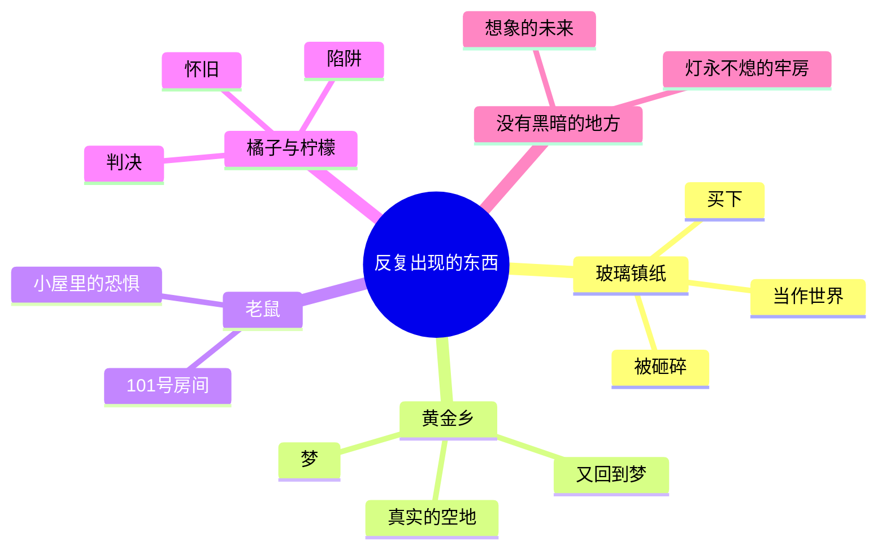

# 17｜这本书是怎么写成的？

> 本篇核心问题：视角、书中书和附录，这些结构选择各自在做什么？

> **剧透提示**：以下内容包含关键剧情与结局。

---

## 开篇：一个值得思考的问题

《一九八四》最后一句话是：他爱上了老大哥。

可小说其实没有在这一句收尾。再往后翻，还有一篇看上去与故事毫无关系的东西：《新话的原则》，一篇讲语言政策的说明文，没有人物，没有对话，用的是教科书式的口气。更怪的是，它几乎全是过去时。

一部小说，用一个人的崩溃结尾，却在这之后再放一篇语言学说明，这是为什么？再往前，小说中段还有整整一章，主人公捧着一本厚书读了很久，读的是一本叫《寡头集体主义的理论与实践》的书。

这一篇想问的是：这几处结构上的选择，视角、书中书、附录，各自在做什么？

## 一、从故事开始

先看整部书的骨架。

全书分三部。第一部八章，温斯顿一个人，写日记，看着周围的人，被电幕盯着，只在梦里和奥勃良的一句话上有一点指望。第二部十章，他遇见裘莉亚，租下查灵顿先生楼上的房间，两个人在里面度过了他一生中仅有的一段亲密时光，最后以被捕收场。第三部六章，几乎全部发生在友爱部：审问、折磨、101 号房间，最后是那句「他爱上了老大哥」。

这个结构有一个很清楚的节奏：一个人，两个人，然后又回到一个人，只不过第三部的「一个人」，是被拆空了的人。第一部的孤独里还有一点疑问和念头，第三部的孤独里，什么都没有了。

## 二、真正的问题是什么？

把结构放一边，这里的普通问题是：

> 一个故事为什么要这样讲，而不是别的讲法？

换成读者的感受就是：为什么读这本书的时候，你会觉得自己被困住了？为什么奥勃良的真面目让人那么猝不及防？为什么读完之后，最先涌上来的不是愤怒，而是一种说不清的空？

这些感受不全是内容造成的。一部分来自作者替你选好的位置。

## 三、人物为什么会这样选择？

这一篇的「选择」是奥威尔的写法选择，我们逐个看它们各自在做什么。

**第一，视角：第三人称，但紧贴温斯顿。** 叙述者几乎不离开温斯顿的所见所想。他看到什么，读者才看到什么；他不知道的，读者也不知道。于是查灵顿先生楼上的小屋，读者和温斯顿一样觉得那是一片「安全的角落」；奥勃良那句「我们会在没有黑暗的地方见面」，读者和温斯顿一样把它当成暗号。到小屋里的画像后面露出电幕的时候，读者没有任何心理准备，就像温斯顿一样。

这种写法的好处是：读者没法站在安全的高处审视这个世界。你想当旁观者，叙述者不给你位置。

结尾有一个细微而残忍的变化。「哦，残酷而不必要的误会！哦，固执任性、离开了慈爱胸怀的流亡者！」这样的句子，是叙述者的声音，还是温斯顿被改造之后的声音？读起来像是两者融在了一起：叙述者仍然贴着他，贴到连他的崩溃也变成了叙述的语气。这是全书最让人不适的一笔：连旁白都被拿走了。

**第二，书中书：读者和温斯顿读同一本书。** 第二部中段，温斯顿从奥勃良那里拿到一本被称作戈德斯坦写的书，书中详细解释了这个世界的运转方式：三个超级大国为什么永远在战争、为什么要让社会保持贫穷、权力要的究竟是什么。小说让他读了很长一段，读者也跟着读了其中的两章节选。

它在做两件事。一是**解释**：不用人物吞吞吐吐地交代世界观，直接放一本「内部文件」，让读者拿到全部的理论。二是**设陷阱**：到了友爱部，奥勃良告诉温斯顿，这本书他自己也参与写了，他的原话大意是，没有一本书是单独一个人写成的。也就是说，温斯顿以为自己读到的是地下抵抗运动的秘密文献，其实是党拿来钓他的东西。读者当时读到的每一句理论，仍然是真话，这才是令人发冷之处：圈套里放的是真相。

也有读者认为，这一整章像是把小说拖慢了，是奥威尔想说的话太多，直接塞进了故事。这个批评并非没有道理，那一章确实更像论文。一种可能的读法是：这种「慢」本身也有用，它让读者和温斯顿一样，在一个下午里读得满足，以为自己终于弄懂了「怎么做」，而下一章之后才知道，弄懂了「怎么做」，并不等于弄懂了「为什么」。

**第三，附录：最安静、也最有争议的一笔。**

## 四、作者真正想讨论什么？

附录《新话的原则》写的是新话这种语言的构造：怎样删减词汇，怎样让某些念头无法被表达。其中说，新话的目的是让异端的想法「在字面上无法想出」，至少在思想依赖词语的限度内是如此。

先看文本写了什么，再看人们怎么读它。

**文本事实**：附录通篇用过去时。开头就是「新话曾是大洋国的官方语言」，并写道，在一九八四年，还没有人把它当作唯一的交流工具。它还说，新话预计要到二〇五〇年前后才会完全取代旧话（即标准英语）。文中还说，这里要讲的是收入第十一版词典的最终完善版，而故事里的一九八四年用的还是第九、第十版的临时版本，这就等于承认，写下这篇文章的时间，比故事的时间要晚。附录末尾还举了《独立宣言》的例子：要把它翻成新话，不是换几个词，而是连意思一起改掉，原来的文本等于被取消。

**几种解读，都只是解读，不是定论：**

- 一种常见的读法是**希望说**：既然这篇文章是用标准英语、以过去时写成的，说明在写作的那个时间点，新话已经成了历史，党的统治已经结束。照这个读法，结尾的绝望并不是终点。
- 另一种读法认为这太乐观：过去时只是小说叙述的一般习惯，并不能说明叙述者站在一个遥远的未来；附录里那句「我们称之为标准英语」的「我们」，也没有交代究竟是谁。持这种看法的人认为，附录不提供任何关于党是否倒台的证据。
- 还有一种读法关心的不是政权的存亡，而是**语言本身**：附录的作用，是把「思想与语言的关系」这条线单独拎出来，在故事之后用冷静的口气再讲一遍，让读者在情感冲击之后获得一种理性的距离。

这三种读法在文本里都能找到一点依据，但没有一种能被文本直接证实。奥威尔没有就此留下明确的说明，我也没有查到可靠材料说明他对附录的意图。所以更稳妥的态度是：承认这里留了一个口子，而这个口子究竟是希望，是冷静，还是单纯的技术说明，读者可以有自己的看法。

## 五、把这个问题放回时代

奥威尔不是凭空造出这个形式的。他在一九四四年一月前后从俄国文学史家格列布·斯特鲁韦那里听说了扎米亚京的小说《我们》，并告诉对方自己也有写这类书的想法。一九四六年一月，他在《论坛报》上写了一篇关于《我们》的书评。据引述这篇书评的资料，他在文中认为赫胥黎的《美丽新世界》很可能部分受益于《我们》，也认为《我们》在政治上更有指向。

那么《一九八四》受了《我们》多少影响？这一点有争议。有传记提到，奥威尔的朋友回忆他说过要拿它做下一部小说的样板，但这是转述；另一方面，《一九八四》里还有许多别的来源，比如伯纳姆的《经理革命》对三大超级国家的设想，科斯特勒的《正午的黑暗》，以及奥威尔自己在西班牙、在BBC的亲身见闻。能说的只是：他读过，也评过，并且在写作时有所借鉴；借鉴多少、哪些地方，没有定论。赫胥黎则说过他在写《美丽新世界》时没有读过《我们》，这是二手转述，但至少说明「谁影响了谁」不是一件简单的事。

## 六、作品是怎么写出来的？

最后看看那些反复出现的东西。奥威尔给这本书留下了好几件「小东西」，它们像线头一样在三部之间穿过。

**玻璃镇纸。** 第一部里，温斯顿在查灵顿的旧货店买下它：一块厚厚的玻璃，里面嵌着一小枝珊瑚。第二部里，他躺在小屋的床上盯着它看，觉得镇纸就是这间屋子，珊瑚就是他和裘莉亚的生活，被固定在水晶中心的某种永恒里。被捕的那一刻，有人从桌上拿起它，砸碎在壁炉石上，珊瑚滚到垫子上，小得可怜。一件东西把「一个看似安全的小世界」从被拥有到被打碎的过程，演了一遍。

**黄金乡。** 第一部的一个梦：一片野兔啃过的老牧场。第二部，裘莉亚带他去的林间空地，几乎就是那个梦的实景。第三部，被关押时，他做的都是好梦，梦里还在黄金乡。它从一个想象的地方变成真实的地方，再回到想象，每一次变化都标记着他离自由有多远。

**老鼠。** 第二部里，小屋墙角出现过一只老鼠，温斯顿的反应异常强烈，他说，世上所有的恐怖里，最怕的就是老鼠。这是个很小的伏笔，却在第三部整个兑现：他最怕的东西，就是 101 号房间里等着他的东西。

**童谣《橘子与柠檬》。** 第一部里，查灵顿先生教他这首老歌，歌里有一座座已经不存在的教堂的钟声。第二部，奥勃良竟然能把整节背完。到了被捕那一刻，从画像后面的电幕里传出一个似曾相识的声音，念的正是后面那两句：给你点上蜡烛送你上床，砍刀来了要砍你的头。一首童谣从怀旧变成了陷阱，又变成了判决。

**「没有黑暗的地方」。** 第一部里，它是温斯顿从梦里听来的一句话，他以为那是想象中的、永远看不到的未来。第三部，在友爱部灯永远不灭的牢房里，他才明白这个地方是哪里。同一句话，两个相反的意思。

这些意象有一个共同的规律：**同一样东西，在第一部和第二部里意味着可能，到第三部全部翻面。** 这不是奥威尔在炫技，而是他让读者在不知不觉中，把小说读了两遍。

最后是语言。奥威尔在《我为什么写作》里说，好的散文像一块窗玻璃；他在一九四六年的《政治与英语》里主张写清楚、少用大词、能用短词就不用长词。这个主张与小说的主题恰好呼应：他写的是一个语言被篡改的世界，用的却是最平实的语言。语句不绕，比喻不炫，不堆砌，读者想躲都找不到可以躲的地方。

## 七、如果放到今天

今天读这本书，也许不是被它的情节吓到，而是被它的「读法」提醒到。

你有没有这样的经验：读到一篇文章，越读越觉得它说的就是自己想的，读得很舒服，很满足。那种舒服，温斯顿在第二部里也有过。书中书的设计提醒我们，让你觉得「终于有人说出了真相」的东西，值得多问一句：谁在写它？写给谁看？

至于附录，今天不妨把它读成一个问题，而不是一个答案：一种语言能被改造到什么程度，才算改变了人的思考？这个问题有很多种答案，附录只给了问法。

## 八、小结

这一篇想说清的是：视角让读者没法旁观，书中书让真相变成了圈套，意象让小说被读两遍，而附录用一个安静的口气，给整个故事留了一个有争议的尾巴。

这些选择彼此配合，用最平实的语言，造出了一个读者无处可逃的结构。附录是否在暗示什么，各家读法不同，但可以确定的是：奥威尔没有让故事在最黑的地方真正收尾。

## 下一篇

读完结构，最后的问题是它离我们有多近：今天的监视、数据和假消息，和书里的世界到底有多像？《一九八四》究竟是一本预言，还是一份警告？
