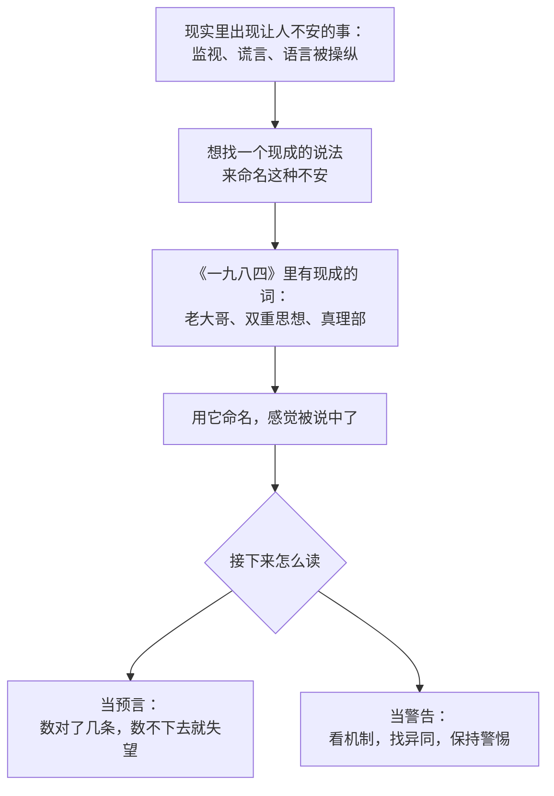

# 18｜《一九八四》是预言还是警告？

> 本篇核心问题：今天的监视、数据和假消息，和书里的世界到底有多像？

> **剧透提示**：本文不涉及具体情节，只在需要时提到书中的一些广为人知的设定。

---

## 开篇：一个值得思考的问题

二〇一七年一月，一句话让一本七十多年前的小说重新冲上了榜单。

当时，美国总统的一位顾问在电视访谈里为新政府关于就职典礼观众人数的说法辩护，说那是「另类事实」。几天之内，媒体陆续报道，《一九八四》的销量暴涨。出版方的说法见诸报端：有报道引述企鹅方面称，几天内销量增长了约九千五百个百分点，也就是近百倍；亚马逊畅销榜上的名次，不同报道说法不一，从第一名到第六名都有，大概是因为榜单每小时都在变。

这是个很有意思的场面：一句话出来，许多人立刻想到一本书。可这里藏着一个问题：他们想到这本书，是因为这本书「预言」了这一幕，还是因为它帮我们看清了这一幕？

这一篇想回答的，就是这个问题：把今天的监视、数据和假消息，放在书里那个世界旁边，到底有多像，又在哪里不像？

## 一、从故事开始

先别急着拿今天去对照，看看这本书出版后是怎么被读的。

一九四九年六月，书刚出版，美国的一些评论就把它读成一份政治声明，有的认为它是在影射英国首相艾德礼治下的工党政府，有的认为它写的是斯大林的苏联。作者不得不写信澄清：这本书不是攻击社会主义，而是一种可能性的警告。冷战的空气里，同一本书同时被几个阵营征用。

另一头也有人在读。波兰诗人米沃什在《被禁锢的头脑》（一九五三）里写到，铁幕那一边也有人读过奥威尔，他说，那本书又难弄到、拥有它又危险，所以只有内党的某些成员才读得到。他们被奥威尔对细节的洞察迷住了，连只听说过这本书的人，也惊讶于一个从未在俄国生活过的作家，居然对那里的生活有如此敏锐的把握。

更早一点，还有另一种读法。一九四九年十月二十一日，奥尔德斯·赫胥黎从加州写信给奥威尔，感谢他寄来的书。信里他夸了这本书，随后话锋一转：他怀疑「靴子踩在脸上」的统治能不能无限期地持续下去，他认为，统治者最终会发现，用更温和的办法更有效，比如从婴儿时期开始的条件训练和药物催眠，这比棍棒和监狱更能让人服从。他预言，《一九八四》的噩梦最终会演变成《美丽新世界》那样的噩梦。

这三种读法，勾出了这本书的一个基本处境：**它从出版那一天起，就不断被人当作一把尺子，拿去量别的东西。**

## 二、真正的问题是什么？

把读法放一边，这里的问题其实很普通：

> 一本讲未来的书，该用什么标准来评价？是看它「说中了多少」，还是看它「提醒了什么」？

如果把它当预言，标准很简单：对一对，数一数。电幕有没有？思想警察有没有？可一旦这样数，很快就会发现，对的很少，错的很多：我们没有一个无处不在的、监视你的脸的电幕，没有每天改写历史、把报纸烧掉的部门（至少不是以那种方式），也没有一个人人都说同一种语言、不允许有私人感情的国家。

如果把它当警告，标准就换了：看它指出的**机制**，在今天有没有以别的形态出现。

奥威尔自己倾向于后者。他在一九四九年那封回应工会官员的信里说，他并不认为他所描述的那种社会必然会到来，但他相信，某种与之相似的东西可能会到来。「必然」和「可能」之间，就是预言和警告的分界。

## 三、人物为什么会这样选择？

这里的「人物」，是我们这些读者：为什么每隔几年，就会有一批人想把这本书当成预言？

一个简单的链条是：

人想要的是：用一个已知的词，替自己说出那种说不清的不安。这没有错。问题只在后面：一旦把这本书当成预言，我们就期待现实照着它走；现实没有照着走的时候，我们要么觉得「书错了」，要么觉得「危险已经过去了」，两种结论其实都不对。

## 四、作者真正想讨论什么？

这里要把几层意思分开。

**作者明确说过的**：这是警告，不是预测。他在信里强调，这是一部讽刺作品，他描述的是中央集权经济可能出现的扭曲，这些扭曲在共产主义和法西斯主义里已经部分实现。

**文本事实**：书里的世界，靠的是三样东西：持续的监视、对过去的垄断、对语言的限制。这三样东西不依赖某一种具体的技术，电幕只是那个年代的想象载体。

**主流解释**：研究者和评论者普遍把这本书读成对极权机制的描绘，而不是对科技的预测。它的力量来自那些抽象的机制，所以能在不同时代、不同国家里一再被重读。

**另一种解释：赫胥黎式的对照**。一九八五年，尼尔·波斯曼在《娱乐至死》的前言里把两本书做了对比：奥威尔害怕的是禁书的人，赫胥黎害怕的是根本不需要禁书，因为没有人想读书。他的结论是：他想讨论的，是赫胥黎而不是奥威尔也许说对了。这是一种解释，而且是一种有影响的解释，但它是波斯曼的论点，不是定论。也有人认为，这两本书描述的是不同的权力形态，不必二选一，今天的世界里两者都有，只是出现的地点不同。

## 五、把这个问题放回时代

一九四九年的奥威尔，没有互联网，没有智能手机，没有数据库。他想象的监视，是一块放在墙上的屏幕和一群听墙根的邻居。

这一点很重要：他并没有预见今天的技术，他看到的是一种政治关系，**谁能看见谁，谁能决定什么是真的，谁能决定哪些话可以被说出来。** 技术只是给这种关系换了一个载体。

所以当有人说「奥威尔没想到手机」，或者「奥威尔想到了手机」，这两种说法都偏离了重点。他想到的是权力，不是设备。

## 六、作品是怎么写出来的？

这也解释了为什么这本书会被反复拿来用。

奥威尔写的是一个**完整闭合的世界**，每一个环节都互相咬合：监视服务于控制，控制依赖于对记忆的垄断，对记忆的垄断又依赖语言。这样的世界读起来像一个模型，模型的好处是可以拿去对照任何别的东西，任何别的东西也都能找到几个对得上的零件。

对读者来说，这既是力量也是风险。力量在于，它给了我们一套分析的词汇；风险在于，零件对上了几个，就容易误以为整个机器也对上了。所以读这本书，最需要的是一个习惯：每次说「像」，都接着问一句「不像在哪里」。

## 七、如果放到今天

下面选几个常被拿来对照的现实，逐一看像在哪里，不像在哪里。

**一、二〇一三年之后的监视讨论。** 二〇一三年六月起，爱德华·斯诺登披露的材料显示，美国国家安全局大规模收集通信数据。随后的几天里，《一九八四》的销量上涨，有报道说一周内增长了多达七倍。

- 像在哪里：国家有能力收集大量人的通信记录，而被收集的人大多不知情，这与书里「你永远不知道自己有没有被看着」的状态确有相通之处。
- 不像在哪里：书里的监视是公开的、与惩罚直接挂钩的；而这件事是被记者披露出来的，披露之后引发了公开的争论、媒体报道和法律上的讨论，这样的争论在书里的世界是不可能发生的。

**二、「另类事实」与后真相。** 二〇一七年一月，一句「另类事实」让许多人想到书里那个可以随时改写事实的世界。

- 像在哪里：当有人坚持一个与可观察事实相左的说法，并要求别人接受时，确实让人联想到书里那种「事实取决于党怎么说」的状态。
- 不像在哪里：书里的政权垄断了所有记录，可以把不符合的材料直接销毁；而二〇一七年那件事里，说法一出来，照片、数据和媒体就公开地质疑它。能被当场反驳，本身就说明那个垄断并不存在。同时也要提醒自己，这个对照也会被各方互相拿来用，这恰恰是第一节说的那种「征用」。

**三、监控资本主义。** 肖莎娜·祖博夫在二〇一九年出版的《监控资本主义时代》里提出，一些科技公司把用户行为数据当作原料，用来预测并影响人的行为。她用「老大哥」做对照，提出了一个「大他者」的说法。

- 像在哪里：行为被持续记录、被用于预测和引导。
- 不像在哪里：驱动力是商业利润，而不是意识形态；多数时候，人们是因为便利而同意被记录的，而不是被恐惧逼迫。这一点更接近赫胥黎，而不是奥威尔。

**四、「老大哥」成了电视节目。** 同名的真人秀一九九九年在荷兰首播，二〇〇〇年起在多个国家播出。参赛者自愿住进一栋被摄像机全天候拍摄的房子里。

- 像在哪里：被持续注视，而且观众在看。
- 不像在哪里：参赛者是自愿的，并且是为了被看见；书里的「被看」是为了控制。这也许是最有意思的一条：一个原本代表恐惧的词，变成了娱乐的名字。

把这四条放在一起，大概可以得到一个克制的结论：书里的东西，在今天几乎都能找到某种变形，但几乎没有一样是原样出现的。**像的是机制，不像的是形态和动机。**

## 八、小结

这一篇想说清的是：《一九八四》不是一本预言书，而是一面镜子。把它当预言，我们会数着「说中了几条」，然后因为数不下去而失望，或者因为数得太多而恐慌；把它当警告，我们才会去问：权力能不能看见我们？谁在决定什么是真的？语言是不是正在被收窄？

奥威尔留下的那句话，大意是这件事可能发生，取决于我们。这句话在流传中有各种版本，具体出处并不清晰，但它的意思与他在信里表达的立场一致：未来不是被预言好的，是被人们的选择塑造的。

## 下一篇

全部读完之后，剩下的是最后一个问题：回头看，这本书究竟在讨论什么？下一篇将把整个系列收束起来，回到一个人怎样一点点被拿走了世界，又怎样被换成了另一个。
