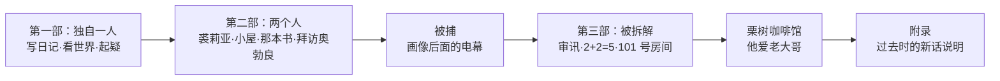
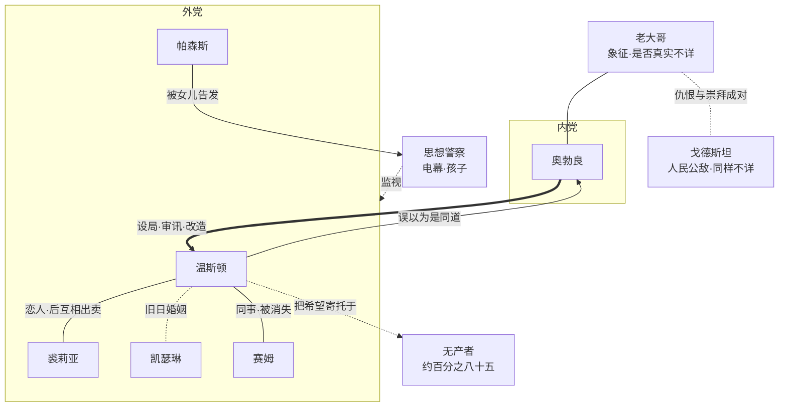

# 99｜系列总结：《一九八四》

> 这本书借一个小职员的故事，讨论的是同一件事：当权力要的不再是你的服从，而是你的记忆、语言、情感和内心，一个人还剩下什么。温斯顿一点点被拿走了世界，又被换上另一个，最后连「不愿意」这件事本身也被改写成了「我爱」。

> **剧透提示**：以下内容包含关键剧情与结局。

---

## 一、故事地图

全书三部，写的是同一个人的三种处境：一个人，两个人，然后又回到一个人，只是最后那个「一个人」已经被拆空了。

第一部是观察。温斯顿在四月一个钟敲十三下的日子里买下日记本，坐进电幕看不到的壁龛，写下第一行字。顺着这一行字，读者认识了大洋国的分层、四个部的反义名字、电幕与告密的孩子，也看见了真理部里例行公事的改史。这一部的主题是：一个世界如何先让你看不清它，再让你不敢说它。

第二部是越界。纸条上的「我爱你」，乡间空地，杂货店楼上没有电幕的小屋，奥勃良豪华公寓里那场仪式般的宣誓，戈德斯坦的书。这一部里温斯顿拥有了他一生中仅有的一点私人生活，也把自己的命一寸寸交了出去。

第三部是回收。牢房、刻度盘、四根手指、老鼠、咖啡馆。党在这里证明的不是它能杀人，而是它能改人。

## 二、人物地图

小说人物不多，每个人几乎都是一种态度的代表。

**温斯顿·史密斯**，三十九岁，真理部记录司的外党职员，体弱，怕疼，不英勇。他的全部动力是一点固执的「这件事发生过」。这是他的力量，也是他被捕获的缺口：他想要一个「为什么」，所以会相信任何看上去给出了答案的人。

**裘莉亚**，二十六岁，小说司的机械工。她反抗的是被管得太多的生活，在规则的缝里偷偷快活，对真假本身兴趣不大。她更像幸存者，温斯顿更像见证者。

**奥勃良**，内党成员，温斯顿以为的同盟，事实上的设局者与审讯者。他体面、耐心，像一位教师，也是全书里唯一把权力的逻辑说透的人。

**配角各自占一种位置。** 赛姆是看懂了一切的专家，因为说得太清楚而消失；帕森斯是最彻底顺从的党员，被自己七岁的女儿告发后仍满怀感激；凯瑟琳是「人形录音机」，是温斯顿婚姻里的空洞；查灵顿先生是旧货店里属于过去的老人；戈德斯坦与老大哥是党需要的一对象征，一个供人恨，一个供人爱，书里始终不确定他们是否真实存在。

## 三、人物关系图

这张图里最重要的是一条粗线：奥勃良到温斯顿。其余关系几乎都是它的陪衬。温斯顿对无产者的期待是单向的，他从未真正与他们交谈；他与裘莉亚的亲密是真的，所以才会在最后被当作筹码；他与奥勃良的「同盟」只存在于他的需要里。

## 四、核心冲突

表面上看是一个人对一个国家。再往下，是三组更具体的对峙。

第一组，**记忆对记录**。温斯顿手里只有日记、一段童年记忆、半页旧报纸，对面是整个真理部。党的第二句口号说，谁控制过去，谁就控制未来，说的就是比较的权力：没有可对照的过去，现在就没有刻度。

第二组，**私人对公共**。壁龛、小屋、镇纸、没有电幕的角落，这些都是「里面」的象征。党要取消的正是这个「里面」。

第三组，**为什么对怎么做**。温斯顿一直想弄清党为什么这样，戈德斯坦的书只回答了怎么做。真正的答案在奥勃良嘴里：为了权力本身。这个答案之所以可怕，是因为它不需要任何理想来装饰。

冲突的结果是一边倒的，但小说并不是靠对手强大来产生悲剧感，而是靠主人公自己的缺口。他要被理解，所以信了奥勃良；他要答案，所以读了那本书；他要保住「里面那一块」，所以在 101 号房间里发现那一块也能被拿走。

## 五、核心主题

这个系列拆出了五条互相咬合的线，可以串成一条因果链。

**监视造出自我审查。** 电幕的力量不在真的看见，而在你无法确定有没有被看见。久而久之，被监视者替监视者先检查了自己。

**对过去与记录的垄断。** 真理部把谎言做成流程：换名字（勘误）、拆工序、烧证据。改的人知不知道并不重要，因为流程不需要人相信，只需要人照章办事。

**对语言与思想的限制。** 新话是个夸张的设想，作为语言学预测不成立，作为对权力如何对待语言的描述却有洞察。真正起作用的往往不是词没了，而是敢不敢说。

**对情绪与内心的改造。** 两分钟仇恨把愤怒当配给品分发，对象可以随时更换；双重思想要求把矛盾的两边都留着，并忘记自己留过。到了第三部，奥勃良说得最直白：党不满足于消极的服从，要的是你出于自由意志的屈服。

**对现实本身的宣称。** 四根手指一幕里，党要证明的不是它能让你说错话，而是对与错都可以服从命令。小说没有让奥勃良的哲学获胜，它让他的刻度盘获胜：现实并没有被证明不存在，只是一个人在无法承受的压力下放弃了为它辩护。

五条线的终点是同一个：「我爱老大哥」。这是全书最恐怖的一句话，因为此刻已经没有人逼他。

## 六、作者思想

先分清哪些是作者明说的，哪些是读者的推断。

**作者明说的。** 奥威尔在一九四六年的《我为什么写作》里说，自一九三六年以来，他写下的每一行严肃作品，都是反对极权主义、拥护他所理解的民主社会主义。《一九八四》出版后，他在给工会官员亨森的回信里说，这本书不是对社会主义或工党的攻击，而是对中央集权体制可能出现的扭曲的揭示；他不认为这样的社会必然到来，但相信类似的东西可能到来。

**文本里能确认的。** 统治大洋国的主义叫英社，是「英国社会主义」的缩写。研究者通常把它读成一个过程：以平等为名的运动夺得权力之后，留下名字，掏空内容。被写的是权力垄断，不是平等的理想。

**可以合理推断的。** 这本书的底色是一种对「客观真相」的执着。他在《回顾西班牙内战》中写到，他最怕的是客观真相的概念正在从世界上消失。审讯一幕几乎就是这句话的小说版。

至于流行的说法，比如某个部门以哪座大楼为原型，奥威尔本人并无明确说明，不宜当作定论。

## 七、时代背景

书写于一九四七至一九四八年，主要在苏格兰朱拉岛，作者重病缠身，一九四九年六月出版，次年一月去世。

它背后站着他的几段亲历：缅甸的帝国警察生涯让他见过权力对被统治者的态度；底层生活让他见过贫穷；西班牙内战让他见过同一件事被不同报纸写成相反的故事，也见过理想被内部清洗吞掉；BBC 的工作让他近距离看到战时宣传。

时代的空气里则有纳粹与斯大林体制的经验，莫斯科公审上被告的「自愿认罪」，战后的瓦砾与配给，冷战格局正在形成。小说里衣物配给券、断货的剃须刀片、味道像煮白菜的楼道，是一九四〇年代英国的日常；而电幕、孩子告发父母、一夜之间换掉敌人，是当时人们已隐约听说过的东西。

## 八、写作技巧

整个系列反复指向几处写法。

**用清单与物件替代议论。** 炖菜、糖精、漏水的管道、没有窗的友爱部。荒谬自己从句子之间冒出来，作者不替你下结论。

**视角紧贴温斯顿。** 读者只知道他知道的，所以会和他一起把那一眼读成同盟，一起读完戈德斯坦的书而感到安心，一起在画像后面露出电幕时心里一沉。最后一页，旁白与主人公的声音合而为一，连叙述者也像被说服了。

**书中书做成圈套。** 戈德斯坦的书说的大半是真话，所以才能骗人。读者读到「这分析真透彻」时，已经和温斯顿犯了同一个错误。

**意象在三部之间翻面。** 镇纸从被拥有到被砸碎，黄金乡从梦到实景再回到梦，老鼠从小屋的恐惧变成 101 号房间，童谣从怀旧变成判决，「没有黑暗的地方」从未来的希望变成灯永不熄灭的牢房。同一样东西，前半本里是可能，后半本里全部翻面。

**延迟与留白。** 101 号房间的数字先在牢房里被低声念了很久；真正的高潮发生时，叙述直接离开现场，只剩一声笼门响。

**平实的语言。** 他写一个语言被篡改的世界，用的却是最朴素的英语，好像一块窗玻璃，让人看见窗外而不是玻璃。

## 九、文学史意义

它与扎米亚京的《我们》、赫胥黎的《美丽新世界》常被并称为三大反乌托邦小说。三者的分工大致是：《我们》最早，写理性秩序对个体的取消；《美丽新世界》写以快乐与条件训练实现的控制；《一九八四》写以恐惧、谎言与内心改造实现的控制。

它的贡献在于，把一整套抽象的权力机制变成了一批人人可用的词：老大哥、双重思想、新话、记忆洞、思想罪、非人。这些词至今仍被不同立场的人用来命名自己的不安。波斯曼在一九八五年的《娱乐至死》前言里还拿它与赫胥黎并读，说明这部作品已经成了衡量后来者的尺子。

## 十、作品的局限与争议

读完整个系列，应当诚实地说，这本书并不完美，而且争议很多。

**女性人物。** 文本事实是，裘莉亚被写成不爱读书、对理论毫无兴趣、会在温斯顿谈真相时睡着的人，温斯顿还说她只是「从腰部以下造反」。批评者认为这使她成了衬托男主人公深度的角色。也有读者指出，她在好几处比温斯顿清醒：怀疑战争是否真的在打，怀疑兄弟会，熟练地表演「好党员」。这个形象是否公平，没有定论。

**无产者。** 温斯顿在日记里写希望在他们身上，却从未与他们认真交谈；他去酒馆问到的只是一堆碎片。常见的读法是：这是奥威尔对政治希望的怀疑。也有读者认为，这样处理实际上把一大群人写成了没有声音的背景。

**对权力的简化。** 奥勃良说权力的目的就是权力，这个论断在小说里被写得没有缝隙。现实中的极权体制往往更混乱、更低效、更多反抗。这是文学上的极化，不是对任何一个国家的实录。

**新话的设想。** 强版本的语言决定论总体上被研究者否定，词汇被删并不会让概念消失。这套设想夸大了机制，没有夸大动机。

**技术。** 电幕只是一个年代的想象载体，书里没有预见互联网。把它当预言来数「说中几条」，很快就会失望。

**附录的歧义。** 附录用过去时写成，有人读成统治已经终结的暗示，有人认为过去时只是叙述习惯。三种读法在文本里都能找到一点依据，没有一种能被直接证实。

**被征用。** 同一本书先后被不同阵营当作攻击对手的材料。作者生前已经为此写信澄清。今天「奥威尔式」几乎成了万能标签，值得先问：你引用的是他的立场，还是你自己的立场。

## 十一、今天为什么值得阅读

不是因为它预言了什么，而是因为它提供了一套问题。

当你发现自己在发言之前先替看不见的观察者改了几遍稿，那是电幕的机制。当你读到一篇文章越读越觉得它说的正是自己想的，那是戈德斯坦的书的机制。当网上的愤怒几天换一个对象却没有减少，那是仇恨周的机制。当图片与视频不再自动是证据，当网页悄悄失效，当长期待在一个环境里把环境的要求当成自己的愿望，这些都只是轻量的、不完全相同的对应物。

读它的方法，是每次说「像」，都接着问一句「不像在哪里」。今天的许多记录是我们自己同意的，被看见通常不会被蒸发，被改动的东西往往还能当场被反驳。像的是机制，不像的是形态与动机。把它当镜子，而不是水晶球，才读得出分量。

## 十二、只记住 10 句话

1. 日记不是反抗的工具，是一个人想确认自己还存在的本能。
2. 名字与职能相反，不是修辞玩笑，而是这个世界的运转方式。
3. 监视的力量不在真的看见，而在你永远不确定有没有被看见。
4. 谎言一旦做成流程，就不需要有人相信，只需要有人照章办事。
5. 谁控制过去，谁就控制比较的权力，也就控制了未来。
6. 新话作为语言学是夸张，作为权力的方式却很准：让人不敢说，比让人说不出更实际。
7. 把愤怒定时定量地发出去，比禁止愤怒更有效，因为对象可以随时更换。
8. 渴望被理解的人最容易被骗，圈套里放的往往是真话。
9. 每个人都有一件无法承受的东西，权力的本事就是找到它。
10. 最彻底的统治不是让你怕它，而是让你爱它。

## 十三、与其他作品的关联

**《动物农庄》。** 同一位作者，写于一九四五年，以寓言讲革命如何被权力吞掉。它写权力如何形成，《一九八四》写权力形成之后如何运转，两本书可以对读。

**扎米亚京《我们》。** 奥威尔一九四六年为它写过书评，这是可查的。他读过、评过，并在写作时有所借鉴，这一点多有记载；借鉴了多少、哪些地方，没有定论。

**赫胥黎《美丽新世界》。** 常被并读，是因为两本书描绘的控制方式几乎相反。赫胥黎在一九四九年写信给奥威尔，认为更温和的手段终将比靴子踩在脸上更有效。他们互相有没有直接影响，不能简单断言，赫胥黎曾说过自己写作时没有读过《我们》，这是二手转述。

**卡夫卡。** 《审判》《城堡》里不明所以的罪名与无法理解的官僚机器，常被拿来与《一九八四》并读。奥威尔是否直接受其影响，目前缺乏可靠来源，不能确定。

**科斯特勒《正午的黑暗》。** 同样写到被告对自己的罪行「自愿」认罪。小说里的审讯和它在题材上相近，是否直接影响，同样并无定论。

**后世。** 波斯曼的《娱乐至死》，祖博夫的《监控资本主义时代》，都用奥威尔作为参照。它们是后人的读法，而不是奥威尔本人的意思。
