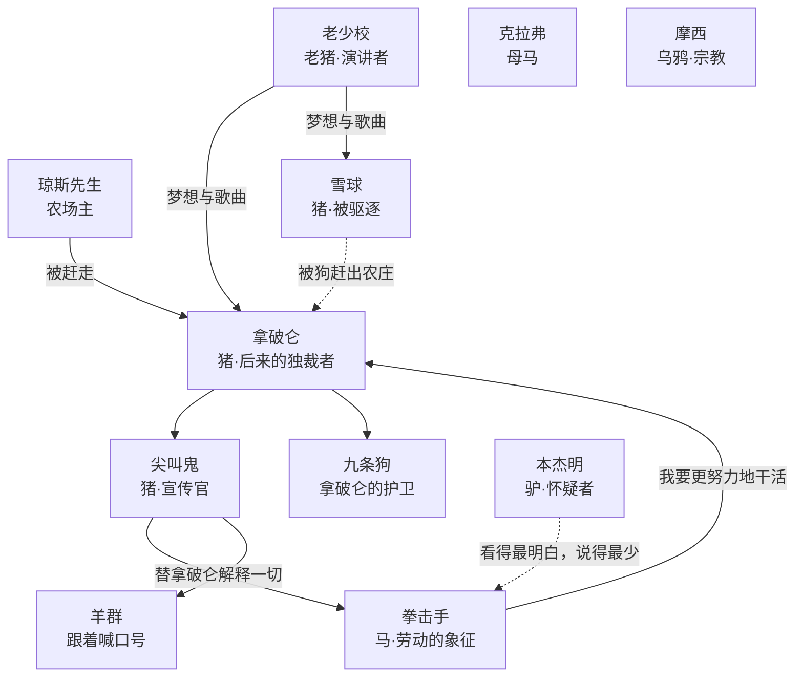

# 00｜系列导读与目录

> 《动物农庄》深度解读系列：先带你认识这本书，再带你一层层走进去。

## 系列简介

《动物农庄》是乔治·奥威尔在一九四五年出版的中篇小说，副标题叫「一个童话」。故事很短：曼纳农场里的牲畜听了一头老猪的演讲，决定赶走醉醺醺的农场主琼斯，自己当家作主。起义成功，农场改名「动物农庄」，墙上写下七条戒律，最后一条是「所有动物一律平等」。几年之后，猪开始睡进了人的床，开始穿衣服，开始用两条腿走路，墙上的最后一条戒律也多了几个字。这本书最值得读的地方，不是它讽刺了谁，而是它让人看清：一场以平等为名的革命，是怎么一步一步变成它当初要推翻的东西。本系列不按原书十章的顺序机械地走，而是按「故事 → 人物与权力 → 谎言与沉默 → 作者与写法 → 今天」的递进逻辑，把这本书拆成十篇文章加一篇总结，每一篇只回答一个问题。

## 作品定位

| 项目 | 内容 |
|---|---|
| 作者 | 乔治·奥威尔（George Orwell，本名埃里克·布莱尔 Eric Arthur Blair，1903—1950），英国作家、记者、随笔作家 |
| 首版时间 | 一九四五年八月十七日，英国 Secker & Warburg 出版社出版；此前多家出版社拒稿 |
| 创作过程 | 约写于一九四三年十一月至一九四四年二月，二战尚未结束；那时英国与苏联仍是同盟国 |
| 文学类型 | 政治寓言、讽刺小说、动物寓言；副标题「一个童话」 |
| 历史背景 | 俄国革命后苏联的演变，尤其是斯大林上台、大清洗与对宣传的垄断；写作时英苏结盟，书的出版因此遇到阻力 |
| 作品地位 | 奥威尔最早获得广泛成功的作品；与《一九八四》并称他的两部代表作，是二十世纪最常被引用的政治寓言之一 |
| 核心思想 | 革命如何被权力吞没；语言与宣传如何改写事实；平等原则如何被一点点换成特权 |

## 全书核心问题

| 层次 | 核心问题 |
|---|---|
| 故事层 | 一头老猪的演讲，为什么能点燃一场革命？起义成功之后，第一个争议为什么会落在牛奶和苹果上？ |
| 人物与权力层 | 拿破仑和雪球的斗争为什么注定只能有一个人赢？猪凭什么成为「领导者」？ |
| 谎言与沉默层 | 七诫为什么能被一条条改写？动物们明明看得出不对劲，为什么没有人说话？拳击手的结局说明了什么？ |
| 主题层 | 「所有动物一律平等，但有些动物比其他动物更平等」，这句话为什么成了最著名的一句？ |
| 作者与现实层 | 奥威尔为什么要用一个童话讲苏联？寓言体有什么好处？今天读这本书，我们该警惕什么？ |

## 故事与人物地图

主要角色与历史对应（对应关系为文学研究中的常见读法，不是每一处都有定论）：

## 剧透策略声明

本系列默认读者是**已经读完小说**的人。这本书很短，读一遍只要一两个小时，建议先读完原书再来读本系列。各篇开头都有「剧透提示」，说明涉及的情节范围；00 导读本身不点破结局的具体画面。

## 全系列目录

### 第一部分：进入农庄

#### 01｜一头老猪的演讲，为什么能点燃一场革命？
核心问题：动物们过了一辈子的苦日子，为什么偏偏在这一天决定造反？
核心观点：老少校给了动物们三样东西：一个解释、一首歌、一个未来；真正点燃革命的，是这三样东西合在一起。
理解难度：★★☆☆☆
关键词：老少校、《英格兰兽》、不满、解释
剧透范围：第一至二章
---

#### 02｜革命成功之后，谁来分配牛奶和苹果？
核心问题：起义才刚胜利，第一个争议为什么就落在牛奶和苹果上？
核心观点：权力的第一次越界，往往以「这是为了大家」的理由发生。
理解难度：★★★☆☆
关键词：牛奶、苹果、尖叫鬼、「脑力劳动」
剧透范围：第三章
---

### 第二部分：权力与代价

#### 03｜拿破仑和雪球：两头猪的斗争为什么只能有一个赢家？
核心问题：为什么权力斗争最后总是一个人赢，而不是两种主张共存？
核心观点：拿破仑赢的不是主张，而是办法：他先找到可以使用的暴力，再谈主张。
理解难度：★★★☆☆
关键词：雪球、拿破仑、风车、九条狗
剧透范围：第四至五章
---

#### 04｜动物们明明看得出不对劲，为什么没人说话？
核心问题：集体沉默是怎么形成的？
核心观点：沉默不是因为没看见，而是因为每个人都在算：现在开口，代价由谁来付。
理解难度：★★★★☆
关键词：沉默、清洗、恐惧、「糖果山」
剧透范围：第五至七章
---

### 第三部分：谎言与结局

#### 05｜尖叫鬼与谎言：七诫是怎样被一条条改写的？
核心问题：为什么没有人阻止七诫被改写？
核心观点：改写最有效的办法不是公开废除，而是让人怀疑自己的记忆。
理解难度：★★★★☆
关键词：七诫、尖叫鬼、宣传、记忆
剧透范围：第六至九章
---

#### 06｜拳击手为什么必须死？
核心问题：全书最勤劳、最忠诚的角色，为什么得到了最残酷的结局？
核心观点：拳击手的悲剧不是因为他做错了什么，而是因为他做对了一切，却无法改变规则。
理解难度：★★★☆☆
关键词：拳击手、劳动、忠诚、屠宰场
剧透范围：第九章，含关键情节
---

#### 07｜为什么「所有动物一律平等，但有些动物更平等」？
核心问题：结局那一幕为什么让人不寒而栗？
核心观点：最后一幕不是反转，而是完成：动物们再也分不清猪和人。
理解难度：★★★☆☆
关键词：两条腿、七诫、宴会、结局
剧透范围：第十章，含结局
---

### 第四部分：作者、写法与今天

#### 08｜奥威尔为什么要用一则童话来写苏联？
核心问题：这本书讽刺的是谁？为什么当时差一点出不了？
核心观点：它是一本讽刺苏联的书，也不止于此；理解这一点，需要把历史对应与奥威尔本人的立场分开来看。
理解难度：★★★☆☆
关键词：苏联、托洛茨基、斯大林、出版风波
剧透范围：不涉及具体情节
---

#### 09｜这个寓言是怎么写成的？
核心问题：为什么是动物？为什么是童话的口气？
核心观点：奥威尔用最简单的语言，让读者在笑声中先站到动物这一边，再发现自己也坐在了那张桌子旁边。
理解难度：★★★☆☆
关键词：寓言、反讽、简朴文体、叙述者
剧透范围：全书，含结局
---

#### 10｜今天读《动物农庄》，我们该警惕什么？
核心问题：它只是一本关于苏联的书吗？
核心观点：这本书真正想提醒的，是任何一个以「为了大家」之名的权力，都会遇到同样的诱惑。
理解难度：★★★☆☆
关键词：权力、宣传、监督、今天
剧透范围：不涉及具体情节
---

#### 99｜系列总结：《动物农庄》
核心问题：回头看，这本书究竟在讨论什么？
核心观点：全系列收束：从一个梦想到一张桌子，革命是怎样变成了它自己的反面。
理解难度：★★★☆☆
关键词：总结、主题、闭环
剧透范围：全书，含结局
---

## 推荐阅读顺序

主线：`01 → 10 → 99`，按认知难度分三段：

- **进入故事**（01—02）：难度最低，读完就能进入这个农场。
- **理解权力与谎言**（03—07）：核心部分，最好按顺序读。
- **理解作者与今天**（08—10）：从这个农场回到作者所在的世界和我们自己。

不同读者的入口：

- **只想抓骨架**：01 → 03 → 05 → 07 → 99。
- **对宣传与语言感兴趣**：05 → 09。
- **对历史对应感兴趣**：08。
- **想练习批判性阅读**：04、08、10 都明确区分了「文本事实」和「后人的解释」。

## 全系列状态

本系列共 10 篇正文 + 1 篇系列总结（99）。
