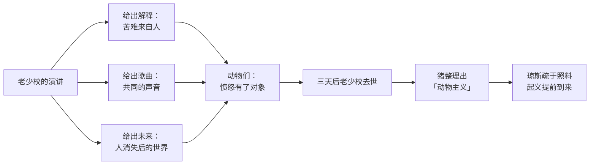

# 01｜一头老猪的演讲，为什么能点燃一场革命？

> 本篇核心问题：动物们过了一辈子的苦日子，为什么偏偏在这一天决定造反？

> **剧透提示**：本文涉及第一至二章，也就是起义的开头；会在文末略提后面七条戒律的命运，但不展开。

---

## 开篇：一个值得思考的问题

故事的第一幕，是一个醉汉摇摇晃晃地回家睡觉。

曼纳农场的主人琼斯先生，喝足了啤酒，忘了把鸡舍的小门关上。灯一灭，整个农场就骚动起来：一头十二岁的老公猪，人称老少校，说自己前一晚做了个怪梦，想趁主人睡着，召集大家在大谷仓里讲一讲。

于是马、牛、羊、鸡、鸭、猫、狗、驴、鸽子陆续赶到。老猪躺在稻草堆上，对着满屋子的动物，发表了一场演讲。

三天之后，老猪去世了。又过了几个月，动物们真的把琼斯赶了出去。

这一篇想问的是：这场演讲到底有什么魔力？这些动物不是一天两天地受苦，为什么之前没有人起来造反，偏偏听了一次演讲就动手了？

## 一、从故事开始

先看老少校说了什么。

他的开头很朴素：同志们，我们这一生的真相，是「悲惨、辛苦，而且短暂」。我们生下来，被给到刚好够活命的食物；能干活的，被榨干最后一点力气；等到再也没用了，就被残忍地宰掉。没有一只英国的动物，在满一岁之后还知道什么叫幸福和闲暇。

然后他把一个已知的事实重新说了一遍：这不是自然规律。英国的土地肥沃，气候温和，足够养活比现在多得多的动物。我们之所以过着这样的日子，**是因为我们劳动的几乎全部成果都被人类偷走了**。人是唯一只消费、不生产的生物：他不产奶，不下蛋，拉不动犁，跑不快抓不到兔子，却是所有动物的主人。

接着他点了名：对着母牛说，你们去年产了几千加仑牛奶，每一滴都流进了敌人的喉咙；对着母鸡说，你们下了那么多蛋，有多少孵成了小鸡？对着克拉弗说，你生的四匹小马，哪一匹还在你身边？对着拳击手说，你那一身肌肉一旦没了力气，琼斯就会把你卖给屠马的人。

最后，他讲了他的梦，并教会大家一首歌《英格兰兽》。

## 二、真正的问题是什么？

这场演讲真正回答的，是一个很普通的问题：

> 人为什么会忍受不公正，又是什么让他们突然不再忍受？

一个常见的想法是：忍受，是因为不知道有更好的生活；不再忍受，是因为终于知道了。可老少校没有告诉动物们任何它们不知道的事。母牛知道牛奶被拿走了，母鸡知道蛋被收走了。它们一直都知道。

那他给了什么？

**一个解释。** 在老少校开口之前，动物们的苦是一件一件的、互不相关的坏事：这一年冬天太冷，这一茬活儿太重，哪一头小马又被卖了。老少校把这些零散的事串成了一条线，给它起了一个名字：人。有了这个名字，苦难就有了原因，原因就有了责任人，责任人就可以被推翻。

**一首歌。** 《英格兰兽》教会了动物们一件事：怎么把一种愤怒变成大家共同的声音。书里写，他们试了几遍之后，整个农场一下子唱了起来。

**一个未来。** 老少校的梦，是一个人类消失之后的世界。你可以不相信它，但它让「明天会不一样」这件事，第一次有了画面。

## 三、人物为什么会这样选择？

看这些动物为什么会被说动，可以按它们各自的处境来想。

拳击手这样的老实马想要的很简单：好好干活，被公平对待。它害怕的是失去力量之后被卖掉。母马克拉弗是一个母亲，在意的是孩子被卖掉。母牛、母鸡在意的是自己的产物。每个动物的诉求都很具体、很小，**所以老少校的演讲才会这样有效：它没有要求任何人先成为英雄，只是替每个动物把心里的话说了出来**。

而猪的位置，值得多看一眼。老少校自己就是猪，他在演讲里也直说：「我是幸运的，活了十二年，有过四百多个孩子，这是猪的自然生活。」换句话说，他是演讲里少数几个并没有那么苦的动物之一。三天之后他去世，接过这场革命的，也是猪：雪球、拿破仑和尖叫鬼把他的思想整理成一套叫「动物主义」的体系。

## 四、作者真正想讨论什么？

这里要把几层意思分清楚。

**文本事实**：小说明确写了，起义并不是按计划发生的。老少校说过，这场起义「也许一周后，也许一百年后」。而真正发动的那天，是琼斯因为喝醉了，一整天忘了喂牲口，饿极了的动物们冲进储藏室，被琼斯和他的人用鞭子抽，终于忍不住一起反击，把人全部赶了出去。起义的时机不是被策划出来的，是被压垮出来的。

**常见的文学解释**：评论家常把老少校读成马克思或列宁的影子，把演讲读成对革命思想的概括：先找到一个压迫者，再指出剩余劳动被拿走，然后号召团结。这样读，这场演讲是一场教科书式的革命动员。

**一种可能的读法**：也可以换个角度读。老少校的演讲里，其实埋了好几个以后会开花的种子。第一，他把一切问题归结为「人」这个单一的敌人，这让后面的领导者永远有一个可以指向的对象。第二，他说「所有动物一律平等」，却在讲话开始时就以「教导者」的身份坐在高台上。第三，他有一个小细节：他让大家投票决定「老鼠是不是同志」，投票结果是同志，但有三只狗和一只猫投了反对，而猫「后来被发现两边都投了票」。这些细节很小，却是奥威尔对后面整个故事的一次预告：平等的口号，从第一天开始就是由一部分动物来解释的。

## 五、把这个问题放回时代

奥威尔写这本书是在一九四三年末到一九四四年初，当时他在英国。那几年里，不少英国左派知识分子对苏联的革命成果有很高的期待，把它看成一种可以借鉴的新秩序。

奥威尔并不反对革命的理想。他后来在文章里反复说，他自己是「民主社会主义」的支持者。他担心的恰恰是：一个以「消灭压迫」为目标的革命，如果没有办法限制新的权力，会走向什么地方。老少校的演讲里最动人的一句话，是「在与人类斗争的过程中，我们绝不能变得像人类」。这句话既是理想，也是整本书要检验的对象：它是怎么被一点点放弃的。

## 六、作品是怎么写出来的？

第一章的写法有几个值得留意的地方。

第一，**用一个醉汉开场**。琼斯在开篇就是个粗心、昏聩的人，不是什么恶魔。这样写，读者从一开始就不会觉得这是一个单纯的善恶之战，而是一个**管理失败**的故事：旧秩序之所以倒，不只是因为它坏，更是因为它松垮了。

第二，**用动物自己的口吻**。老少校的演讲几乎没有一个生僻词，每个动物听得懂。奥威尔特意让这场革命的话语尽可能简单，因为他想让读者看清：一个简单的口号有多大的力量，也就有多大的危险。

第三，**《英格兰兽》这首歌**。它在第一章出现，后来被禁，再后来被另一首歌替换。一首歌的命运，几乎就是整场革命的缩影。

## 七、如果放到今天

今天我们仍然会遇到类似的「演讲」。一个社群、一个公司、一个运动，总有人用简洁有力的话把大家分散的不满收束到一个名字上：这一切都是因为「他们」。

老少校的演讲提醒我们两件事。其一，**好的解释确实有力量**，不要因为它被滥用过，就否认大家的不满是真实的。其二，**要留意那个解释到底把谁放在了「他们」之外**：当一个解释只有一个敌人、没有任何自我怀疑的空间时，它迟早会变成另一种权力。

## 八、小结

这一篇想说清一件事：老少校的演讲点燃了革命，不是因为它告诉动物们什么新鲜事，而是因为它给了动物们一个解释、一首歌、一个未来。

也正是在这里，奥威尔已经埋下了全书的主线：**一个把所有问题归于单一敌人的理想，要怎样才能避免成为新的统治？** 老少校自己没有机会回答这个问题，他三天后就去世了。

## 下一篇

革命成功了，墙上写上了七条戒律，农场迎来第一次丰收。可才过没多久，大家就发现了一个新的问题：牛奶和苹果，到哪里去了？
