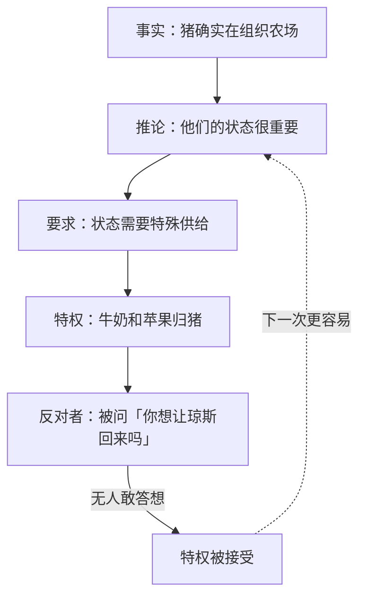

# 02｜革命成功之后，谁来分配牛奶和苹果？

> 本篇核心问题：起义才刚胜利，第一个争议为什么就落在牛奶和苹果上？

> **剧透提示**：本文涉及第三章，并回看第二章结尾牛奶消失的那一幕；只在个别地方提到后来的发展，不展开。

---

## 开篇：一个值得思考的问题

第二章快结束的时候，有一个很容易被读过去的细节。

三头母牛二十四小时没人挤奶，乳房胀得发疼，哞哞地叫。猪用蹄子夹着桶，把奶挤了出来，一共五桶，白花花、起着泡沫。有动物问了一句：这些奶怎么办？一只母鸡说，琼斯以前有时会拌一点在我们的饲料里。拿破仑走到桶前面，挡住了大家的视线：「别管牛奶了，同志们！那个会处理的。收割更要紧。」

动物们去了干草地。傍晚回来，牛奶不见了。

一个刚刚推翻了压迫者的农场，头一件没有交代清楚的事，居然是几桶牛奶。这一篇想问的是：为什么偏偏是牛奶和苹果？它们为什么能成为权力第一次越界的地方？而更值得追问的是，动物们为什么接受了？

## 一、从故事开始

第三章一开始，写的是一幅近乎田园的画面。收割干草，动物们汗流浃背，结果比预想的还好，比琼斯和他的人少用了两天，而且「一点都没有浪费」，母鸡和鸭子的锐眼连最后一根草茎都捡干净了。书里还特意补了一句：全农场没有一只动物偷吃过一口。

在这幅图景里，已经有一个细节埋着伏笔：猪「并不真正干活，只是指挥和监督」。叙述者给出的理由是：「凭着他们高超的知识，由他们来担任领导是很自然的事。」拳击手和克拉弗套上挽具，在田里一圈一圈地走，后面跟着一头猪，喊着「驾，同志！」「吁，同志！」

接下来，是一连串美好的日子：星期天升旗，开大会，学认字，雪球成立各种委员会。然后，在这些热闹的段落之间，叙述者平平淡淡地说了一件事：拿破仑把杰西和蓝铃刚断奶的九只小狗带走了，说要亲自负责它们的教育，藏在只有梯子才能上去的阁楼里。大家很快就忘了它们。

紧接着，这段话出现了：

「牛奶去了哪儿的谜，很快就解开了。它每天都被拌进猪的饲料里。」

早熟的苹果也开始落了。动物们理所当然地以为，这些风落的苹果会平均分。结果有一天，命令下来了：所有落地的苹果都要捡起来，送到农具房，供猪使用。有些动物小声嘀咕，可是「没有用」。书里特意强调，这件事上所有的猪意见一致，连雪球和拿破仑都一致，这大概是全书里他们两个唯一一次站在同一边。

然后，尖叫鬼被派出来做「必要的解释」。

## 二、真正的问题是什么？

尖叫鬼那段话，值得慢慢读。他先说，不要以为我们猪这么做是出于自私和特权，我们中很多猪其实不喜欢牛奶和苹果，我自己就不喜欢。然后说，我们这么做，唯一的目的是保持健康；牛奶和苹果里含有猪的身体绝对必需的物质，这是「科学证明了的」。再说，我们是脑力劳动者，整个农场的管理和组织都靠我们，白天黑夜都在为你们的福祉操心，「我们喝那牛奶、吃那苹果，是为了你们」。最后一步：如果我们猪倒下了，会发生什么？琼斯会回来！他几乎是哀求着问：「同志们，你们当中肯定没有谁想看到琼斯回来吧？」

这个问题的真正难点，不是猪该不该吃苹果。猪的确需要吃东西，指挥的人需要精力，这些话单独拿出来看，并没有错。真正的问题是：**一个本来应该平分的东西，是怎么变成了「只给一部分」，而且几乎没有遇到阻力？**

可以把这套话拆成一条链子：

链子里每一环单独看都不算荒唐，荒唐的是最后一环：把质疑特权，等同于召回旧主人。当「琼斯会回来」成了通用的结尾，前面的任何一个环节就都不必再经受检验了。

## 三、人物为什么会这样选择？

先看动物们。书里有一句话，几乎把整个心理过程交代完了：

「动物们完全确定的一件事，就是他们不要琼斯回来。」

这是一个被革命的成功固定下来的底线。琼斯是他们共同的、记忆犹新的噩梦，所以任何以琼斯为代价的论证，都会立刻压倒其他的考虑。书里的话是：「这么一说，他们就没什么可讲的了。」于是，牛奶和风落的苹果，连同以后成熟的苹果，「毫无异议地」被决定留给猪。

其次是对猪的信任。收割的成功，认字班的成功，写在墙上的七诫，这一切都是猪带来的。动物们对猪的信任，不是盲目的，而是有一个真实的功劳作基础。信任越有底，越难当面开口说：你们多拿了。

还有一层，是代价的计算：几桶牛奶、几筐苹果，对一个刚刚吃饱的农场来说，实在是小事。为这点东西去顶撞给自己带来了好日子的领导者，似乎不划算。

再看猪。叙述者没有写猪的内心，这一点很重要。我们只看到一些行为：他们在农具房里单独学习，用的是从农舍里搬出来的书；命令一发出，尖叫鬼就「被派去」做解释，像一道现成的程序。**这至少说明，越界和解释是配套出现的：决定做出的同时，说法就已经有人负责了。**

## 四、作者真正想讨论什么？

这里要把几层意思分清楚。

**文本事实。** 第三章里，牛奶和苹果的分配，是一个小团体的决定。书里没有写任何一次大会上的投票：命令是「发出」的，反对是「嘀咕」，最后是「毫无争议地」被认可。而同一章里讲得清清楚楚：每周的大会上，提出议案的永远是猪，别的动物只懂得怎么举手，却想不出任何议案。也就是说，**决定在小范围内完成，大会只是用来知会和追认的地方。**

**作者的明确表述。** 关于这一场景，奥威尔本人有没有专门说过什么，目前缺乏可靠来源，不能确定，所以这里不替他下结论。

**常见的读法。** 许多读者把猪读成革命后的新精英，把牛奶和苹果读成最早的特权物资，把「脑力劳动」读成新统治阶层为自己辩护的话术。这个读法有文本支持：尖叫鬼的发言，几乎每一句都在把特权转写成责任。

**也有读者认为……** 这一幕并不只是在讽刺伪善，而是在写一个真实的难题：任何组织都需要有人专门负责协调，协调者需要条件，条件就可能变成特权。按这个读法，奥威尔写的不是坏人如何骗人，而是一个合理的需要如何不被察觉地滑成不合理的占有。

**一种可能的读法是：** 这一场戏最让人不安的地方，是尖叫鬼的论证里有一部分是真的。猪确实在组织农场；琼斯回来也确实是个灾难。真话被拿来保护假的结论，才最难反驳。

## 五、把这个问题放回时代

奥威尔写这本书的时候，英国正处在战时配给制度之下，食品从一九四〇年起就按人头凭票分配，培根、黄油、糖都是定量的，这种制度一直延续到一九五〇年代。「大家公平分」是那几年里最普通的政治常识，也是人们对战争痛苦最起码的期待：谁多拿一口，邻居都看得见。

在这样的背景下读牛奶与苹果，会更有感觉：一个读者几乎本能地知道，分配问题从来不是小事，它是共同体是否公正的试金石。

如果对照苏联历史，则有一个常被研究者提到的事实：苏联的干部享有专门的供应渠道，这是史学界熟知的情况。不过，把它和这一场戏一一对应，是后来读者的解释，不是书里写明的。

## 六、作品是怎么写出来的？

第三章的写法，有三点值得留意。

第一，**顺序。** 牛奶是在一个快乐的章节里出现的。收割的成功、读书班、旗帜、委员会，都是明亮的画面，牛奶这一笔夹在中间，看上去不过是一桩小小的行政事务。奥威尔不让读者在这里警觉，**因为在真实的生活里，第一次越界通常也出现在气氛最好的时候。**

第二，**被动语态。** 「牛奶消失了」「命令发出了」「大家同意了」，每一句都没有主语。谁拿的？谁下的令？谁同意的？叙述者把这些都藏起来了，因为在这样的时刻，答案本来也是模糊的。

第三，**尖叫鬼第一次被正式介绍为解释者。** 他蹦蹦跳跳，晃着尾巴，几乎是央求地说话。这个形象很可爱，甚至很无辜，但他开场就把全书会反复使用的整套工具亮了出来：科学的名义、功劳的名义、恐惧的名义。后面的许多事，其实都是这一场戏的放大和加固。

## 七、如果放到今天

这一幕的形状，在今天并不陌生，我们可以拿三个问题去检验一件具体的事：

一个团队里，有人拿走了某项资源，理由是「为了保证核心人员的状态」「为了决策效率」。这时可以问：第一，这个理由能不能被外面的人核实？尖叫鬼的「科学已经证明」，恰恰是不能核实的。第二，这个安排有没有期限、有没有被撤回的办法？第三，如果有人提出异议，得到的回答是内容，还是一句「你是想让局面失控吗」？

比如一个社群里的管理员，为了「维持秩序」拿走了某些权限；比如公司里，为了「让管理层把精力放在重要的事情上」，给他们配的专属待遇。这些安排不一定是错的，有些确实合理。但当质疑本身被说成对共同利益的威胁时，就该提高警觉了：**一个经得起检验的理由，不怕被追问。**

## 八、小结

这一篇回答的是：起义才刚胜利，第一个争议为什么就落在牛奶和苹果上。

答案不在牛奶和苹果本身，而在它们是最先出现的、可以被分配的东西，也是最容易被说成「应该这样」的东西。权力的第一次越界，几乎总是以一个很难反驳的理由出现：这是为了大家。动物们接受它，是因为一边是对琼斯的恐惧，一边是对猪的信任，而代价看上去又小得几乎可以忽略。

**第一次让步的价值，不在于它拿走了什么，而在于它证明了：这样说话是管用的。**

## 下一篇

特权的第一块砖放下了，猪的内部却并不平静：雪球和拿破仑在每次大会上都对着干，而且越吵越凶。两头猪的斗争，最后为什么偏偏只能剩下一个赢家？
