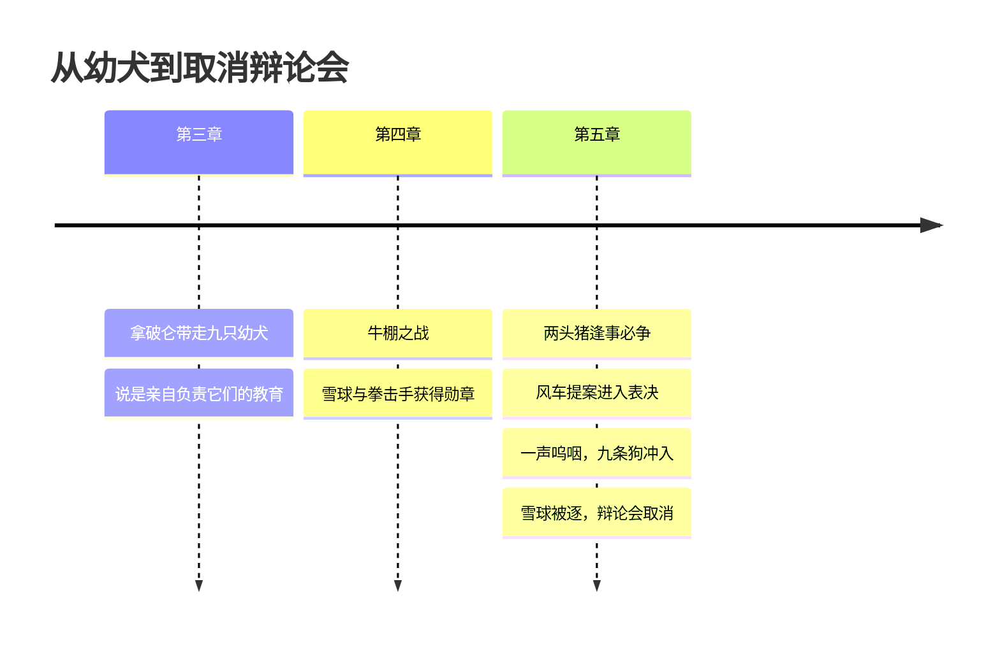

# 03｜拿破仑和雪球：两头猪的斗争为什么只能有一个赢家？

> 本篇核心问题：为什么权力斗争最后总是一个人赢，而不是两种主张共存？

> **剧透提示**：本文涉及第四至五章，包括牛棚之战、风车之争，以及雪球被赶出农庄的经过；个别地方会一笔带过后来的反转，但不展开。

---

## 开篇：一个值得思考的问题

大谷仓里，雪球正讲到最精彩的地方。

他刚刚描绘完一个没有繁重劳动的农场：电灯、热水、电暖器，脱粒机、犁和收割机自己转起来。动物们已经听入了迷，书里说，到他讲完的时候，表决的结果「已经毫无疑问」。

就在这时，拿破仑站了起来，斜着眼睛看了雪球一眼，发出一声尖细的呜咽，是谁也没听过的那种声音。

谷仓外面传来一阵可怕的吠叫，九条戴着铜钉项圈的大狗冲了进来，直扑雪球。雪球跳出座位，几乎是擦着狗牙逃了出去，穿过长牧场，钻过树篱上的一个洞，从此再没人见过他。

这一篇要问的是：两头猪争了那么久，为什么最后不是各让一步，而是一方被撵走，另一方独占农场？更具体地说：**拿破仑赢的到底是什么？**

## 一、从故事开始

先看雪球，因为在这一幕之前，他是全书里最光彩的角色之一。

牛棚之战里，他读过一本从农舍里翻出来的恺撒战史，用它布置防御：先派三十五只鸽子从空中袭扰，再让鹅啄人的小腿；第二波是羊和他自己带头冲击，一听见他的尖叫就假装溃退；等人们追进院子，埋伏在牛棚里的马、牛和猪突然杀出，切断退路。他自己直扑琼斯，挨了一枪，背上一道道血痕，同时撞倒了琼斯。战后，动物们一致决定设立「动物英雄」勋章，当场授予雪球和拳击手。

这场仗里有一个值得注意的空白：叙述者在整个战斗描写中没有提到拿破仑。后来这个空白会被填上一个很不一样的版本，不过那是后面的事了。

再看第五章。两头猪的关系，用一句话说就是：一个提出什么，另一个必定反对。一个要多种大麦，另一个必要燕麦；一个说这块地适合种白菜，另一个就说除了块根什么都种不了。

他们的风格也完全不同。雪球靠演说，常常在大会上说服多数。拿破仑不太演说，他擅长的是「会议之间」的拉拢，特别是对羊群。羊群开始在关键时刻，尤其是雪球讲话的关键处，冷不丁地喊起「四条腿好，两条腿坏」。

风车之争把矛盾推到了顶点。雪球拿着粉笔，趴在孵化室的地板上画了几个星期的图纸；拿破仑一直说反对，有一天忽然走进去，把图纸看了一圈，然后抬起腿，在图纸上撒了一泡尿，一句话没说就走了。到了表决那天，他只讲了不到三十秒，说风车是胡闹，劝大家不要投票。雪球的雄辩把多数拉了过去。接下来就是那声呜咽、那九条狗。

事后，拿破仑踏上老少校当年站过的台子，宣布：星期天早上的辩论会取消，不需要了，浪费时间。今后一切有关农场运作的问题，由一个以他为首的猪的特别委员会私下决定，再向大家通告。

到这里，有一个交代是必须的：这九条狗，就是第三章里被拿破仑从母狗身边带走的九只幼犬。书里说，它们摇尾巴的样子，和当年对着琼斯摇尾巴一模一样。

## 二、真正的问题是什么？

表面上，这是一场关于风车的争论：建，还是不建？

但如果认真看这个过程，就会发现，风车从头到尾没有被「驳倒」。拿破仑没有一条有力的论证：他的话是「风车是胡闹」，是撒尿，是半分钟的发言。他提出的真正有分量的反对意见只有一个：先增产粮食，不然大家会饿死，这个理由并非毫无道理。可到了表决的关键时刻，他没有用这个理由去说服谁。他换了一种方式。

所以这里的真正问题是：**权力的竞争，到底是在比谁的主张更好，还是在比谁能决定主张怎样被处理？**

如果规则是投票，那么靠演说赢票的雪球就会赢；拿破仑想赢，要么在演说上超过他，要么改变规则。他选了后者，而且早早就开始准备了。

## 三、人物为什么会这样选择？

**拿破仑。** 他的路线，一部分在文本里看得很清楚。第五章里说他「自己不拿出任何方案，只是平静地说雪球的方案会一事无成，似乎在等待时机」。等待什么？回头看他在第三章做的事，一种可能的解释是：带走幼犬，藏在阁楼上，让大家「很快忘了它们的存在」。这等于把暴力工具的培养，包装成了教育。

这也解释了开头的那个问题：他赢的不是主张，是办法。雪球有恺撒战史、有图纸、有口才；拿破仑有狗，有羊，有一个只有他能发出的信号。

**雪球。** 他是一个相信道理的人。他的整套方式，委员会、认字班、图纸，都以「把事情讲清楚，让大家自己决定」为前提。这不是弱点，而是他对这个农场的信念。问题在于：他研究了恺撒怎样对外打仗，却没有想到，武器会从内部伸出来。书里没有写他被狗扑向时在想什么，但从他慌忙跳开、几乎来不及出声的样子看，这场较量的规则，显然已经不是他以为的那一种。

**其他动物。** 书里有一句很刺的话：动物们「先听拿破仑，再听雪球，不知道谁对；其实，他们总是赞同正在说话的那一个」。这是一群没有自己的判断框架的听众，所以才会被半分钟的发言、几声羊叫轻易影响。至于狗冲进来之后，他们是「吓得说不出话」，纷纷挤到门口看这场追逐，然后「沉默而恐惧地」回到谷仓。他们不是同谋，但在那一刻，他们成了没有力量的旁观者。

## 四、作者真正想讨论什么？

这里要把几层意思分清楚。

**文本事实。** 这场斗争的结局，不是由辩论分出的：表决没有完成，雪球是被狗赶走的，辩论会随后被取消。三个动作紧挨着发生：先清除对手，再取消论坛，再把决定权收进一个私下开会的小委员会。顺序本身就是一种说明。

**作者的立场。** 奥威尔明确把这本书和苏联联系在一起，并多次说过它的目的是批评苏联政权。至于逐个人物的对应，他本人的表述需要查具体的文献，这里不替他做逐条的断言。

**常见的读法。** 雪球对应托洛茨基，拿破仑对应斯大林。托洛茨基是红军的组织者，和书中指挥牛棚之战的雪球相呼应；他于一九二九年被驱逐出苏联，一九四〇年在墨西哥被杀。斯大林则是靠对党的机构的控制，一步步压倒了同样有威望的对手。风车常被读成工业化和电气化计划。这个对应在文学研究和历史书写里都很常见，不过它是读者的解释，不是书里的明文。

**也有读者认为……** 不应该把雪球读成纯粹的好人。他提出风车时，对如何取得发电机和电缆这类关键问题含糊带过，书里特意写了一句「这些要怎么弄到，雪球没有说」；他的雄辩也是一种说服，甚至是一种带有诱惑性的承诺（每周只要工作三天）。拿破仑关于粮食的担心，也不是凭空捏造。按这种读法，奥威尔并没有把这场争论写成「正确对错误」，而是写成「两种合理的主张之间的对立」，恰恰因此，谁来决定怎样处理分歧，才成了问题的核心。

**一种可能的读法是：** 奥威尔想说明的，是两种政治的差别。一种政治里，输赢发生在主张之间，输的一方还可以留在场内，下次再争。另一种政治里，输赢发生在「谁能让对方消失」之间。后一种政治里，主张只是名义，暴力和程序才是实质。

## 五、把这个问题放回时代

奥威尔不是从书本上了解这件事的。他在一九三六至三七年去了西班牙，加入了一支与共和国政府并肩作战的左翼民兵（马克思主义统一工人党，即 POUM）。一九三七年五月，巴塞罗那爆发内部冲突，随后共产党主导的力量对这个党派展开镇压，奥威尔不得不逃离西班牙。他的《向加泰罗尼亚致敬》一书记下了这段经历。

对他来说，「同一阵营里的人，胜利之后把另一部分人说成叛徒并清除」，不是一个抽象的寓言，而是亲眼所见的事情。这也解释了为什么这本书写雪球被逐时，笔调那么冷静，甚至带着荒诞的喜剧感。

## 六、作品是怎么写出来的？

这一幕的写法，有几处特别值得看。

第一，**信号很小，后果很大。** 拿破仑发出的只是一声「尖细的呜咽」，书里强调这是「谁也没听过的声音」。一个极轻的信号，换来一群巨犬的冲锋。奥威尔用这个反差告诉我们：真正的权力常常不是喊出来的，而是一旦发出，就有人立刻照办。

第二，**追逐的喜剧性。** 雪球「像只有猪才能跑出的那样」飞奔，眼看要被追上，又加速，狗嘴差一点咬到尾巴，他把尾巴一甩，钻进了篱笆洞。这段描写几乎有点滑稽，读者会不自觉地为他捏一把汗，甚至忍不住想笑。可是接下来立刻是动物们沉默地爬回谷仓。笑与冷的剪接，本身就是这场戏的讽刺。

第三，**幼犬的伏笔。** 它在第三章里埋得那么轻，以至于大多数第一次读的人都不会留意。奥威尔让读者在事后「恍然大悟」，也等于让读者体验了一次动物们当时的状态：线索摆在眼前，却没有人把它们连起来。

最后一个细节：拿破仑站的位置，是老少校当年的台子。第一场演讲里，那个台子是用来点燃反抗的；现在，同一个台子被用来宣布不再需要讨论。

## 七、如果放到今天

这个故事的骨架，在今天的许多场合都看得到：两个负责人在会上各执一词，其中一个会下去单独做工作；会议的规则、议程、参会名单、纪要，其中一项悄悄地变了；最后，争论在没有任何人被说服的情况下结束了，因为已经有一方有了「不必说服别人，也能让决定生效」的东西，比如预算权、人事权，或者一套只有他能改动的程序。

所以，看一场权力之争，除了问「谁的主张更好」，还可以问另外几个问题：谁控制着议程？谁控制着会议之后的执行？当分歧出现时，有没有一个双方都无法单方面关闭的场合？

## 八、小结

这一篇回答的是：为什么两种主张不能共存，最后只能有一个赢家。

答案是：当其中一方掌握了暴力和程序，这场竞争就已经不再是主张之间的竞争。拿破仑早在风车图纸出现之前，就已经准备好了狗；他在会上一句像样的话也没有说，却在会后一并拿到了所有的东西：对手的消失、辩论的终止，以及一个只对他负责的委员会。

**主张可以被反驳，办法却可以直接让反驳不再发生。** 这是这场斗争留给后面所有章节的前提。

## 下一篇

辩论会取消了，狗在拿破仑身边坐成一圈。有人想说话，有人想抗议，可是接下来，几乎没有一个声音真的响起来。动物们明明看得出不对劲，为什么没人说话？
