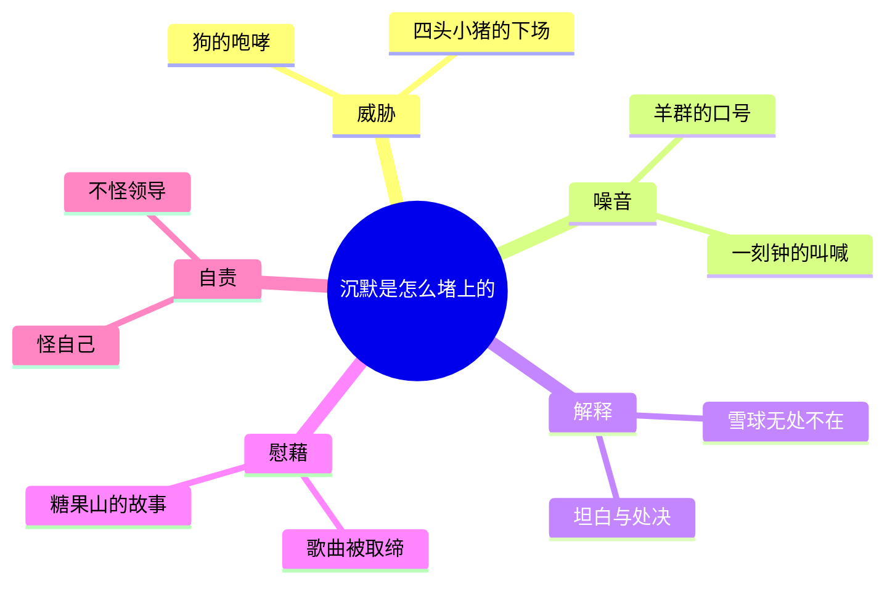

# 04｜动物们明明看得出不对劲，为什么没人说话？

> 本篇核心问题：集体沉默是怎么形成的？

> **剧透提示**：本文涉及第五至七章，包括清洗与处决的场面，并会回看第二章、提到第九章里摩西与「糖果山」的出现；不涉及后面的结局。

---

## 开篇：一个值得思考的问题

第七章里有一个很安静的画面。

处决刚刚结束，空气里还是血的味道。幸存的动物们悄悄爬上了山坡，挤在一起，像是互相取暖。克拉弗往下看，整个农场都在眼前：长牧场，干草地，小树林，水塘，嫩绿的麦田，还有冒着炊烟的红屋顶。那是个晴朗的春天傍晚，草和树篱被斜阳镀成金色。书里说，他们「带着一点惊奇」想起这个农场是自己的，每一寸都是自己的，从来没有觉得它这么可爱。

克拉弗的眼里却含着泪。如果她能把想法说出来，她会说：这不是我们当年起来推翻人类时想要的。

可她「没有话可以表达」。

这就是这一篇要问的问题：动物们不是瞎子。他们看见了血，看见了狗，看见了被改过的规矩。可为什么没有一个动物站出来说一句话？

## 一、从故事开始

沉默不是一天形成的。书里至少有四个台阶。

**第一步，是狗和羊。** 拿破仑赶走雪球、取消辩论会之后，不少动物是想抗议的。书里说，有几个「要是能找到合适的论据就会抗议」。猪里面倒有几个更会说话的：前排四头年轻的小猪发出尖利的反对声，站起来同时开口。就在这时，围着拿破仑的狗发出低沉的、带威胁的咆哮，小猪们闭嘴坐下。紧接着，羊群爆发出震耳的「四条腿好，两条腿坏」，足足喊了一刻钟，讨论的可能就此打消了。

注意这里的分工：狗负责让人闭嘴，羊负责让话题消失。前者是威胁，后者是噪音。

**第二步，是替罪羊。** 第六章末，风车被一场大风吹倒，拿破仑当众宣布：这是雪球干的，判他死刑，抓到者有奖。到了第七章，这个说法成了制度：冬天缺粮，是雪球；窗子破了，是雪球；钥匙丢了，大家深信是雪球扔进了井里，哪怕钥匙后来在一袋粮食下面找到了，大家还继续相信。书里还有一个细节，母牛们一致宣称，雪球夜里溜进牛棚，趁她们睡觉时偷偷挤了奶。

**第三步，是母鸡的反抗和饥饿。** 农场要把鸡蛋拿去卖，换粮食。母鸡们在三只年轻黑色米诺卡鸡的带领下飞到房梁上下蛋，让蛋摔碎在地上。这是「自琼斯被赶走以来，第一次近似造反的事」。拿破仑的回应很快：停发母鸡的口粮，谁给母鸡一粒谷子就处死。五天之后她们投降，九只母鸡已经死了，尸体被埋在果园里，说是死于球虫病。

**第四步，是坦白。** 四天之后，拿破仑召集全体到院子里。狗扑上去，把四头猪拖到他的脚下。这四头猪正是当初在辩论会取消时站起来抗议的那四头。他们不用提示，就承认自己一直和雪球秘密联络，合伙破坏风车，把农场交给弗雷德里克。话一说完，狗撕开了他们的喉咙。接着，那三只带头的母鸡说雪球托梦给她们；一只鹅承认去年收割时藏了六穗玉米夜里吃掉；一只羊承认往饮水池里撒尿……一个接一个，都被当场杀死。直到尸体堆在拿破仑脚前，空气里全是血腥味。

## 二、真正的问题是什么？

这里先要排除一个常见的误会：以为沉默是因为不知情。

书里反复说明的恰恰相反：动物们知道。他们记得曾经通过过不与人类做生意的决议（至少「觉得自己记得」）；他们「觉得雪球打仗很勇敢」；他们看到血。更重要的是，克拉弗的思绪里，那个对比清清楚楚：理想中的社会，是没有饥饿和鞭子，人人平等，强者保护弱者；眼前的现实，是一个没人敢说心里话的地方。她心里一清二楚。

所以问题不是「为什么看不见」，而是：**看见了，为什么不说？**

一个有用的想法是把它当成一笔账。开口的人付出全部代价，而开口带来的好处，要由所有人分享。你说出来，被咬的是你；你不说，大家一起承受，但你自己还安全。每个动物都这么算，结果就是：每个人都等别人先说。最后没有人说。

## 三、人物为什么会这样选择？

**那四头小猪。** 他们是全书里第一批开口的，也是最早付出代价的。开口的时候，他们得到的只是一阵咆哮；真正的账单是在大约一年之后寄到的：他们被当众拖出来，被迫「坦白」，被杀。注意这个顺序：拿破仑没有当场惩罚，他等了。这就让整个农场看到了一个清楚的标价：**谁先开口，谁付代价；而且代价不会立刻到，但一定会到。**

**坦白的动物们。** 有一个细节很容易被读过去：拿破仑在杀完四头猪之后，问还有没有谁要坦白。也就是说，这个场合里唯一被允许的发言，就是坦白。说话没有被禁止，而是被改造了：你可以开口，但只能是认罪。一个既不能辩护、也不能质疑的「说话」，等于没有说话。

**克拉弗。** 她是最值得看的一个。她有判断，有感情，甚至有勇气，但书里写得很清楚：她心里「没有反叛或不服从的念头」。她替自己算了一笔账：就算现在这样，也比琼斯时代好；最要紧的是，不能让人类回来；所以，她会继续忠诚、努力工作、服从命令、接受拿破仑的领导。这笔账里，有一半是真话（确实不想要琼斯），另一半是被塞进来的前提（只能在拿破仑和琼斯之间二选一）。

**其他动物。** 他们走到山坡上，躺在一起，谁也不说话。「有一阵子没人开口」，然后有一个动物开了口，却说：一定是我们自己出了毛病。这是沉默的最后一环：当人们开始怀疑自己，而不是怀疑规则，不需要再有狗来看守了。

## 四、作者真正想讨论什么？

这里要把几层意思分清楚。

**文本事实。** 书里没有任何一场「有人明确下令禁止说话」的戏。每一次沉默，都是在具体的情境中、由具体的手段促成的：狗的咆哮、羊的口号、恐惧、不知道该怎么说。这一点很重要：**沉默被写成一个结果，而不是一个命令。**

**作者的话。** 奥威尔在为这本书准备、但当时没有刊出的序言《新闻自由》里写过：自由如果还有意义，就是向人们说出他们不想听的话的权利。这篇序言写于一九四五年，直到一九七二年才在《泰晤士报文学增刊》上发表。他在里面谈的主要是英国的情况：他说，当时的英国，最大的压力不是官方审查，而是知识界的自我审查。把它放在这一幕旁边，我们可以看到，他关心的不仅是国家怎样禁止，更是人们怎样自己闭嘴。

**常见的读法。** 一九三六至三八年的莫斯科公审，是一个公开的、以被告认罪为中心的程序，书里「坦白、处决」这一幕常被读成它的寓言版。狗常被读成秘密警察。摩西这只乌鸦，常被读成宗教，尤其是东正教会。史料显示，斯大林在一九四三年九月接见了东正教会领导人，战时对教会有所缓和；奥威尔写作时（一九四三年底起）这是新近的事，不过他是否有意影射，目前缺乏可靠来源，不能确定。

**也有读者认为……** 摩西不是单纯的反派。书里写，第二章里摩西讲糖果山，动物们恨他，「因为他搬弄是非、不干活」，可是有些动物还是信了，猪们花了很大力气才说服大家这个地方不存在。几年之后，他回来了，还是在谈糖果山，而猪们一边公开说他在撒谎，一边留他在农场里不干活，每天还给他一杯啤酒。按这种读法，奥威尔写的不是谁是骗子，而是**一种功能**：一个无法改变现状的群体，需要一个现状之外的地方来存放希望。

**一种可能的读法是：** 糖果山和被取缔的《英格兰兽》其实是一对。歌曲是把希望放在这个世界的未来，所以被取缔；糖果山把希望放在死后，所以被容忍，甚至有人供养。一个让人想改变，一个让人只想等待。哪一个对掌权者更安全，不难理解。

## 五、把这个问题放回时代

一九三六到三八年的莫斯科公审，是当时西方读者能读到报道的事件：昔日的革命领袖在法庭上承认自己是间谍和破坏分子。当时有些西方左派一边觉得难以置信，一边选择相信，或者至少选择不说话，担心的是给反对苏联的人递了材料。这和书里动物们的处境有几分相似。

奥威尔在那篇没有刊出的序言里，直接谈到了这种沉默：他说，知识界的怯懦，比官方压制更值得警惕。
这一点，正好是《动物农庄》里动物们的状态：他们的沉默，不是因为被蒙在鼓里，而是因为每一个人都在权衡开口的后果。

## 六、作品是怎么写出来的？

这一部分的写作，有几点特别值得看。

第一，**克拉弗的那段思绪，是全书里叙述者最贴近某个角色内心的地方之一。** 但奥威尔用了一个很巧妙的限定：「如果她能把想法说出来……」，她终究没有说。读者看见的是她心里的东西，而书里的所有人物看不见。这就把沉默变成了一个双重的结构：我们知道她在想什么，她的邻居却不知道。每个动物都可能在想同样的事，却彼此不知。

第二，**歌唱作为替代。** 克拉弗找不到话，就唱起了《英格兰兽》，其他动物跟着唱，唱了三遍，「又慢又悲伤」。歌，成了没有话的人的话。而紧接着，尖叫鬼就来宣布这首歌被取缔了。穆丽尔问了一句「为什么」，答案是：革命已经完成，歌没有用了。羊群又开始叫，讨论结束。这是一个很残忍的次序：先剥夺了说话的机会，再拿走了替代说话的歌。

第三，**数量的冷静。** 奥威尔写那场处决，几乎没有形容词，只是一个接一个地罗列：一只鹅，一只羊，两只羊……就像记账。这种平静，反而使人更害怕。

## 七、如果放到今天

这个机制在今天的许多地方都看得见。比如一个组织里，大家都知道某个决定有问题，会后私下里都在讲，会上却没有人提；比如一个群里，有人说了不同的意见，没有被反驳，只是被冷落，下次其他人就学会了不说。

沉默并不等于同意。当一个环境里「提出异议」的成本远高于「保持沉默」，沉默就会变成默认的选项，并且会被误读为一致。要判断一个地方是否健康，不能只看有没有反对的声音，还要看：那个说了反对意见的人，后来怎样了。

## 八、小结

这一篇回答的是：集体沉默是怎么形成的。

不是因为动物们没有看见，而是因为每个动物都在算：现在开口，代价由谁来付。狗和羊让开口变得危险，替罪羊和坦白让开口变得可疑，歌曲被取缔、糖果山被容忍，则让希望从这个世界移走。克拉弗那一刻的泪水，说明沉默不是冷漠，而是**一种有话说不出的状态**。

## 下一篇

有话说不出的时候，还有一道更隐蔽的防线：连「记得」本身也可以被动摇。墙上的七条戒律，是怎样被一条一条改写，而没有人阻止的？
