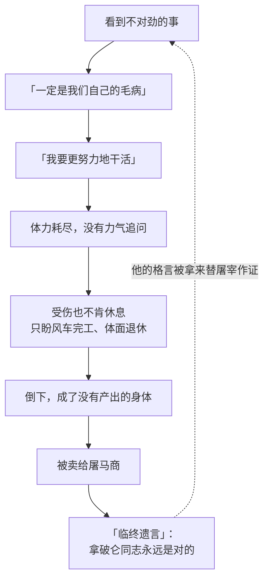

# 06｜拳击手为什么必须死？

> 本篇核心问题：全书最勤劳、最忠诚的角色，为什么得到了最残酷的结局？

> **剧透提示**：以下内容包含关键剧情与结局。本文集中讨论第九章拳击手被送走的经过，并会回溯前面几章里他的两句口头禅。

---

## 开篇：一个值得思考的问题

在曼纳农场，没有人见过本杰明跑步。

这头老驴一向慢吞吞，对什么都是一副「早知道会这样」的神情。可在第九章的一个中午，动物们正在地里拔萝卜，忽然看见本杰明从农场的房子那边狂奔而来，扯着嗓子大叫：「快来！他们要把拳击手拉走了！」

等大家赶回院子，一辆带篷的货车已经停在那里，拉车的是两匹马，车夫戴着一顶低帽檐的圆顶礼帽。拳击手的马厩是空的。动物们还在喊「再见，拳击手」，本杰明已经气得直跺蹄子，骂他们是傻瓜，然后一字一字读出了车身上的字。

这一幕要问的是：这个一辈子没有偷过懒、没有说过一句怨言的角色，为什么偏偏是他？

## 一、从故事开始

先看他做了什么。

起义之后的第一个收获季，书里写他「像三匹马一样」干活，让一只小公鸡每天早上提前半小时叫醒他，在正式开工之前先做一点「自愿劳动」。他的答案是同一句：「我要更努力地干活。」后来他又添了第二句：在一次关于星期天辩论会的争论里，尖叫鬼说拿破仑的决定不容置疑，拳击手想了想，说「如果拿破仑同志这么说，那就一定对」，从此他有了第二句格言：「拿破仑同志永远是对的。」

风车开工以后，他的贡献更是具体可见：巨石要靠绳子一点点拖上采石场的坡顶再推下去摔碎，每回石头往下滑，都是他一个人绷紧绳子把它顶住；休息的时候，他还独自去采石场装一车碎石，拖到风车工地。到了第二年，拿破仑宣布星期天下午也要干活，名义上「完全自愿」，但缺席者口粮减半。拳击手当然去了。

然后是第八章的战斗。他在保卫风车的战斗里劈裂了一只蹄子。第九章一开头就写他不肯休息一天，「把不让人看出他疼」当成一件荣誉的事。克拉弗用嚼烂的草药给他敷蹄子，她和本杰明都劝他少干点：「一匹马的肺是不能一直这样用的。」他不听。他只剩一个心愿：在到退休年龄之前，看到风车已经立起来。

退休年龄是有规定的。农庄最早定法律的时候，马和猪都是十二岁，牛十四岁，狗九岁，羊七岁，鸡和鹅五岁，还说好要发「优厚的养老金」。他的十二岁生日就在第二年夏末。可是，书里补了一句关键的话：直到那时，没有一只动物真正退休过。

夏天的一个傍晚，他在拉石头的路上倒下了，嘴里淌出一股血。尖叫鬼赶来，说拿破仑已经安排送他去威林登的医院。三天后货车来了，车身上写着「艾尔弗雷德·西蒙兹，屠马商兼熬胶，威林登」。车开走时，拳击手的脸出现在车尾的小窗里，里面传来一阵猛烈的踢踹声，渐渐弱下去。动物们追着车喊「出来，拳击手，快出来」，追不上。

又过三天，尖叫鬼宣布他「死在医院里」，说他临终前低声说：「前进，同志们……拿破仑同志永远是对的。」同一个星期，农场收到一只从杂货店送来的大木箱。当晚农舍里传出一阵大吵大闹的歌声，最后以一声玻璃碎裂的巨响收场；第二天，风声传开，说猪不知从哪里弄到钱，又买了一箱威士忌。

## 二、真正的问题是什么？

把这些摆在一起，会发现一个别扭的地方：拳击手没有做错任何一件事。

他没有违反过七诫，没有顶撞过猪，没有私吞过东西，甚至连怀疑都比别的动物晚一步。如果这本书讲的是「坏人得恶报」，那么他的结局根本讲不通。它讲的是另一件事：

> 一个人把全部的价值押在「我劳动，所以我值得被善待」这笔账上，而记账的人是别人，会发生什么？

在拳击手的账本里，劳动是本金，退休是利息，规矩是担保。在猪的账本里，劳动只是产出，产出没了，这个劳动者也就没了价值。两套账从来没有对过。拳击手只是一直没有发现这一点，因为只要他还能拉石头，两套账的结果看上去总是一样的。

老少校在第一章就把话说过了：你们这一身肌肉，一旦没了力气，琼斯就会把你们卖给屠马的人。革命的承诺是不让这件事再发生。第九章要检验的，只有一个问题：革命以后，这句话还成立吗？

## 三、人物为什么会这样选择？

拳击手的两句格言，常被读成「愚忠」，但这样读有点省事。更准确地说，它们是他替自己发明的一套思考办法。

他不识字，学到字母 D 就停了。他不擅长分析，可他有一个朴素的信念：只要我加倍努力，事情总会变好。所以每次遇到想不通的事，他不是去追问，而是把问题换成一个自己能解决的问题。第七章里，拿破仑下令处决一批「承认」与雪球勾结的动物，满地尸体，整个农场沉默，只有拳击手站着，不安地甩着尾巴。他说：「我不明白。我不相信这种事会发生在我们农场。一定是我们自己出了什么毛病。解决办法，依我看，就是更努力地干活。从明天起，我要提早一小时起床。」

这是他的整个心理结构：看到不对劲，先怪自己；怪完自己，就加班。第二句格言替他把「怀疑」这一项彻底封上了口：既然拿破仑永远是对的，那么不对的只能是我。

于是他的勤劳成了一个闭环：越是怀疑，越是加班；越加班，越没有力气怀疑。

再看他身边的几个角色。克拉弗一直警告他，却只能照顾，不能阻止；本杰明读得懂车身上的字，也跑了起来，这是全书唯一一次他表现出着急，可他到了现场只剩一声「傻瓜」。他读了，喊了，动物们追了，没有一个动物能拦住一辆货车。能拦住的东西，早在许多章之前就已经没有了：没有人有权去问「医院」是什么，没有人有权去验那份证明。

还有一个残酷的细节：动物们对拉车的两匹马喊「不要把你们的同胞送去死」，那两匹马只是把耳朵向后一别，加快了步子。它们太笨了，听不懂。拳击手一生都在用劳动证明自己是「同志」，到最后，别的马甚至听不懂他是谁。

## 四、作者真正想讨论什么？

这里需要把几层意思分开。

**文本事实**：小说清楚地写了两点。一是退休养老金这个许诺，到第十章回头看，从来没有兑现过，那片「给退休动物的草场」的话题「早已不了了之」。二是猪没有为他的死做出任何实质性的补偿，只给了一场追悼宴会，而且那场宴会之后就是一箱酒。至于那笔钱是否来自卖掉拳击手，原文没有明说，只说猪「不知从哪里弄到了钱」，这只是读者能做出的联想。

**作者自己说过的话**：奥威尔在一九四七年为乌克兰文版写的序言里讲过这本书的起点：他看到一个十来岁的男孩赶着一匹巨大的挽马走在窄路上，马一想拐弯就挨鞭子。他当时想，这样的动物如果意识到自己的力量，人就没有办法控制它们；人剥削动物，就像富人剥削无产阶级。（需要注意，这篇序言的奥威尔手稿已经遗失，今天读到的是从乌克兰文回译的版本。）他没有说那匹马就是拳击手。把两者放在一起，是读者自己的联想。

**常见的读法**：大多数评论把拳击手读成劳动阶级，尤其是对制度忠诚、最肯出力的那一部分工人；有人联想到苏联宣传里被反复树立的劳动模范。这样读，拳击手的死就是「一个把劳动者榨干的体制，处理掉他们的方式」。

**也有读者认为**：拳击手并不只是受害者。他的盲从，是体制能够运转的零件之一：没有他，风车不可能建成，采石场不会出石头；他的格言被拿破仑拿去当作号召，要求「每只动物都应当采用」。这样看，他的悲剧里也有一份责任，不过这份责任主要落在「没有机会知道真相」上，不在「不愿意知道真相」上。

**一种可能的读法是**：奥威尔想让读者看到，拳击手的错处不在忠诚，也不在勤劳，而在他把「被公平对待」这件事，寄放在了一个没有任何办法强制兑现的承诺里。养老金写在法律里，可执行法律的人，是要付养老金的人。所有的美德，在这样的结构里，都只会让他更早地被用完。

## 五、把这个问题放回时代

奥威尔写这本书的时候，苏联正是英国的盟友，英国左派里有不少人把苏联看成劳动者的国家。奥威尔恰恰对此怀疑：在一九四七年的序言里，他说自己自一九三〇年以来，越来越看不到苏联在走向任何可以称为社会主义的东西，反而看到它变成「一个等级社会」，统治者没有理由比任何其他统治阶级更愿意交出权力。

拳击手的故事，正好把这个怀疑落在一个具体的身体上。一个以劳动者之名成立的国家，如果劳动者的权利没有独立于领导者的保障，那么「劳动光荣」就只会变成一句对劳动者最方便的口号。

这是奥威尔当时反复在想的问题，不只针对苏联：任何把「为了大家」放在前面的体制，都要回答它怎样对待那些已经没有产出的人。

## 六、作品是怎么写出来的？

这一章最动人的地方，是它的克制。

奥威尔没有写拳击手在车里的感受，我们只能看到车尾小窗里出现过一次那张带白条的脸，听到一阵踢车厢的声音，然后声音渐渐小了。书里只用一句话交代原因：当年几脚就能把这辆车踢成碎木片的力气，已经没有了。叙述者既不替他喊冤，也不替读者哭，把所有的情绪留给读者自己去补。

另一个值得留意的地方，是尖叫鬼的谎话是怎么编的。他编的「临终遗言」里，拳击手最后一句话是「拿破仑同志永远是对的」。也就是说，这句本来只是拳击手用来安慰自己的格言，被原样拿回来，当成了他同意被送去屠宰的证据。谎话最有效的做法，是用受害者自己的话。

还有那个「车是兽医买了旧车、还没来得及涂掉屠夫名字」的解释。它荒唐得几乎不用驳斥，而动物们「大大松了一口气」。书里没有说他们蠢，只说他们愿意相信，因为相信这个，眼前的痛苦就小一点。

## 七、如果放到今天

把拳击手放到今天，很容易想到一类场景：一家公司里，有人长年加班，从不请假，带着旧伤上班；某一天，部门调整，他的名字出现在一份名单上。人事部的告别信写得很得体，感谢「多年来的付出与贡献」。国内互联网行业曾一度把裁员叫作「毕业」，这个说法被媒体广泛报道过。

当然，这不是说每一次裁员都是屠宰，也不是说劳动者不该努力。《动物农庄》提醒的，是一个更窄的问题：你把多少自己的价值，托付给了一个只在你有产出时才兑现的承诺？

比较实际的做法，是留意「承诺有没有人能强制执行」：养老金有没有独立的账户，工伤有没有独立的认定，离职有没有明文的程序。这些听起来很不浪漫，可拳击手的故事说的就是：忠诚是浪漫的，保障必须是不浪漫的。

## 八、小结

拳击手的悲剧不是因为他做错了什么，而是因为他把一切都做对了，却没有任何一项权利是他自己能够兑现的。他的两句格言让他勤劳，也让他不再发问；他的蹄子裂了还在拉石头，是想用身体去交换一份体面，而那份体面从来没有人真的准备好。

这一幕真正残酷的地方，不是货车，而是货车开走之后：谎话被相信，追悼会照开，酒照喝。死亡被改写成一件光荣的事，活着的动物被要求继续把他的格言当作自己的。

## 下一篇

拳击手走了以后，农场里还能剩下什么原则？多年之后，当动物们再次走进院子，发现猪已经开始用两条腿走路，墙上只剩下一条戒律。

