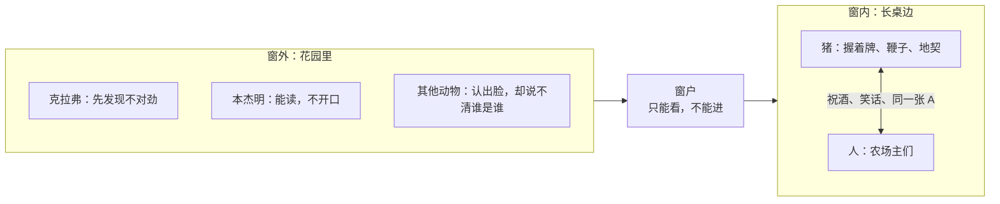

# 07｜为什么「所有动物一律平等，但有些动物更平等」？

> 本篇核心问题：结局那一幕为什么让人不寒而栗？

> **剧透提示**：以下内容包含关键剧情与结局。本文集中讨论第十章，也就是全书最后一章。

---

## 开篇：一个值得思考的问题

最后一章里，第一个发出尖叫的是克拉弗。

那是一个舒服的傍晚，动物们收工往回走，忽然院子里传来一匹马惊恐的嘶叫。大家跑进院子，看到她看到的东西：一头猪，正用后腿站着，慢慢地穿过院子。

接着，一长串猪从农舍里走了出来，全部用后腿走路。最后出来的是拿破仑，笔直、傲慢，狗在他身边打转，蹄子里握着一根鞭子。

书里写道：一片死寂。这个场面常被说成全书的「反转」，仿佛前九章讲的是平等，到了这里忽然翻了个底朝天。可如果认真回头去看，这一章里几乎没有一件事是新的。本篇想问的是：这一幕真正让人发凉的地方是什么？为什么说它是「完成」，而不是「反转」？

## 一、从故事开始

先回到现场。

第十章先用一大段话把时间拉开：许多年过去了，琼斯死在一家戒酒所里，雪球被遗忘，拳击手被遗忘，只有克拉弗、本杰明、乌鸦摩西和几头猪还记得起义以前的日子。风车终于建成了，但它用来磨谷子，不是发电；雪球当年描绘的电灯、热水和三天工作制，拿破仑宣布「违反动物主义精神」，说「最真正的幸福在于辛勤工作和节俭生活」。农场变富了，动物没有变富，除了猪和狗。

然后是那一天。前一周，尖叫鬼带着羊群去了农场另一头的白桦林，让它们待了整整一周，说是教一首需要「不受打扰」的新歌。回来以后，羊群的口号变了：从「四条腿好，两条腿坏」变成了「四条腿好，两条腿更好」。猪走出农舍的那一刻，羊群恰好齐声大喊这句话，一喊就是五分钟，等它们安静下来，「抗议的机会已经过去了」，猪已经走回农舍。

克拉弗眼睛不好，拉着本杰明走到大谷仓的墙边，问：「七诫还是原来那样吗？」本杰明破例读了出来。墙上只剩下一条：

> 所有动物一律平等，但有些动物比其他动物更平等。

此后书里连用三个「这不再显得奇怪」：监督劳动的猪人人拿着鞭子，不显得奇怪；猪买了无线电、订了报纸、嘴里叼着烟斗，不显得奇怪；猪穿上琼斯先生的衣服，拿破仑穿黑外套和马裤，他最宠的母猪穿上琼斯太太星期天穿的绸裙，也不显得奇怪。

一周后，附近的农场主们来参观，晚上，农舍里传出笑声和歌声。动物们悄悄溜进花园，踮着脚从餐厅的窗户往里看。长桌边坐着六个农场主和六头资格较老的猪。皮尔金顿站起来祝酒，说双方的误会终于结束了，并对「下等动物」做的工多、吃的少表示敬佩，还讲了一个笑话：「你们有你们的下等动物，我们有我们的下等阶层！」拿破仑也回敬了几句：农庄是合作企业，地契在他手里，由猪共同拥有；以后不许再互称「同志」，那个钉在柱子上的公猪头骨已经埋了，旗子上的蹄和角也去掉了，农庄的名字改回「曼纳农场」。

二人举杯，然后重新拿起牌来打。不一会儿，屋里吵成一团，原因是拿破仑和皮尔金顿同时出了一张黑桃 A。窗外的动物看着那些争吵的脸，「十二个声音在愤怒地叫喊，它们全是一个样子」。最后一句话是：

> 窗外的生灵们先看猪，再看人，再看猪，再看回人；可是已经说不清哪个是哪个了。

## 二、真正的问题是什么？

这一幕之所以令人不寒而栗，答案是：它没有「变」，它只是「到了」。

「反转」意味着事情从一个状态跳到相反的状态，一个突发的、能让人惊呼的变化。可是翻回前面看，猪睡进了床，是先改了一条戒律；猪喝酒，是先改了一条戒律；猪与人做生意，是先说服大家以前并没有禁止过；猪在院子里领头，是早就有了绿色缎带和路上要给猪让路。第十章里的每一件事，都是之前某个小动作的最后一步：用后腿走路，是「不许穿衣服」「不许睡床」的收尾；那条仅存的戒律，是之前每一条被改写之后剩下的东西；改回「曼纳农场」，是把起义的名字也收了回去，让一切回到原点的最后一步。

所以更准确的说法是：动物们一直在等一个「背叛发生」的时刻，然而背叛早就发生了，在一个又一个他们没有觉得值得抗议的小时刻里。第十章不过是让这件事第一次变得无法回避：它被一个具体的画面，用一个人人都能看懂的姿势，展示了出来。

## 三、人物为什么会这样选择？

**猪**想要的东西，在这一章里一目了然：不是平等，是被承认。他们已经拥有农场里的一切，仍然需要邻居们的认可，需要被当作「同行」。皮尔金顿那个关于「下等动物」的笑话，说穿了就是：我们是同一个阶层，问题是同样的，对手是同样的。猪在这个笑话里，笑得最响。

**克拉弗**是最接近真相的人。她老了，看不清墙上的字，但她还是第一个察觉不对劲，第一个问「七诫还是原来那样吗」。她的问题不是挑战，是求证，她要别人替她确认，自己不敢确认。

**本杰明**在这一章里有一个微妙的位置。他是农场里读得最好的动物之一，之前读了车身上的字，这一回读墙。书里特意写「他破例打破了自己的规矩」，说明他平时是拒绝读的。他一直说，生活不会好，也不会更坏，这是「生命不可更改的法则」。这句话很难说是智慧还是逃避：他看得最清楚，却因为相信一切都不会改变，选择什么都不做。一种可能的读法是，他代表知识分子里的那种冷眼旁观，知道真相，但不把真相变成行动。

**其他动物**的处境，是这一幕里最值得停下来的。他们在窗外。

注意这个空间：动物们是蹑手蹑脚地「溜进」花园的，到了窗外也只是「踮着脚」，隔着一道玻璃看。他们的位置，从起义那天的农场主人，退回到了站在别人家窗外的人。哪怕眼前正在发生与他们命运相关的事，他们也只是旁观者：没有人注意到那些窗外的脸。

## 四、作者真正想讨论什么？

**文本事实**：小说在这里没有给出任何议论，叙述者只是描述。「变成了人」这件事，是靠场面（用后腿走、握鞭子、穿衣、同桌、同一张牌）完成的，而不是靠哪一句宣言。

**作者明确说过的话**：奥威尔在一九四七年为乌克兰文版写的序言里，专门谈到了这个结尾。他说，有些读者读完这本书，可能觉得它以猪和人的完全和解收场，但这不是他的本意；他的意思是让它「以一阵响亮的不和谐音」结束，因为他是在德黑兰会议之后写的，当时人人都以为苏联与西方的关系从此最好，他自己却不相信这样的关系会长久。（这篇序言的奥威尔原稿已经遗失，现在读到的是从乌克兰文回译的版本，措辞可能与原文有出入。）

**常见的读法**：最常见的看法是，这一幕对应着苏联与西方列强关系的变化，而桌边的黑桃 A 之争，是奥威尔预判的又一次翻脸。另一个常见的看法是，这一幕是在说革命后的新统治者，终究变得与旧统治者没有区别。

**也有读者认为**：不和谐的牌桌，对窗外的动物没有任何安慰。吵架是统治者之间的事，不管谁赢，他们都站在窗外。从这个角度读，奥威尔写下「不和谐」，并没有给动物们留下出路。

**一种可能的读法是**：这一章的核心，不是「猪变成了人」，而是「差别消失了」。动物们不是看到猪背叛了什么，而是发现自己失去了辨认的能力，没有任何尺子可以证明谁变了、变成了什么。七诫一条条被改写时，尺子就在被一寸一寸地锯掉；到了这一章，尺子已经没有了，所以「已经分不出谁是谁」。

## 五、把这个问题放回时代

奥威尔在乌克兰文版序言里写，自己从一九三〇年起越来越看不到苏联在朝社会主义走，反而看到它在变成「等级社会」，统治者像任何统治阶级一样，没有理由放弃权力。这是第十章的政治底色：一个自称消灭了阶级的国家，一旦重新长出了阶级，它最先要做的事，是让自己与旧阶级「在同一张桌上」。

另一层时代背景，是奥威尔对英国左派的担心。他担心许多人不愿意承认这件事，因为他们「想相信，在某个地方，真有一个社会主义国家存在」。动物们站在窗外，认不出脸，对应的是这些愿意相信、也不得不相信的人。

## 六、作品是怎么写出来的？

第十章的几个写法，值得一一拆开看。

第一，是**连用的「不再显得奇怪」**。这个句式出现三次，每次后面跟的东西更大：鞭子、报纸、衣服。奥威尔没有让叙述者说「这很荒谬」，他只是平静地说，这些事此时已经不显得奇怪了。读者在这个句子里感到的不安，正是动物们已经丧失的那种不安。

第二，是**把七诫缩成一句话**。前面七条戒律每一条都有一个具体的禁令，如今只剩下一句，而且这句话自己和自己矛盾。一句既说「平等」又说「更平等」的话，没有办法约束任何人，因为它给任何行为都留了解释的空间。从这个意义上说，墙上剩下一条，等于墙上一条也不剩。

第三，是**末句的节奏**。「从猪看到人，从人看到猪，再从猪看到人」，视线来回三次，一次比一次快，到最后一个半句忽然刹住：「已经分不出谁是谁了」。这个句子本身，就是一次被迫的辨认失败。

第四，是**那张黑桃 A**。这是全书最轻的一个细节，一场赌桌上的小纠纷，却在这里承担了最重的象征：猪与人不但在服装、姿势上相同，连赌桌上的作弊与翻脸，也相同了。

## 七、如果放到今天

今天这个场景不难找。一个以「人人平等」「去层级」为理念创办的组织，在做大之后，常会出现这样的变化：先是有了「核心团队」，再有了「不需要对外公开的会议」，然后有了只给管理层开放的福利，最后，被服务的人，和提供服务的人，说着同一种内部用语。

可以问几个具体的问题：这个机构里谁能进房间，谁只能看窗户；规则变化的时候，是谁来告诉你的，是谁来解释的；当你问「以前不是这样的吗」，你得到的是文件，还是一阵齐声的口号。

这些问题不是要证明谁是猪。它们只是提醒我们，不要等到「分不出谁是谁」的那一天，才开始问第一个问题。

## 八、小结

这一幕让人发冷，不是因为它突然，而是因为它早已发生。猪用两条腿走路，不是背叛的开始，而是背叛已经完成之后，终于不再需要遮掩。墙上最后一句话，则是最诚实的一句：它把平等这个词保留了下来，却把里面的东西全部拿走了。

至于窗外的动物，奥威尔没有让他们尖叫，也没有让他们造反，只让他们看。这是全书最冷的一笔：当辨认能力消失的时候，连愤怒都没有地方放。

## 下一篇

读到这里，一个问题自然浮上来：奥威尔为什么要用一个动物的故事，去写一个人类国家的历史？为什么这本书在当时差一点没能出版？

