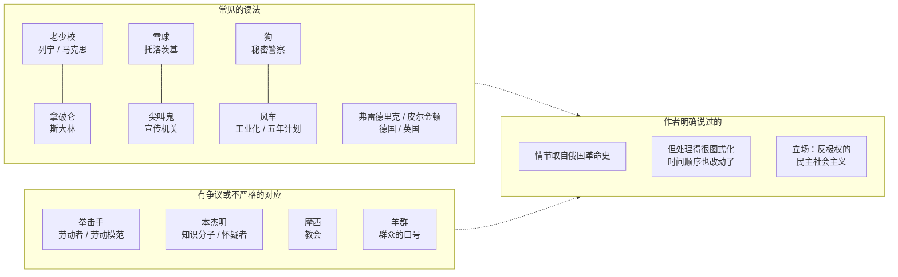

# 08｜奥威尔为什么要用一则童话来写苏联？

> 本篇核心问题：这本书讽刺的是谁？为什么当时差一点出不了？

> **剧透提示**：本文不涉及具体情节。谈到历史对应时只提角色的名字和身份，不展开任何章节的内容，也不点破结局。

---

## 开篇：一个值得思考的问题

一九四四年，一份稿子在伦敦的几家出版社之间传来传去。稿子很短，只讲了一些牲畜赶走农场主的故事，副标题是「一个童话」。读到的人几乎都说写得好。然后几乎都说：现在不能出。

这件事本身就值得玩味。一本看上去给孩子读的动物故事，为什么会让几位见多识广的出版人不安？它的锋芒到底对着谁？这一篇想弄清楚两件事：这本书讽刺的是谁；以及，这个答案在多大程度上属于奥威尔，在多大程度上属于后来的读者。

## 一、从故事开始

先把能核实的事实排一排。

**写作时间。** 书末印着「一九四三年十一月至一九四四年二月」，这是奥威尔自己留下的落款。那时第二次世界大战还没有结束，苏联和英国是并肩对抗德国的同盟国。

**被拒稿。** 奥威尔为这本书写过一篇后来被拿掉的序言，在里面说，书「被四家出版社拒绝」，其中只有一家有意识形态上的动机，另外两家多年来一直在出版反俄的书，剩下一家没有明显的政治色彩。他没有在文中点出这些出版社的名字。后人的研究和传记通常指出的名单包括：维克多·戈兰兹（Victor Gollancz），他是奥威尔此前几本书的出版人；乔纳森·凯普（Jonathan Cape），以及费伯与费伯（Faber and Faber）。至于戈兰兹拒绝的具体理由，我没有找到可靠的一手来源，不能确定，这里不展开。

**凯普的撤回。** 奥威尔在那篇序言里引了一位出版人的信：此人起初接受了书稿，后来咨询了信息部（Ministry of Information）的一位「重要官员」，随后写信说，这个寓言「完全沿着俄国苏维埃及其两个独裁者的进程」展开，因此只能适用于俄国；还说选猪做统治阶层，会冒犯人，特别是冒犯「有点敏感的人，俄国人当然就是」。奥威尔没有在序言里写出这位出版人的名字，后来的研究者一般认为是凯普。至于那位「重要官员」是谁，坊间常说是彼得·斯莫利特（Peter Smollett），他后来被揭露为苏联的情报人员。但这是推测，那封信里没有写名字，我不把它当作定论。

**费伯与费伯。** T. S. 艾略特当时在费伯任董事，一九四四年七月十三日写信回绝。据公开的报道，他称赞书写得好、有诚意，但表示「没有信心，认为这是在当前批评政治局势的正确观点」，同时说他不确信这是「眼下需要说的话」。他认为书的观点大体可以看作托洛茨基式的。

**出版。** 最后，书由塞克与沃伯格（Secker & Warburg）出版，日期是一九四五年八月十七日。

**那篇被拿掉的序言。** 它的题目是《新闻自由》（The Freedom of the Press）。书的第一版为它留了位置，最后没有印。它一直到一九七二年九月十五日，才由伯纳德·克里克（Bernard Crick）写了导言，发表在《泰晤士报文学增刊》上。

## 二、真正的问题是什么？

「讽刺的是谁」看上去是一个很简单的问题，答案似乎是：苏联。事实上，这个答案对，也不够。

如果这本书只是讽刺一个国家，那么战争结束、冷战过去之后，它就该像一份过期的时事评论一样褪色。可它并没有。要理解这一点，需要区分两层靶子：

- **第一层是一个政权**：奥威尔认为它背离了革命的初衷。
- **第二层是一种信念**：相信这个政权是社会主义的，或者相信批评它是「不合时宜」的。

奥威尔自己更看重后者。他在一九四七年为乌克兰文版写序时说，从西班牙回来之后他就确信：要让社会主义运动复兴，必须摧毁「苏联神话」。靶子是那个神话，不单是那个国家。

## 三、人物为什么会这样选择？

这里的「人物」，是那几位拒绝了书稿的人。他们的选择并不难理解，但原因各不相同。

奥威尔在序言里给出了他的判断。他说，英国知识界对苏联的态度几乎是「自发」的：没有人下命令，大多数人却心照不宣地知道，批评斯大林是「不合适」的。他写道：

> 英国文学检查中令人不安的事实是，它在很大程度上是自愿的。

他又说，真正的危险不是政府部门的直接干预，而是出版人和编辑「害怕公众舆论」，在他看来，「知识上的怯懦」是这个国家的作家和记者所面对的最大敌人。

艾略特的回信则是另一种类型。他没有说「不能批评苏联」，反而写到出版社有义务出版「违背一时潮流」的书；他拒绝的理由，是他不认同这个批评的角度。换句话说，同样是拒稿，有的是出于战时同盟的顾虑，有的是对政治立场的分歧，有的甚至是纯粹的商业考虑，不能一概而论。

奥威尔的选择是不改：稿子被拒了四次，最后出版的书里，统治者仍然是猪。

## 四、作者真正想讨论什么？

这是最需要区分来源的一节。

**作者明确说过的话。** 在乌克兰文版序言里，奥威尔说了几件重要的事。第一，书里的各个情节「取自俄国革命的实际历史」，但是处理得「图式化」，时间顺序也被改动了，「这是故事的对称所需要的」。（这篇序言的奥威尔原稿已经遗失，今天读到的是从乌克兰文回译的版本，措辞可能与原文有出入。）第二，他说自己并不是要对斯大林个人做道德审判，而是希望西欧的人看清这个政权「实际是什么」。第三，他对自己的立场有过非常直接的描述：一九四六年的随笔《我为什么写作》里写道，一九三六年以后他所写下的每一行严肃作品，都是「直接或间接地反对极权主义、支持民主社会主义」的，「按我所理解的那样」。

**常见的读法。** 研究和评论里最通行的对应是：老少校是列宁或马克思的影子，拿破仑是斯大林，雪球是托洛茨基，尖叫鬼是官方宣传，狗是秘密警察，风车是国家的大规模建设计划，弗雷德里克和皮尔金顿是德国和英国。这些对应在书的整体上讲得通，当时的读者也很快看了出来。

**其他解释与不严格之处。** 但对应并不处处严丝合缝，原因正是奥威尔自己说的「图式化」。比如，风车究竟是五年计划，还是电气化运动，还是二者的混合，读者各有看法；拳击手是工人阶级，还是被宣传树立起来的劳动模范，也没有定论；本杰明有人读成知识分子，也有人读成奥威尔本人的某种自嘲，这些说法没有一个能从书里得到确证。把每一个角色都钉死在一个历史人物上，反而会让人漏掉这本书更普遍的东西。

**一种可能的读法是**：把历史对应和奥威尔的立场分开看。历史对应是书的「材料」，立场才是书的「方向」。奥威尔不是反对革命，不是反对社会主义，他是以社会主义者的身份，批评一个自称社会主义的政权，也批评那些不愿意承认这一点的人。所以，说「这是一本反共的书」，会抹掉他自己反复强调的部分；说「这只是一本关于苏联的书」，则会忽略他想让英国读者看到的是他们自己。

## 五、把这个问题放回时代

要理解它为什么「差点出不了」，得回到一九四四年的英国。

苏联当时是同盟国，红军正在东线承担着对德战争的主要压力，英国社会对苏联有强烈的好感。奥威尔在序言里写到，当时英国知识界的态度是「不加审视地接受俄国的观点」，他举的例子是，英国广播公司庆祝红军二十五周年时，竟然没有提托洛茨基，他把这比作「纪念特拉法加海战却不提纳尔逊」。

另一条线索是奥威尔自己的经历。一九三六年他去了西班牙，加入的是马统工党（POUM）民兵；一九三七年共产党人在西班牙政府中取得控制权之后，开始追捕这一派，他和妻子也成了被追捕的对象。（需要注意，POUM 常被共产党方面称作「托派」，但这是对手的标签，不等于奥威尔本人是托洛茨基主义者。）他从这段经历里得到的教训是：极权主义的宣传，可以多么轻易地控制民主国家里受过教育的人的看法。

他还有一个细节常被忽略：同一篇序言里，他说自己并不想仅仅因为斯大林的「野蛮和不民主的方法」就谴责他，因为在那种处境下，即便出于最好的意图，他们也许别无选择。他在意的，不是一个人好不好，而是西欧的人是否看清了这个制度。

## 六、作品是怎么写出来的？

奥威尔在乌克兰文版序言里，说过这本书的来历：从西班牙回来之后，他想用一个「几乎任何人都能理解、也容易翻译成别国语言」的故事来揭露苏联神话，但具体的故事一直没有出现。直到有一天，他在乡下看到一个大约十岁的男孩赶着一匹巨大的挽马，马一想拐弯就挨鞭子。他想到：如果这样的动物意识到自己的力量，人类就没有办法控制它们；人剥削动物，就像富人剥削无产阶级。接着他「从动物的角度分析了马克思的理论」。他说，主要情节在他脑中放了大约六年才真正落笔，而他在写作中还加进了德黑兰会议这样正在发生的事件。

这给了我们一个重要的线索：**童话不是障眼法，是方法。** 他要的是一个「易懂、易翻译」的故事；动物让读者暂时放下既有的立场，先站到受压迫者一边。这个选择，在内容上有效，在传播上也有效：用一个孩子也能听懂的故事，去讲一个成年人不愿意承认的事情。

他对这个选择有一句很干脆的话：「我不想对这部作品做评论；如果它不能自己说话，那它就是失败的。」

## 七、如果放到今天

这个问题放到今天，仍然有它的现实性，大致有两个层面。

第一，**「现在说这个不合适」。** 奥威尔看到的不是审查官，而是一种自我审查：书稿因为「时机不对」被搁置，批评因为「会帮对手」被推迟。今天的任何阵营，都有这样一些话题，在自己人面前几乎不能说。判断标准不是话题本身，而是一个朴素的问题：如果被批评的对象换成对手，我会不会说？

第二，**一本批评正统的书，也会被拿去当作新的正统。** 冷战时期，西方官方机构曾翻译、散发这本书，二手资料里还有用气球向东欧空投的说法，但具体规模我没有查到一手来源，不能确定。奥威尔在那篇没有印出的序言里说过一句话，用在这里非常合适：「用一种正统去替换另一种正统，不一定是进步。」他在乎的，是不要有「留声机式的头脑」，不管唱片上放的是什么。

## 八、小结

这本书讽刺的是苏联，也不止于苏联。一个更准确的说法是：它的靶子是一个以革命之名形成的新特权，以及围绕这个特权形成的、让人不愿意去看的信念。历史对应是这本书的材料，反极权的民主社会主义才是奥威尔自己的方向。

它在一九四四年差点出不了，不是因为它荒诞，而是因为它在一个不适合的时机，说了一件对的事。当同盟国的敬意成为一种不能被质疑的气氛，一个动物童话，便足以让人沉默。

## 下一篇

既然靶子是一个国家和一种信念，为什么奥威尔偏偏选了动物，又偏偏用童话的口气？这个看上去最简单的选择，是怎么一步步写成的？

