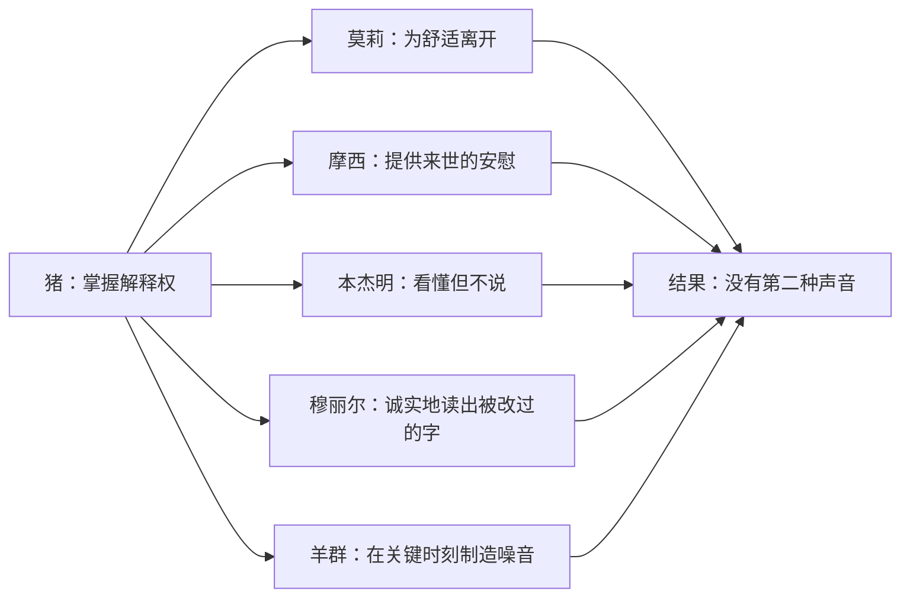

# 09｜这个寓言是怎么写成的？

> 本篇核心问题：为什么是动物？为什么是童话的口气？

> **剧透提示**：以下内容包含关键剧情与结局。

---

## 开篇：一个值得思考的问题

一本讲独裁、清洗、伪造历史的书，开头却像睡前故事：农场主喝多了啤酒，忘了关鸡舍的小门，灯一灭，牲口们就聚到大谷仓里听一头老猪说话。

英文原书的封面上，书名下面还印着一行小字：A Fairy Story，一个童话。

这很奇怪。一个想批评政治暴力的作家，为什么不直接写人、写政权、写审判，而要写一群马、羊、猪和一只乌鸦？他又为什么偏偏用讲童话的声音，去讲一个并不适合孩子听的结局？

这一篇要回答的，就是这个问题。答案不止一个，但可以先说一句：这里的「童话」不是装饰，而是一种工具。它先让读者放松，再让读者发现，自己放松得太早了。

## 一、从故事开始

先看三个场景，它们都来自这本书的后半段。

第一个，第七章。动物们刚经历了一场公开处决，缩在山坡上，母马克拉弗望着下面的农场，想起当初的盼望，说不出话，只好唱起《英格兰兽》。大家跟着唱了三遍，慢而悲凉。尖叫鬼走过来，宣布拿破仑下了特别命令：这首歌被取缔了。理由是，歌里唱的是对美好社会的期待，而那个社会「已经建成」，歌因此「不再有任何用处」。穆丽尔问了一声「为什么」，话音刚落，羊群就开始喊「四条腿好，两条腿坏」，一喊就是好几分钟，讨论到此为止。接替的是米妮穆斯写的一首新歌，大意是「动物农庄，动物农庄，有我在，你不会遭殃」。书里补了一句：动物们总觉得，不管词还是调，都比不上《英格兰兽》。

第二个，第十章。猪开始用两条腿走路，手里拿着鞭子。动物们本来可能说点什么，就在这一刻，羊群又喊了起来，这次喊的是「四条腿好，两条腿更好」。等它们喊完，抗议的机会已经过去。

第三个是最后一幕。动物们趴在窗外，看着猪和人坐在同一张桌子旁打牌，打到一半吵起来，原因是双方同时打出了一张黑桃 A。屋里十二个声音在吼，听上去一模一样。最后一句是：动物们看看猪，又看看人，再看看猪，再看看人，「已经分不出谁是谁了」。

这三个场景有一个共同点：叙述者始终没有替我们下判断。

## 二、真正的问题是什么？

表面的问题是「为什么用动物」，真正的问题是：**一个作者想让读者看清一件他们不愿意看清的事，该站在哪里讲？**

如果直接写一个国家，读者进来的时候就带着立场：喜欢这个国家的人会说你在抹黑，不喜欢的人会说你写得太轻。写到具体的人，读者又会急着对号入座，去争论某个细节准不准确。寓言的好处是把这些入口都先关上。一头猪就是一头猪，没有人需要为猪辩护。读者带着轻松的心情进来，站在受苦的动物一边，笑尖叫鬼的花招，同情拳击手。到最后才发现，自己笑过的那些话术，在现实里有人认真地说过，甚至自己也点过头。

所以问题可以拆成三个：动物这个设定给了作者什么？平静、近乎天真的口气怎样制造反讽？不起眼的小角色各自负责什么？

## 三、人物为什么会这样选择？

这一节换个角度，问的是：奥威尔为什么这样安排这些角色。

**为什么是动物。** 奥威尔本人在一九四七年为乌克兰文译本写的序里说过这个念头的来源：他当时住在一个小村子里，看见一个十来岁的男孩赶着一匹巨大的拉车马走在窄路上，马一想拐弯就挨一鞭子。他想到，如果这些牲口意识到自己的力量，人就没法支配它们；而人剥削动物的方式，和富人剥削无产者很相似。这是作者自己的说法，来源清楚。它说明动物不是随手选的：动物天然是「被使用的一方」，劳动、被喂养、被宰杀，这些事不需要比喻，本来就是它们的生活。

**小角色的功能。** 全书真正掌握话语权的只有猪，其余的动物像一张分工很细的「观众席」，每一类观众对应着权力得以运转的一种缝隙。

莫莉，那匹爱戴缎带、爱吃方糖的白马，在起义前就问过：革命之后还有糖吗？还能戴缎带吗？雪球回答，缎带是奴隶制的标志，她表示同意，但语气并不信服。后来她悄悄跟一个人类走了，再也没有回来。她的功能是**退出的那条路**：对一些人来说，革命没有道德问题，只有舒适问题，谁给的糖多，就往谁那边去。书里后来说，除了莫莉和雪球，没有别的动物离开过农场。

摩西，琼斯的宠物乌鸦，整天讲「糖果山」，说动物死后都去那个地方，那里每周七天都是星期天。起义后他跟着琼斯夫人跑掉，几年后又回来，猪们一边轻蔑地宣称那是谎话，一边每天给他一杯啤酒，让他留下来继续讲。他的功能是**供给安慰的人**：一个统治者不一定要亲自相信来世的故事，只要允许它存在，就能让现世的苦显得可以忍受。

本杰明，那头活得最久的驴。他识字，识得和猪一样好，但很少用。克拉弗请他读第六条戒律，他总是说不愿插手这类事。他的功能是**看得懂但不出声的人**，这里只记一件事：全书只有一次，他真的急了，在拳击手被拉走的那天，他大喊「蠢货」，念出货车侧面的字。可是太晚了。

穆丽尔，白山羊，认字，一点点拼读。每次有人记不清戒律，是她去墙边把字拼出来，而她拼出来的，往往已是被改过的版本。她的功能是**可靠但无力的证人**：她从不撒谎，但她只负责读，不负责判断。到了最后一章，书里平淡地说「穆丽尔已经死了」，于是能读墙的动物又少了一个。

羊群。它们学得最快的是「四条腿好，两条腿坏」，一学会就乐此不疲，一喊就是几个小时。后来每逢场面尴尬，它们都准时开口。它们的功能最简单：**噪音**，在需要的时刻把可能出现的第二种声音淹掉。

## 四、作者真正想讨论什么？

这里要把几层意思分开。

**文本事实。** 书的结构是一个圆。故事从「曼纳农场」开始，经过起义，农场改名「动物农庄」，最后在晚宴上，拿破仑当着客人的面宣布，这个名字作废，农场仍叫「曼纳农场」，还说这才是它「正确的、最初的名字」。名字回到原点，是文本里明白写出的事。同时，「同志」这个称呼被取消，绘有蹄和角的旗换成了一面纯绿的旗，野猪头骨被埋掉，这些细节也明明白白写在拿破仑的讲话里。

**作者明确说过的话。** 一九四六年，奥威尔在《我为什么写作》里写道，《动物农庄》是他第一本「在充分自觉的情况下，试图把政治目的与艺术目的融为一体」的书。这句话常被拿来作为理解全书的入口：它不是一篇披着故事外衣的政论，作者在意的是这个故事本身好不好看，写得对不对。

**常见的读法。** 评论界通常把这本书读成一则讽刺性的寓言，认为语气上的克制与天真是它最重要的手法：叙述者不骂，不叹，不下结论，只把荒谬的事用平常话说出来。

**一种可能的读法。** 另一种看法是，这个口气有一个更具体的任务：把读者放到动物们的位置上。读第一章时，我们是旁观的、带点优越感的读者；读到后面，当尖叫鬼说「你们总不想让琼斯回来吧」，我们会发现自己也有那么一秒，觉得这话有点道理。叙述者越平静，读者越没有地方放那一点不安，只好自己带着走。这是我对文本的一个解读，不是作者说过的话。

关于「为什么是童话」，目前我找不到奥威尔本人对副标题做过专门说明，所以不在这里替他编一个理由。能确定的是，书的篇幅、角色、句子都很接近童话的写法，而内容恰恰相反。这种错位本身就是效果。

## 五、把这个问题放回时代

用动物讲人事，是一个很长的传统。伊索的故事、十七世纪拉封丹的寓言诗，都是让动物说话，借此谈论权力、虚荣和狡诈。这条路的好处是安全，也是委婉：不点名的批评，更容易被听进去。奥威尔走的是同一条路，但他把短小的道德小故事，拉长成了一个有时间线的政治史。

写作的时间也很重要。小说写于一九四三年十一月至一九四四年二月，书末署着这个日期；一九四五年八月出版。那时战争还没有结束，英国和苏联是并肩作战的盟国，在这样的气氛里直接批评苏联，是不受欢迎的。寓言形式让这本书可以在不点名的前提下，说该说的话。但它也没能完全避开麻烦：这本书出版前被多家出版社拒绝，这里不展开。

## 六、作品是怎么写出来的？

下面从叙述者的口吻、反讽的位置和结构三件事，看这本书是怎么写成的。

**叙述者的口吻。** 叙述者几乎从不评论，他只是记录。比如尖叫鬼向动物们解释猪为什么睡在床上：床不过是「睡觉的地方」，稻草堆也算床；戒律反对的只是「被单」，所以猪撤掉被单、改盖毯子，没有违规。叙述者没有说这是诡辩，他只写了克拉弗事后想起来：第四条戒律里，好像从来没提过被单，但既然墙上这么写，那想必是写了。请注意这个结构：一句歪理，加上一个「想必」，反讽就完成了。

再看尖叫鬼讲雪球在牛棚战役里的「真相」：雪球被枪擦伤，是「事先安排好的」。叙述者的下一句是：尖叫鬼讲得那么生动，动物们**觉得自己好像是记得的**。注意，叙述者没有说「动物们被欺骗了」，他说的是它们「觉得记得」。这是整本书最精确的一句话之一，因为它不是在写谎言，而是在写记忆如何被借走。

**反讽的位置。** 反讽不在叙述者的语气里，而在语气和事实之间的缝隙里。叙述者越像一个老实人，缝隙越大。读者会发现，他们是在替叙述者「补上」那句没说出口的话，而补话这个动作，让读者成了共谋：不是被告知，而是自己看出来的。

**结构：一个圆。** 前面说过，名字回到了曼纳农场。但圆不止于名字。开头的老少校，把人当作敌人；结尾的猪，穿上琼斯的衣服，对着邻近的农场主敬酒，皮尔金顿开了个玩笑，说你们要对付下等动物，我们要对付的是下等阶级，引来满桌大笑。开头，动物们听一头猪演讲；结尾，动物们在窗外看一群猪宴请。窗外的位置，正是琼斯时代它们待的位置。

**最后一句。** 结尾写得很克制。叙述者没有说「猪变成了人」，因为那样太直接，太像结论。他写的是一个动作序列：动物们看猪，看人，看猪，再看人，再看猪，最后「已经分不出谁是谁了」。注意，这里的主语是动物，不是叙述者。判断是动物们自己看出来的，叙述者只是把视线交给了它们。这与第二节说的呼应：读者在这一刻，和窗外的动物站在同一个位置。

## 七、如果放到今天

不妨留意一个很日常的现象：我们读到一份措辞极其平静的通知时，往往比读到一份愤怒的声明更不安。

比如一家公司发出这样一封邮件：「为提高协作效率，原有的周会机制将调整为按需沟通，具体安排由管理层另行通知。」每一个词都是平静的，没有一处写着「取消」「撤销」「不得」，但读的人心里清楚，一个原来可以公开提意见的场合，没有了。再如某个线上社群的管理员，把「禁止人身攻击」的群规改成「禁止不友善言论」，字数几乎一样，裁量权已经换了手。

《动物农庄》教给我们的一个阅读习惯是：**看一句话说了什么之外，也看它的语气想让你省略什么**。大多数通知确实只是通知，要检验的不是语气，而是语气背后有没有提问的路径。

## 八、小结

这一篇想说的是：《动物农庄》的形式和内容是一体的。动物这个设定，让读者先站到被使用的一方；童话的口气，让读者在笑声里放下防备；几个不起眼的小角色，把权力运转所需的缝隙一一摆出来；最后用一个圆和一句动物视角的话，把读者从旁观席推到窗外。

奥威尔自己说，这是他第一次有意识地把政治目的和艺术目的合在一起。放在这本书上，这句话可以这样理解：政治上的判断，没有靠议论说出来，而是靠一个故事的形状说出来了。

## 下一篇

一个形式如此简单的故事，今天读起来，是只在讲一个已经过去的国家，还是在讲任何一个以「为了大家」的名义聚起来的权力？下一篇我们把书合上，问问它今天还能提醒我们什么。
