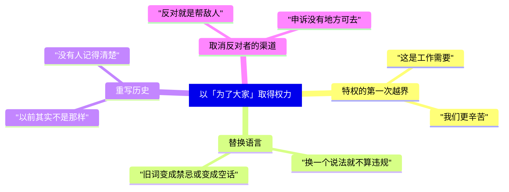

# 10｜今天读《动物农庄》，我们该警惕什么？

> 本篇核心问题：它只是一本关于苏联的书吗？

> **剧透提示**：本文不涉及具体情节，但会提到全书整体走向。

---

## 开篇：一个值得思考的问题

设想一个很普通的场景。一个二十来人的兴趣社团，因为前任负责人长期不管事、经费说不清，大家投票把他换了下来。新的负责人是个热心人，办事利索，大家都很满意。三个月后，社团的账目由他一个人保管，「省得大家麻烦」；半年后，群规改了几条，「为了让讨论更有效率」；一年后，有人问起当初换人的原因，群里已经没人说得清，只记得「以前很乱」。

这里面没有一个人是坏人，也没有一个瞬间可以指出「就是从这里变质的」。

《动物农庄》写的是一个国家的故事，但读它的人，总是会想起自己待过的某个小圈子。这一篇要问的就是：这种熟悉感可靠吗？这本书是只在讲苏联，还是在讲一种更普遍的东西？如果是后者，我们该警惕的究竟是什么，又不该怎么读。

## 一、从故事开始

先回到书的整体走向，不涉及任何具体场面。

一群被使用、被榨取的牲口，在一个有说服力的解释和一个共同的未来面前联合起来，推翻了旧主人。起初，一切都按承诺的样子运转：大家一起干活，一起讨论，墙上写着所有人都认同的原则。随后，一部分最会说话、最会组织的成员开始承担「领导」的责任；责任慢慢变成了解释权；解释权慢慢变成了决定权；到最后，原则还在墙上，但谁来解释它，已经不再由大家决定。

这个走向，读者在读到一半时就已经看得出来。真正让人不安的，不是结局，而是它的每一步都有一个听上去合理的理由。

## 二、真正的问题是什么？

「它只是一本关于苏联的书吗」，其实包含两个问题，需要分开回答。

**第一个问题：这本书的历史对应是什么？** 这是有据可查的。写作时间、作者的立场、书中人物与事件的对应关系，是文学研究里的常见读法。奥威尔自己也在《我为什么写作》里说过，一九三六年以后，他认真写下的每一行字，都是直接或间接地反对极权主义、支持他所理解的民主社会主义。这就是说，他写这本书时的立场很明确：他反对的是一种统治方式，而不是平等的理想本身。

**第二个问题：这本书能不能被拿去读别的东西？** 这是读者的权利，也是读者的责任。书的结构里没有任何一处只能属于苏联：一群人，一个理想，一个负责「组织」的小团体，一套越来越长的解释。这个结构可以套在许多地方，但要小心：**能套，不等于一定对**。每一次把它套在现实中的某件事上，都需要先问一句：这件事里，真的有那几个环节吗？

所以，较稳妥的回答是：这本书讽刺的是一段具体的历史，它提炼出来的那个结构，则可以拿来当作检查表，但不能直接当作判决书。

## 三、人物为什么会这样选择？

把「为了大家」之名取得权力的组织，所遇到的诱惑归成四类，会比较清楚。这四类，书里都有对应，但这里只讲一般的形态。

**一、特权的第一次越界。** 它几乎从不以「特权」的名义出现，而是以「工作需要」出现：负责协调的人需要多一点信息，负责管钱的人需要多一点权限，付出更多的人需要多一点补偿。每一条单独看都说得通。真正的警讯不是某一条，而是**谁来判断这些理由是否成立**，以及这个人是否同时也是受益者。

**二、替换语言。** 原则本身一般不会被公开废除，被改的是对原则的解释，或者词的含义。「公开」变成「向相关人员公开」，「讨论」变成「收集意见」，「平等」变成「各有分工」。词还在，但词能约束的范围已经缩小。

**三、重写历史。** 当一个组织说「我们一直是这样做的」，而你不确定它是不是真的，那就是这种诱惑起作用的时候。最有效的做法不是销毁记录，而是让大家觉得，**记得清楚的人，反而才是记错的人**。

**四、取消反对者的渠道。** 这是最难察觉的一步，因为它很少表现为「禁止批评」。更常见的表现是：批评可以提，但没有人负责回复；申诉可以递，但递给的正是被申诉的人；反对意见被归类为「不够顾全大局」，而不是被当作信息。

这四种诱惑的共同点是：它们都以一个**看上去为了大家**的理由发生，而每一次，被削弱的恰恰是大家用来检查这个理由的工具。

## 四、作者真正想讨论什么？

这里需要把不同来源的说法分开。

**作者明确说过的。** 前面引过：奥威尔反对的是极权主义，不是社会主义的理想。这意味着，把这本书读成「平等理想天生有毒」，是和作者自己的说法相违背的。

**文本事实。** 书中的动物并不是一开始就被骗的。它们的起点，是真实的苦，真实的解释，真实的联合。书写的不是一个骗局，而是一条斜坡：每走一步，都有人认为这一步还在原来的路上。

**常见的读法。** 最常见的读法是：革命容易被它自己产生的权力阶层吞没。理由是全书的结尾回到了出发的位置。

**也有读者认为……** 这个读法有局限。有读者指出，这本书里的大多数动物被写得过于被动和健忘，似乎普通人天生不会反抗、不会记事、不会联合。如果把这当作对「群众」的判断，就等于说集体行动注定失败；而作为一个寓言，这样设计恰恰是为了把问题推到极致，现实里的人不会这么单薄。

**一种可能的读法。** 一种可能的读法是：这本书写的是一个**条件的组合**，而不是一条规律。文字记录掌握在少数人手里，没有独立于统治者之外的机构，没有一个可以安全表达异议的场所，能读懂的少数选择沉默。这是我对文本的归纳；这些条件缺一个，故事是否会不一样，书没有回答，只能说是一种推测。也就是说，书里的失败不是「必然」，而是「在这些条件下很容易发生」。这样读，这本书就不是悲观的判决，而是一份**如何避免的反面清单**。

## 五、把这个问题放回时代

回到一九四〇年代的英国。奥威尔写作时，不少左派知识分子对苏联抱有同情，也有人认为批评它就是帮了法西斯。书出版之前遇到的阻力，部分也来自这种气氛。在那样的环境里，他要提醒的，其实是自己人：一个理想正确，不等于实行它的组织不需要被监督。

这个提醒的对象，并不只是某一个阵营。所有以「正确」为凭据取得权力的人，都容易把「我是对的」顺手变成「所以我不需要被检查」。奥威尔的立场之所以今天还能被读，是因为他没有把这个毛病只留给对手。

## 六、作品是怎么写出来的？

从写法看，这本书为什么适合当作检查表，有三个原因。

第一，**人物是功能，不是人格**。拿破仑不是一个复杂的人，他是「一个拿走解释权的位置」；拳击手不是一个具体的工人，他是「一个相信努力就会被公平对待的位置」。位置是可以被换上不同的人的。

第二，**每一步都小**。奥威尔没有写任何一次大的背叛，而是写了很多次小的调整。这使得读者很难在书里找到「该在哪里反对」的那一刻，这恰恰也是现实中最难的地方。

第三，**书里一直有看得清楚的人**。这使得读者无法把问题推给「它们看不见」。看见了，之后呢？这是写法留给读者的问题。

## 七、如果放到今天

下面几个场景，都是可以自己去核对的日常情况，不下断言，只提供一种观察的角度。

**公司。** 一个创业公司，早期决策靠全员讨论。公司变大后，开始出现只在少数人之间流转的文档。可以问：新的规则，是否先对管理者适用？绩效指标变了，是否有人记录过变更前的版本？员工提意见，渠道是否独立于被提意见的人？

**社团与校园组织。** 经费的使用是否有人在被使用者之外检查？换届的规则是否在最初写下的版本里就存在，还是在某次「完善章程」之后才有？一份被修订过的章程，能否查到修订前的文字？

**网络社区。** 管理规则是否公开、有历史版本？被删帖、被禁言的人，能否向管理者以外的人申诉？「维护社区氛围」这类措辞，是否有可核对的具体标准？

**家庭群、业主群。** 群主一个人决定谁能发言，在小范围里往往没有问题，因为大家彼此信任。可以留意的是，这种信任是否在没有被检验的情况下，被扩大到了更大的事务上，比如公共款项。

这些例子里，大多数人其实不是坏人，大多数规则也有合理的初衷。书教给我们的，不是怀疑一切，而是**在信任之外，保留检查的路径**。

## 八、小结

这本书是否只关于苏联？不是，但要小心：它提炼出的结构可以当作检查表，不能当作判决书。

读它最容易走偏的有两种。**第一种是「革命必然堕落」**：这等于把一个有条件的故事读成了一条定律，也等于否认了作者自己对平等理想的立场。**第二种是「只有他们才这样」**：把书读成别人的故事，自己不在场，这样读，书就失去了作用。

比这两种读法更有用的，是带几个问题回到现实：

1. 一个组织里，谁有权解释规则？这个人是否同时也是规则的受益者？
2. 规则被修改时，修改前的版本能被查到吗？谁能查？
3. 一个反对意见，要经过谁才能被听到？那个人和被反对的事有利益关系吗？
4. 当我自己觉得「好像不太对」时，我是在等别人先开口，还是有一个我真的可以去的地方？
5. 如果有一天，我是那个被授权的人，我愿意给自己设置哪些限制？

最后一个问题，是整本书里最难回答的。

## 下一篇

这个农场已经从头走到了尾。最后，把所有线索收在一起：回头看，这本书究竟在讨论什么？一个梦想，是怎样一步步变成了一张桌子。
