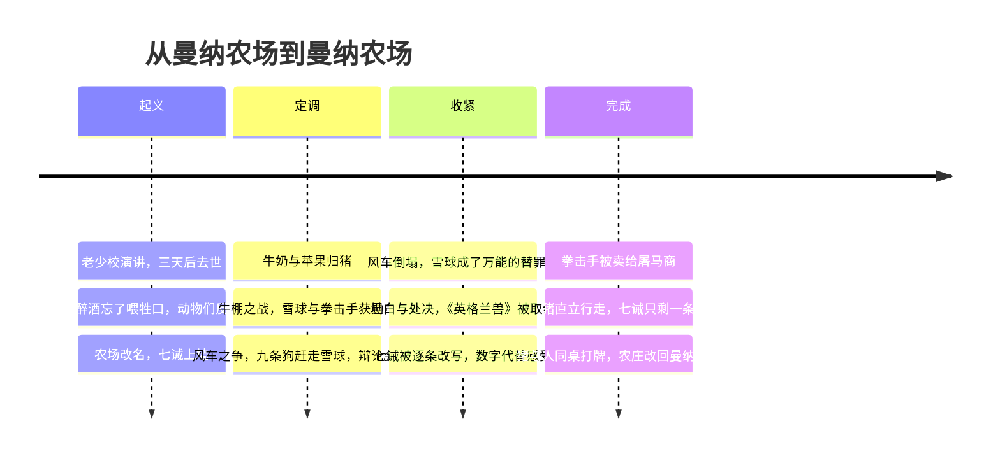
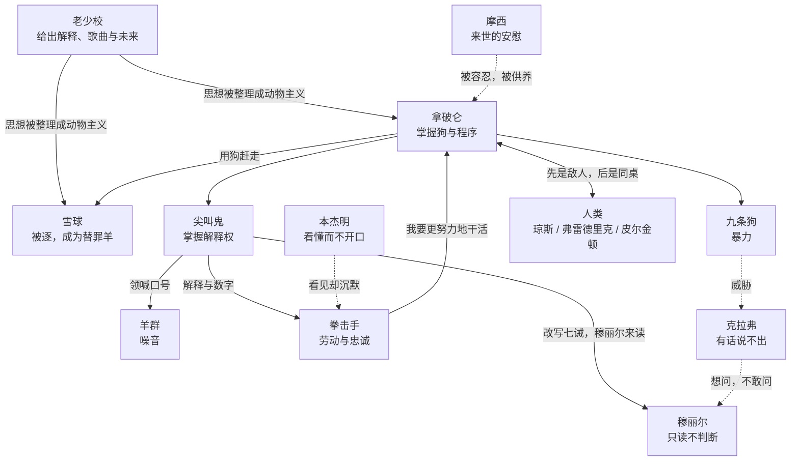

# 99｜系列总结：《动物农庄》

> 《动物农庄》借一个农场里的起义，讨论的是同一个问题：一场以平等为名的革命，如何在没有任何一次「公开背叛」的情况下，一步一步变成它当初要推翻的东西。答案不在某个坏人身上，而在一连串听上去合理的理由里：特权被说成责任，谎言被说成记忆，沉默被说成同意，最后连辨认的能力也一起丢了。

> **剧透提示**：以下内容包含关键剧情与结局。

---

## 一、故事地图

全书十章，可以压成四个阶段：起义、定调、收紧、完成。

转折几乎都藏在气氛最好的时候：牛奶出现在丰收的章节里，幼犬被带走时没有人在意。故事也是个圆：开头动物们在大谷仓里听一头猪说话，结尾站在窗外看一群猪宴客，农场的名字也回到了「曼纳农场」。

## 二、人物地图

这本书的人物是功能多于人格，不妨按「在权力运转里负责哪一环」来认。

- **老少校**：点燃者。他给了动物们一个解释、一首歌、一个未来，然后去世，没有机会回答「谁来接管」这个问题。
- **拿破仑**：握办法的人。他赢的不是主张，而是狗，以及取消辩论会、把决定收进私下委员会的能力。
- **雪球**：相信道理的人。口才好、有图纸、会打仗，但他以为竞争发生在主张之间。他不是纯粹的好人，风车所需的材料他也含糊带过。
- **尖叫鬼**：解释权。他的三件工具是科学的名义、功劳的名义和恐惧的名义，后一件最常用，就是那句「你们不想让琼斯回来吧」。
- **拳击手**：劳动与忠诚。他的两句格言让他勤劳，也让他不再发问。
- **克拉弗**：看得见、说不出的人。她有判断和感情，缺的是话。
- **本杰明**：看得懂、不出声的人。
- **穆丽尔**：诚实但无力的证人，读出来的已是改过的字。
- **摩西**：存放希望的地方。糖果山被容忍，《英格兰兽》被取缔。
- **莫莉**：为舒适离开的人。
- **羊群**：噪音，把第二种声音淹掉。
- **九条狗**：暴力。
- **琼斯、弗雷德里克、皮尔金顿**：人类一方。琼斯是旧秩序，另两位是邻近的农场主，猪对他们一会儿结盟、一会儿翻脸，最后同桌。

## 三、人物关系图

实线是权力与解释的流向，虚线是沉默、威胁与旁观。

## 四、核心冲突

表面的冲突有三层：动物与人，雪球与拿破仑，猪与其余动物。真正贯穿全书的冲突，却发生在另一条线上：**规则由谁来解释**。

老少校时期，冲突是「我们」对「人」，敌人明确。牛棚之战以后，冲突转为猪的内部之争，规则是投票，雪球靠演说赢票，拿破仑改变了规则。再往后，牛奶和苹果的分配、七诫的措辞、数字的口径，决定都在小范围内做出，大会只是通知和追认的地方。到最后，连冲突本身都消失了，因为动物们没有东西可以拿来争辩：墙上只剩一句自相矛盾的话。

所以这本书的冲突不是善恶之战，而是**解释权的单向转移**。起义推翻了旧的解释者，新的解释者坐了上去。

## 五、核心主题

**一，权力的第一次越界，几乎总以「为了大家」出现。** 尖叫鬼的论证有一部分是真的：猪确实在组织农场，琼斯回来也确实是灾难。真话被拿来保护假的结论，最难反驳。

**二，暴力先于主张。** 拿破仑在风车图纸出现之前就已经养好了狗。

**三，沉默是一笔账，不是一种愚蠢。** 克拉弗看得见，拳击手也看得见，没有人开口，因为开口的代价由开口的人付，好处却要所有人分。狗和羊让开口变得危险，替罪羊和坦白让开口变得可疑，歌曲被取缔、糖果山被容忍，则把希望从这个世界移走。

**四，改写比废除有效。** 七诫从未被擦掉，只是多了几个字。改写不制造断裂，不需要同意，还把「规则变了没有」换成「你的记忆准不准」。当唯一的证据掌握在对方手里，怀疑就只剩一个去处：自己。

**五，美德若没有保障，只会让人更早被用完。** 拳击手没有做错任何事，他的悲剧在于养老金写在法律里，而执行法律的人正是该付养老金的人。

**六，差别消失，比背叛更可怕。** 最后一幕不是反转，而是完成。动物们并非没有看到猪变了，而是失去了可以证明谁变成了什么的尺子。

## 六、作者思想

奥威尔的立场，他自己说得相当直接。一九四六年的随笔《我为什么写作》里写道，一九三六年以后他所写的每一行严肃作品，都是直接或间接地反对极权主义、支持民主社会主义。一九四七年乌克兰文版序言里，他又说自己从西班牙回来之后确信，要让社会主义运动复兴，必须摧毁「苏联神话」。（这篇序言的奥威尔手稿已经遗失，今天读到的是回译本，措辞可能与原文有出入。）

由此可以把几件事分清：

- **文本事实**：书里的动物起初有真实的苦、真实的解释和真实的联合。故事写的是一条斜坡，不是一个骗局。
- **作者明确说过的**：他反对的是一种统治方式，不是平等的理想本身；他希望西欧读者看清这个政权实际是什么。
- **主流解释**：革命容易被它自己产生的权力阶层吞没。
- **自己的归纳**：书写的是一组条件的组合，包括记录掌握在少数人手里、没有独立于统治者的机构、没有安全表达异议的场所、能读的少数选择沉默。条件缺一，故事是否会不同，书没有回答，只能算推测。

## 七、时代背景

写作时间是一九四三年十一月至一九四四年二月，书末署有这个日期。当时二战尚未结束，英国与苏联是并肩作战的同盟国，英国社会对红军抱有强烈好感。一九四五年八月十七日，书由塞克与沃伯格出版。

此前书稿被多家出版社拒绝，奥威尔在后来未刊出的序言《新闻自由》里写的是四家。这篇序言直到一九七二年才在《泰晤士报文学增刊》发表。在其中他指出，英国的文学检查在很大程度上是自愿的，真正的敌人是知识上的怯懦。各家出版社的具体动机，有的缺乏可靠来源，这里不展开。

另一条线索是西班牙。奥威尔一九三六年去了西班牙，加入马统工党（POUM）的民兵，一九三七年共产党力量对这一派展开镇压，他不得不离开。他亲眼见过同一件事在不同阵营的报纸上变成完全不同的故事，这是雪球被逐、坦白与处决、数字与改写最直接的经验来源。

## 八、写作技巧

**动物。** 奥威尔自述，这个念头来自他看到一个男孩赶着一匹巨大的挽马，马一想拐弯就挨鞭子。动物天然是「被使用的一方」，不需要比喻，劳动、被喂养、被宰杀本来就是它们的生活。

**童话的口气。** 叙述者几乎从不评论，只记录。一句歪理，加一个「想必」，反讽就完成了。读者先站到受压迫者一边，笑尖叫鬼的花招，到后来才发现自己也点过头。

**被动语态和模糊的记忆。** 「牛奶消失了」「命令发出了」，句子没有主语；「想起，或者以为想起」，叙述者与人物一起不确定，读者因此坐在动物们的位置上。

**反复与收束。** 「不再显得奇怪」连用三次；七诫缩成一句；末句里视线在猪与人之间来回，忽然刹住。

**情绪留给读者。** 拳击手的货车、处决的名单，都写得几乎没有形容词。

## 九、文学史意义

《动物农庄》站在一个很长的传统上：让动物说话，借此谈论权力、虚荣和狡诈。伊索与十七世纪拉封丹的寓言都是这条路上的名字。奥威尔的不同在于，他把短小的道德故事拉长成了一个有时间线的政治史，又保持了童话的简朴。

它也是二十世纪最常被引用的政治寓言之一，「一律平等，但有些动物更平等」已成了常见的引文。奥威尔自己说，这是他第一本「在充分自觉的情况下，试图把政治目的与艺术目的融为一体」的书。把政论写成故事，而不是把故事写成政论，是它给后来者留下的方法。

## 十、作品的局限与争议

这一节尽量把四种东西分开：文本事实、作者观点、主流解释、其他解释。

**把一段复杂的历史写成动物寓言，必然有简化。** 这是作者自己承认的：他说情节取自俄国革命史，但处理得「图式化」，时间顺序也被改动，这是故事对称的需要。因此，一些读者指出，书里看不到内战、外国干涉、农民与城市的关系这些复杂因素，把它当作苏联史的教科书是不合适的。这是读者的批评，也是作者留下的提醒。

**历史对应并不严格。** 老少校对应列宁或马克思，拿破仑对应斯大林，雪球对应托洛茨基，尖叫鬼对应宣传机关，狗对应秘密警察，这些是主流读法，大体讲得通；但风车究竟是五年计划还是电气化，拳击手是工人阶级还是劳动模范，本杰明是知识分子还是别的什么，摩西是否就是教会，都没有定论，书里也没有明文。

**对集体行动的悲观。** 有读者认为，书里的普通动物被写得过于被动和健忘，似乎群众天生不会反抗、不会记事。一种辩护是：寓言需要把问题推到极致，现实里的人没有那样单薄。另一种看法是：书写的是一组条件，而不是一条规律。这两种说法都是读者的解释，书本身没有给出结论。

**「谁才是动物」是开放的。** 结局那一句，既可以读成猪变成了人，也可以读成动物们失去了辨认的能力；窗外的动物是被剥夺者，还是读者本人，也有不同读法。

**各阵营的不同征用。** 冷战期间，这本书曾被西方一些机构翻译、散发，具体规模目前缺乏可靠来源，不能确定；也有人把它读成对一切革命的否定，这与作者自己的说法相违背，他反对的是极权，不是平等的理想。

## 十一、今天为什么值得阅读

读《动物农庄》，最有用的不是认出谁是谁，而是带走一份检查表：

1. 谁来判断特权的理由是否成立，那个人是不是受益者。
2. 规则被修改时，修改前的版本还能不能查到。
3. 一个反对意见，要经过谁才能被听到。
4. 当我觉得「好像不对」时，我是在等别人先开口，还是有一条真正可走的路。

这份检查表可以放到公司、社团、网络社区里。大多数规则有合理的初衷，书教的不是怀疑一切，而是在信任之外，为检查保留路径。要提防的有两种读法：一是把它读成「革命必然堕落」，二是读成「只有他们才这样」。前者把一个有条件的故事变成定律，后者让读者自己不在场。

## 十二、只记住 10 句话

1. 老少校没有告诉动物任何新事，他只是给了它们一个解释、一首歌、一个未来。
2. 权力的第一次越界，几乎总以「这是为了大家」出现。
3. 拿破仑赢的不是主张，是办法：他早就养好了狗。
4. 主张可以被反驳，办法却能让反驳不再发生。
5. 沉默不是没看见，是每个人都在算：现在开口，代价由谁付。
6. 改写比废除有效，因为它把「规则变了没有」换成了「你的记忆准不准」。
7. 当唯一的证据掌握在对方手里，怀疑就只剩一个去处：自己。
8. 忠诚和勤劳若没有可强制兑现的保障，只会让人更早被用完。
9. 最后一幕不是反转，是完成：背叛早已发生，只是终于不再需要遮掩。
10. 靶子不只是一个国家，而是一切不愿被检查的权力，包括我们自己手里的。

## 十三、与其他作品的关联

**《一九八四》。** 这是奥威尔自己的另一部代表作，本站有同作者的系列，可以对读。《动物农庄》写权力如何从一个理想里长出来，宣传与改写记忆已经出现，《一九八四》则把这种控制写成一个完整运转的社会，两本书里的语言与记忆问题可以并起来看。这是两本书主题上的呼应，不意味着前者是后者的草稿。

**伊索与拉封丹的动物寓言传统。** 用动物说人事，是这类寓言共有的做法。奥威尔走的是同一条路，这一点书里和评论里都比较清楚。至于他是否直接受到某一部具体作品的影响，目前缺乏可靠来源，不能确定。

**斯威夫特。** 把荒诞的虚构世界当作讽刺工具、用平静的口气讲可怕的事，是斯威夫特式讽刺的特点，也有不少评论把奥威尔与斯威夫特放在一起谈。奥威尔对斯威夫特写过评论文章，这是可以查证的。不过，《动物农庄》是否直接受哪一部斯威夫特作品影响，并无定论。

**其他政治寓言与反乌托邦作品。** 从扎米亚京到赫胥黎，都在讨论理想社会如何变质。它们与本书是否存在直接的影响关系，并无定论，只能说在同一个问题上相互呼应：当一个社会以「更好」之名重新组织起来，谁来监督组织者？
